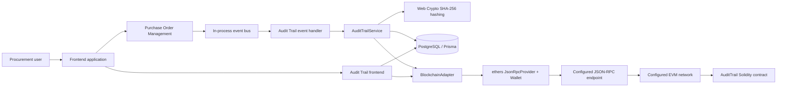
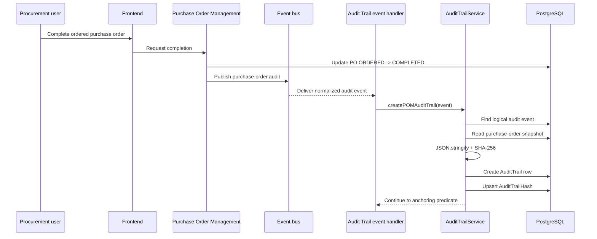
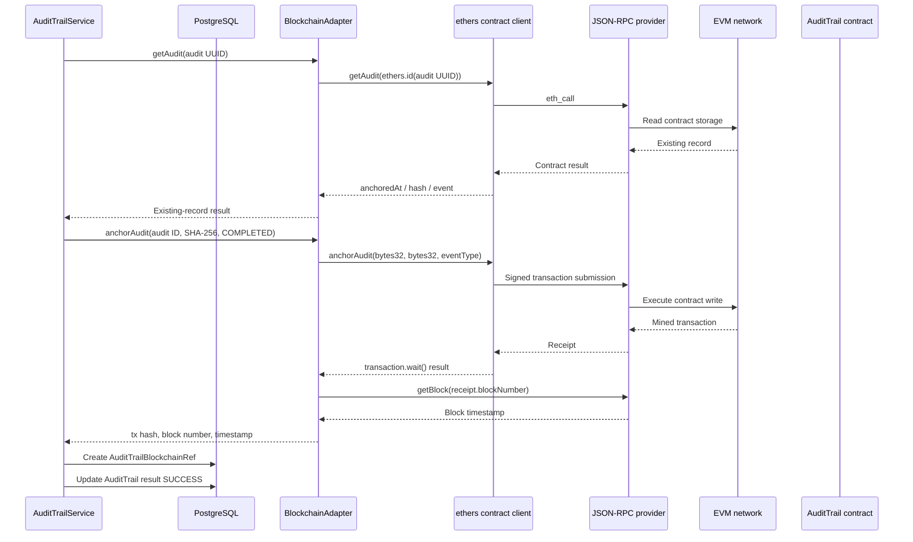
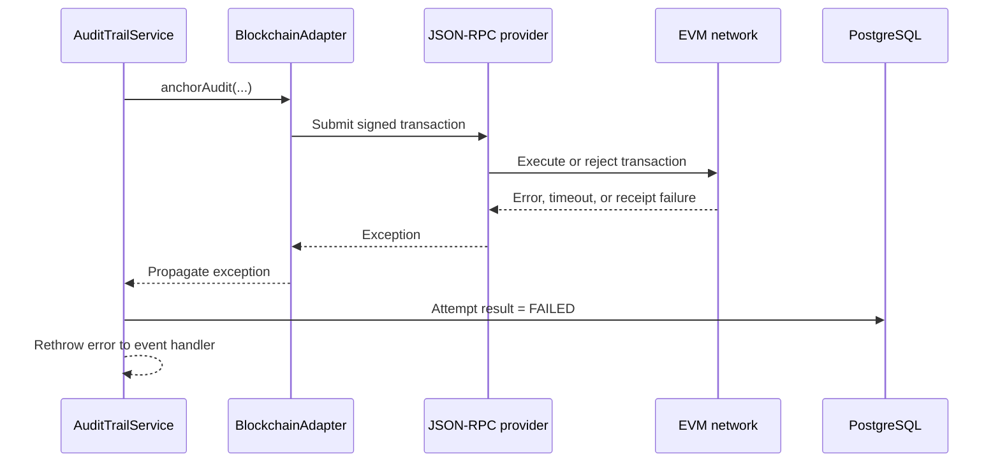
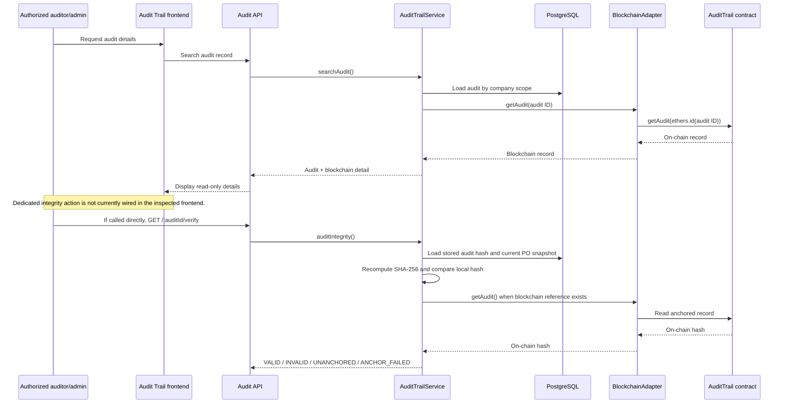
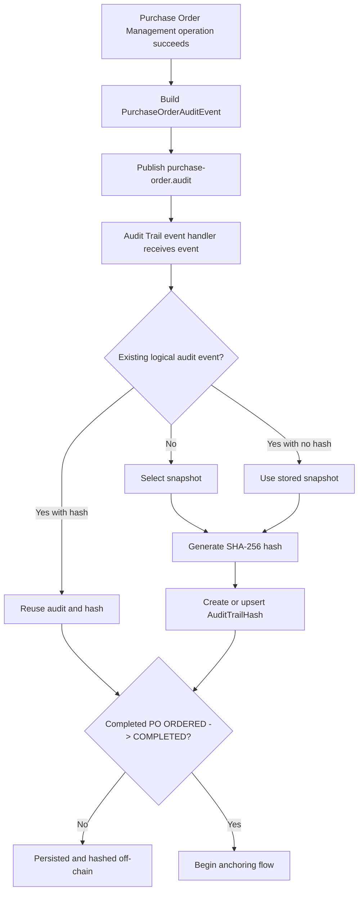
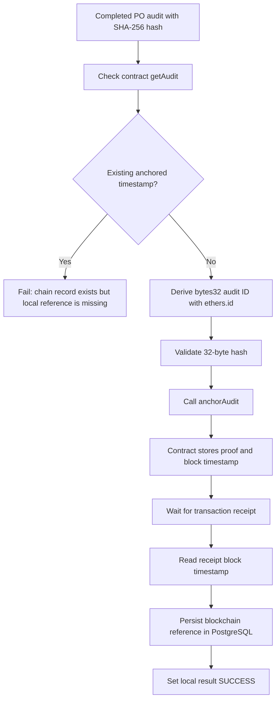
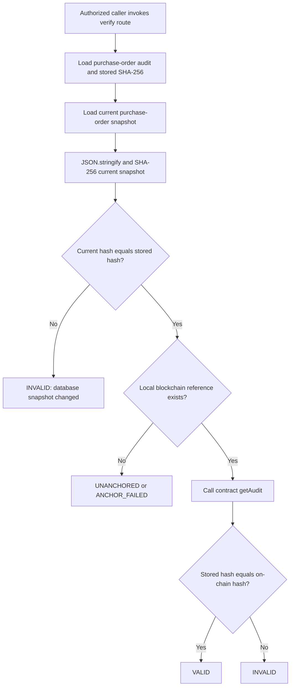

# LINAW Blockchain Integration Reference

**Investigation scope:** Existing LINAW implementation only.  
**Investigation date:** October 31, 2026  
**Document type:** Technical architecture and implementation reference  
**Modification status:** No application, contract, schema, environment, or deployment files were modified during this investigation.

> **Security note:** Environment variable names and configuration behavior are documented, but private keys, RPC credentials, access tokens, and complete secret values are intentionally omitted.

## 1. Executive Summary

LINAW implements a hybrid audit architecture. Procurement events are published on an in-process event bus by the Purchase Order Management module. The Audit Trail event handler subscribes to one normalized event, `purchase-order.audit`, and passes each supported event to `AuditTrailService`.

For every supported event, LINAW creates or reuses an `AuditTrail` row, selects a snapshot, calculates a SHA-256 digest, and persists the digest in `AuditTrailHash`. The supported events are:

- `RFQ_CREATED`
- `QUOTATION_SUBMITTED`
- `QUOTATION_SELECTED`
- `PURCHASE_ORDER_CREATED`
- `ISSUED`
- `ORDERED`
- `COMPLETED`

Only one event is submitted to the blockchain: a purchase order transition from `ORDERED` to `COMPLETED`. The other six events remain off-chain, although they are audited and hashed in PostgreSQL.

The blockchain adapter uses ethers.js. It creates an ethers `JsonRpcProvider` from `BLOCKCHAIN_RPC_URL`, creates a wallet from `BLOCKCHAIN_PRIVATE_KEY`, and connects that wallet to the contract at `AUDIT_CONTRACT_ADDRESS`. The adapter calls the `anchorAudit` contract function, waits for the transaction receipt, reads the block timestamp, and stores the transaction hash, block number, and timestamp in `AuditTrailBlockchainRef`.

The Solidity contract is `AuditTrail`, compiled with Solidity `0.8.28`. It stores one record per hashed audit identifier in a private mapping. Each record contains the bytes32 audit identifier, the bytes32 SHA-256 digest, the event type, and the block timestamp. The contract does not store the full procurement snapshot.

The user-facing Audit Trail detail view reads the on-chain record through the backend detail/search operation and displays the blockchain audit ID, hash value, event type, and anchored timestamp when a record exists. The backend also has a dedicated integrity endpoint that recomputes the purchase-order snapshot hash and compares it with the stored hash and, when available, the blockchain hash. The current frontend does not call that integrity endpoint or display its `VALID`, `INVALID`, `UNANCHORED`, or `ANCHOR_FAILED` result.

## 2. Blockchain Integration Overview

### 2.1 Implemented purpose

The implementation uses the blockchain as an external anchor for a cryptographic proof of a completed purchase-order audit record. The full operational data remains in PostgreSQL. The blockchain stores a compact proof and metadata that can be read independently through the configured RPC provider.

The implementation therefore separates:

1. **Business processing:** Procurement modules create RFQs, quotations, purchase orders, and status changes.
2. **Event publication:** Purchase Order Management publishes normalized audit events.
3. **Audit persistence:** The Audit Trail module records the event and snapshot in PostgreSQL.
4. **Hash generation:** The Audit Trail service hashes the selected snapshot with SHA-256.
5. **Blockchain anchoring:** Only completed purchase orders are submitted to the contract.
6. **Reference persistence:** The resulting transaction hash and block metadata are stored in PostgreSQL.
7. **Verification:** The backend can recompute the local hash and read the anchored contract record.

### 2.2 What is and is not on-chain

| Information | PostgreSQL | Smart contract |
|---|---:|---:|
| Audit record UUID | Yes | Not in original form; converted to `bytes32` with `ethers.id()` |
| Tenant identifier | Yes | No |
| Actor user identifier | Yes | No |
| Entity type and entity UUID | Yes | No direct field |
| Action/event type | Yes | Yes, for anchored records |
| Full snapshot JSON | Yes | No |
| SHA-256 snapshot hash | Yes | Yes, for anchored records |
| Result status | Yes | No |
| Blockchain transaction hash | Yes, as a reference | Native transaction metadata, not contract storage |
| Block number | Yes | Native chain metadata, not contract storage |
| Anchored timestamp | Yes, derived from the block | Yes, as `block.timestamp` |
| Network reference | Schema field exists | No contract field |

### 2.3 Anchoring coverage

Every supported `purchase-order.audit` event is intended to create an audit record and hash. Only an event satisfying all of the following is anchored:

```text
entityType == "PURCHASE_ORDER"
action == "COMPLETED"
metadata.previousStatus == "ORDERED"
metadata.status == "COMPLETED"
```

Consequently, a successful Audit Trail row or SHA-256 hash does not prove that the event was written to the blockchain.

## 3. Existing System Architecture

### 3.1 Component diagram



### 3.2 Component responsibilities

| Component | Responsibility | Location / symbol | Interaction |
|---|---|---|---|
| Purchase Order Management | Publishes normalized audit events after selected procurement operations | `backend/src/modules/purchase_order_management/purchaseOrderManagementService.ts`, `publishAuditEvent()` | Publishes `purchase-order.audit` to the event bus |
| Event bus | Delivers in-process events to subscribed handlers | `backend/src/shared/events/eventBus.ts` | Routes the audit event to the Audit Trail handler |
| Audit Trail event handler | Subscribes once to the purchase-order audit event | `backend/src/modules/audit_trail/auditTrailEventHandler.ts`, `registerAuditTrailEvents()` | Calls `createPOMAuditTrail()` |
| Audit Trail service | Creates audit records, generates hashes, decides whether to anchor, and persists blockchain references | `backend/src/modules/audit_trail/auditTrailService.ts` | Uses repository and blockchain adapter |
| Audit Trail repository | Reads procurement snapshots and persists audit, hash, and blockchain-reference rows | `backend/src/modules/audit_trail/auditTrailRepository.ts` | Uses Prisma |
| Hashing utility | Serializes a snapshot and calculates SHA-256 | `AuditTrailService.generateHash()` | Returns lowercase hexadecimal text |
| Blockchain adapter | Converts IDs and hashes, calls the contract, waits for confirmation, and reads records | `backend/src/shared/blockchain/blockchainAdapter.ts` | Uses the contract client |
| Blockchain client | Creates provider, signer, and contract objects | `backend/src/shared/blockchain/blockchainClient.ts`, `createAuditTrailContract()` | Uses ethers.js and environment variables |
| Smart contract | Stores and compares anchored audit proofs | `smart_contract/contracts/AuditTrail.sol`, `AuditTrail` | Receives signed contract transactions and read calls |
| Audit Trail API | Lists, searches, and verifies records | `auditTrailRouter.ts`, `auditTrailController.ts` | Protected by authentication, authorization, and rate limiting |
| Audit Trail frontend | Lists records and shows read-only audit and blockchain details | `frontend/app/(protected-routes)/audit-trail/page.tsx` | Calls the frontend audit client and backend proxy |

### 3.3 Application wiring

`backend/src/app.ts` creates the `BlockchainAdapter`, creates the `AuditTrailService`, and calls `registerAuditTrailEvents()`. The event handler registration is guarded by a module-level boolean so the subscription is registered once in the process.

The service is event-driven for audit creation. The blockchain operation itself is awaited inside the event handler's service call. There is no separate queue, scheduled worker, or retry worker identified in the inspected implementation.

## 4. Backend Audit Trail Module

### 4.1 Module files and responsibilities

| File | Responsibility |
|---|---|
| `backend/src/modules/audit_trail/auditTrailRouter.ts` | Defines protected list, search, and integrity-verification routes. |
| `backend/src/modules/audit_trail/auditTrailController.ts` | Reads authenticated user context, validates input, invokes the service, and formats responses. |
| `backend/src/modules/audit_trail/auditTrailService.ts` | Orchestrates audit creation, hashing, anchoring, result status, and verification. |
| `backend/src/modules/audit_trail/auditTrailRepository.ts` | Performs Prisma reads and writes, including purchase-order snapshot construction. |
| `backend/src/modules/audit_trail/auditTrailEventHandler.ts` | Subscribes to `purchase-order.audit`. |
| `backend/src/modules/audit_trail/auditTrailValidator.ts` | Validates list, search, and integrity request inputs. |
| `backend/src/shared/blockchain/blockchainAdapter.ts` | Provides blockchain anchoring and read operations to the service. |
| `backend/src/shared/blockchain/blockchainClient.ts` | Creates the ethers provider, wallet, and contract instance. |
| `backend/src/shared/blockchain/abi/auditTrail.json` | Supplies the contract ABI used by the backend. |

### 4.2 API routes

The router applies `criticalRateLimit` and `authenticate` middleware to the audit routes. Each operation also uses the corresponding authorization permission.

| Method | Route shape | Permission | Behavior |
|---|---|---|---|
| `GET` | `/auditTrail/` | `auditTrail.search` | Lists tenant/company-scoped audit records with pagination and filters. |
| `GET` | `/auditTrail/search` | `auditTrail.search` | Retrieves one audit record and reads its blockchain record through `getAudit()`. |
| `GET` | `/auditTrail/:auditId/verify` | `auditTrail.verify` | Recomputes the local purchase-order hash and, when anchored, compares it with the blockchain hash. |

The backend application mounts these routes under the API root. The frontend calls them through its authenticated backend proxy; this document does not reproduce endpoint implementation details beyond the route behavior needed to explain the integration.

### 4.3 Tenant and company scope

The controller takes `user_id`, `tenant_id`, and `company_id` from the authenticated request context. Requests without a company context are rejected. Repository queries restrict records to the tenant and the company represented by the underlying purchase order, RFQ, or supplier quotation.

The verification operation is currently limited to audit records whose entity type is `PURCHASE_ORDER`. The general list and detail paths can include `PURCHASE_ORDER`, `RFQ`, and `SUPPLIER_QUOTATION` records.

## 5. Procurement Event Integration

### 5.1 Event contract

The event definition is in `backend/src/shared/events/purchaseOrderEvents.ts`.

```ts
type PurchaseOrderAuditEvent = {
  tenantId: string;
  companyId: string;
  actorId: string | null;
  entityType: "RFQ" | "SUPPLIER_QUOTATION" | "PURCHASE_ORDER";
  entityId: string;
  action: PurchaseOrderAuditAction;
  metadata: Record<string, unknown>;
};
```

The event name is the constant `PURCHASE_ORDER_AUDIT_EVENT`, whose value is `purchase-order.audit`.

### 5.2 Audited event publishers

| Action | Originating operation | Entity type | Important metadata |
|---|---|---|---|
| `RFQ_CREATED` | Creating an RFQ from an approved requisition | `RFQ` | RFQ ID, RFQ number, requisition ID |
| `QUOTATION_SUBMITTED` | Processing a supplier quotation submission and marking it posted | `SUPPLIER_QUOTATION` | Quotation ID and number, RFQ ID, supplier ID, submission time |
| `QUOTATION_SELECTED` | Selecting a supplier quotation | `SUPPLIER_QUOTATION` | Quotation ID, RFQ ID, purchase-order ID |
| `PURCHASE_ORDER_CREATED` | Creating a purchase order from the selected quotation | `PURCHASE_ORDER` | Purchase-order ID, quotation ID, RFQ ID, requisition ID |
| `ISSUED` | Advancing a draft purchase order | `PURCHASE_ORDER` | Purchase-order ID, previous status `DRAFT`, status `ISSUED` |
| `ORDERED` | Advancing an issued purchase order | `PURCHASE_ORDER` | Purchase-order ID, previous status `ISSUED`, status `ORDERED` |
| `COMPLETED` | Completing an ordered purchase order | `PURCHASE_ORDER` | Purchase-order ID, previous status `ORDERED`, status `COMPLETED` |

The relevant publisher is `PurchaseOrderManagementService.publishAuditEvent()`. The service publishes the event after the associated database operation returns successfully.

### 5.3 Events not subscribed to by the Audit Trail handler

Other modules publish events such as:

- `purchaseRequisition.submitted`
- `purchaseRequisition.cancelled`
- `approvalWorkflow.approved`
- `rfq.published`
- `supplier.quotation.submitted`
- `organization.registered`

The inspected Audit Trail event handler does not subscribe to those event names. They therefore do not enter this Audit Trail creation path through the registered audit handler. A separate requisition status log or another event consumer may still record related business information, but that is not the same as creation of an `AuditTrail` row by this module.

### 5.4 Event-to-audit execution

1. A Purchase Order Management operation changes a procurement record.
2. The service builds a `PurchaseOrderAuditEvent`.
3. `eventBus.publish("purchase-order.audit", input)` delivers the event.
4. `registerAuditTrailEvents()` receives it.
5. The handler awaits `AuditTrailService.createPOMAuditTrail(event)`.
6. The service finds an existing logical event or creates a new audit row.
7. The service chooses a snapshot and computes a SHA-256 hash.
8. The service persists the hash.
9. Only a completed purchase-order event proceeds to blockchain anchoring.
10. The event handler resolves or rejects based on this asynchronous service operation.

## 6. Audit Record Generation and Persistence

### 6.1 AuditTrail model

The Prisma model is `AuditTrail` in `backend/prisma/schema.prisma`.

| Field | Type / behavior | Purpose |
|---|---|---|
| `id` | UUID primary key | Application audit-record identifier. |
| `tenant_id` | UUID | Tenant ownership. |
| `actor_user_id` | Nullable UUID | User who initiated the audited operation, when available. |
| `entity_type` | String | `RFQ`, `SUPPLIER_QUOTATION`, or `PURCHASE_ORDER`. |
| `entity_id` | UUID | Identifier of the audited business entity. |
| `action` | String | One of the supported purchase-order audit actions. |
| `result` | Nullable string | Processing outcome, including `SUCCESS` or `FAILED` for anchoring-related processing. |
| `request_id` | Nullable string | Request correlation field; not populated by the audit creation input inspected. |
| `snapshot_json` | Nullable JSON | Stored event metadata or purchase-order snapshot. |
| `created_at` | Timestamp | Database creation time. |

The model has a unique logical event identity over `tenant_id`, `entity_type`, `entity_id`, and `action`. A repeated publication of the same logical event is therefore found or rejected rather than creating an additional logical record.

### 6.2 Snapshot selection

For `PURCHASE_ORDER` events, `AuditTrailRepository.getPurchaseOrderSnapshot()` loads the purchase order, company, supplier, purchase-order items, goods receipts, and related approval actions. It constructs a deliberately limited snapshot containing:

```text
purchase_order_id
po_number
company: { id, name }
supplier: { id, name }
currency_code
final_amount
order_date
items: [{ description, quantity, price, total_price }]
approvals: [{ approved_by: { id, name }, action, timestamp }]
receipt: { receipt_number, receipt_date, received_by } | null
```

For `RFQ` and `SUPPLIER_QUOTATION` events, the event's `metadata` object becomes the snapshot.

### 6.3 Persistence sequence

When no existing audit row is found:

1. The service selects the snapshot.
2. The service calculates its hash.
3. The repository creates the `AuditTrail` row with `result: null`.
4. The repository upserts the corresponding `AuditTrailHash` row.
5. The in-memory audit object is updated with the hash relation.

When an audit row exists without a hash, the service hashes the stored snapshot and upserts the missing hash. When a completed event is already linked to a blockchain reference, the service marks the record successful if necessary and does not submit another transaction.

The database writes for the audit row, hash row, and blockchain-reference row are separate repository operations. The hash/reference operations are not enclosed in one Prisma transaction in the inspected implementation.

### 6.4 AuditTrailHash model

`AuditTrailHash` contains:

- `id`
- `tenant_id`
- `audit_trail_id` with a unique constraint
- `hash_algorithm`
- `hash_value`
- `created_at`

The current stored algorithm label is `SHA-256`. The hash value is a 64-character lowercase hexadecimal string without an `0x` prefix.

### 6.5 AuditTrailBlockchainRef model

`AuditTrailBlockchainRef` contains:

- `id`
- `tenant_id`
- `audit_trail_id` with a unique constraint
- `network_ref` nullable
- `blockchain_transaction_hash`
- `block_number` nullable `BigInt`
- `anchored_at` nullable timestamp

The service populates `blockchain_transaction_hash`, `block_number`, and `anchored_at`. The `network_ref` field exists in the schema and repository input type but is not populated by the inspected anchoring service.

## 7. Cryptographic Hashing Mechanism

### 7.1 Algorithm and output

`AuditTrailService.generateHash()` performs:

1. `JSON.stringify(snapshot)`.
2. UTF-8 encoding with `TextEncoder`.
3. `crypto.subtle.digest("SHA-256", data)`.
4. Conversion of the digest bytes to lowercase hexadecimal.

The result is deterministic for the same JavaScript object content and property insertion order. It is not a cryptographic signature and does not prove who generated the snapshot.

### 7.2 Serialization behavior

No explicit canonical JSON serializer or sorted-key normalization is used. Therefore, the exact serialized property order affects the digest. JavaScript `Date` values are serialized using their normal JSON representation, which is an ISO string. Decimal database values are converted to JavaScript numbers before they enter the snapshot.

Two objects with the same logical values but different property insertion order can produce different serialized JSON and therefore different SHA-256 values. Identical serialized snapshot data produces the same digest.

### 7.3 Inputs and dynamic values

The hash input is the selected snapshot, not the complete `AuditTrail` row. For a purchase order, the snapshot includes current purchase-order, supplier, company, item, approval, and first-goods-receipt values. Dates and other values included in that snapshot affect the digest.

The tenant ID is stored with the audit record but is not included as a named property in the purchase-order snapshot shown by `getPurchaseOrderSnapshot()`. The actor ID is also stored on the audit row but is not part of that snapshot. For RFQ and quotation events, whether tenant or actor information enters the digest depends on whether the publisher places it in `metadata`; the generic event envelope itself is not automatically hashed as a whole.

### 7.4 Hashing versus blockchain identity

The SHA-256 snapshot hash and the blockchain audit identifier are different values:

- The snapshot proof is SHA-256 over serialized snapshot data.
- The blockchain key is `ethers.id(auditId)`, which is the keccak256 hash of the PostgreSQL audit UUID's UTF-8 representation and is supplied as `bytes32`.

The contract receives the derived bytes32 audit identifier and the SHA-256 digest. It does not receive the original UUID string or the full snapshot.

## 8. Blockchain Adapter Architecture

### 8.1 Provider and contract construction

`backend/src/shared/blockchain/blockchainClient.ts` defines `createAuditTrailContract(env)`:

```ts
const provider = new ethers.JsonRpcProvider(env.BLOCKCHAIN_RPC_URL);
const wallet = new ethers.Wallet(env.BLOCKCHAIN_PRIVATE_KEY, provider);
return new ethers.Contract(
  env.AUDIT_CONTRACT_ADDRESS,
  auditTrailAbi,
  wallet,
);
```

The same contract instance pattern is used for reads and writes. The wallet is the signer for write transactions. The ABI is loaded from `backend/src/shared/blockchain/abi/auditTrail.json`.

### 8.2 Anchor operation

`BlockchainAdapter.anchorAudit()`:

1. Creates the configured contract client.
2. Converts the application audit ID using `ethers.id(input.auditId)`.
3. Adds `0x` to the SHA-256 value if needed.
4. Validates that the hash is exactly 32 bytes of hexadecimal data.
5. Calls `contract.anchorAudit(auditIdBytes32, hashValueBytes32, eventType)`.
6. Awaits `transaction.wait()`.
7. Reads the block identified by `receipt.blockNumber` from the provider.
8. Uses the block's timestamp as `anchoredAt`.
9. Returns the transaction hash, block number, and timestamp.

No explicit confirmation count is supplied. The adapter relies on ethers' default `wait()` behavior. No retry loop, queue, or compensating recovery process was found.

### 8.3 Read operations

`BlockchainAdapter.getAudit(auditId)` calls the contract's `getAudit()` function using the derived bytes32 audit ID. It returns the contract's audit ID, lowercase hash value, event type, and numeric anchored timestamp.

`BlockchainAdapter.verifyAudit(auditId, hashValue)` calls the contract's `verifyAudit()` function after validating the supplied 32-byte hash. This adapter method is implemented and unit-tested, but the Audit Trail service's user-facing integrity path does not call it. The service instead calls `getAudit()` and compares the returned hash itself.

### 8.4 Error behavior

The adapter rejects invalid hash values before making a contract call. It propagates transaction, receipt, block lookup, provider, and contract errors to the service. The service attempts to set the audit result to `FAILED` when anchoring or hash/reference persistence fails, then rethrows the original error.

The service does not automatically retry a failed blockchain submission. A later duplicate event may encounter an existing chain record without a local reference; the service explicitly checks that condition and reports that the audit is already anchored but its blockchain reference is missing.

## 9. Smart Contract Implementation

### 9.1 Contract identity

| Property | Verified value |
|---|---|
| Contract name | `AuditTrail` |
| Source | `smart_contract/contracts/AuditTrail.sol` |
| Solidity version | `pragma solidity ^0.8.28` |
| Inheritance | None identified |
| Libraries | None identified |
| Storage | `mapping(bytes32 => AuditRecord) private auditRecords` |
| Access control | No owner, role, or caller restriction is implemented |
| Payment behavior | Functions are nonpayable/view; no application payment flow identified |

### 9.2 Stored record

The contract's `AuditRecord` struct contains:

```solidity
struct AuditRecord {
    bytes32 auditId;
    bytes32 hashValue;
    string eventType;
    uint256 anchoredAt;
}
```

The mapping key is the bytes32 audit ID. The contract does not store tenant ID, company ID, actor ID, entity type, entity UUID in its original form, JSON snapshot, result status, transaction hash, or network name.

### 9.3 `anchorAudit`

| Function | Purpose | Parameters | Backend caller | Result |
|---|---|---|---|---|
| `anchorAudit` | Stores one audit proof on-chain | `bytes32 _auditId`, `bytes32 _hashValue`, `string _eventType` | `BlockchainAdapter.anchorAudit()` using the configured wallet | Stores the record, sets `block.timestamp`, and emits `AuditAnchored` |

The function is external and nonpayable. It rejects a second write for the same audit ID when the existing record has a nonzero timestamp, using `Audit already anchored`.

There is no validation that the supplied event type corresponds to a known action, that the hash was generated by LINAW, or that the caller is an authorized application wallet. The contract trusts the caller and input values.

### 9.4 `verifyAudit`

| Function | Purpose | Parameters | Backend caller | Result |
|---|---|---|---|---|
| `verifyAudit` | Checks whether an anchored record exists and its stored hash matches | `bytes32 _auditId`, `bytes32 _hashValue` | Implemented by `BlockchainAdapter.verifyAudit()`; not used by the service/frontend path | Returns `true` when `anchoredAt != 0` and `hashValue == _hashValue`, otherwise `false` |

This function does not compare event type, timestamp, tenant, actor, or snapshot. It compares only existence and the supplied hash.

### 9.5 `getAudit`

| Function | Purpose | Parameters | Backend caller | Result |
|---|---|---|---|---|
| `getAudit` | Reads the stored contract record | `bytes32 _auditId` | `BlockchainAdapter.getAudit()` | Returns audit ID, hash, event type, and anchored timestamp |

The function is external and view-only. A missing record returns the default struct values, including timestamp `0` and empty fields.

### 9.6 Event emitted by the contract

The contract emits:

```solidity
AuditAnchored(
    bytes32 indexed auditId,
    bytes32 indexed hashValue,
    string eventType,
    uint256 anchoredAt
)
```

The backend does not use a separate event-listener process to populate `AuditTrailBlockchainRef`; it uses the transaction receipt and block lookup returned from the write call.

## 10. Blockchain Network Configuration

### 10.1 Backend configuration variables

The backend environment validation requires these variables:

| Variable | Purpose | Secret handling |
|---|---|---|
| `BLOCKCHAIN_RPC_URL` | JSON-RPC endpoint used by ethers for reads and writes | Sensitive endpoint value; not reproduced |
| `AUDIT_CONTRACT_ADDRESS` | Deployed `AuditTrail` contract address | Configuration value; exact deployed value not reproduced |
| `BLOCKCHAIN_PRIVATE_KEY` | Private key used to create the ethers wallet signer | Secret; never reproduce |

Relevant backend configuration files include `backend/src/config/env.ts`, environment examples, `backend/wrangler.jsonc`, and `backend/worker-configuration.d.ts`.

### 10.2 Network and chain ID

The smart-contract Hardhat configuration defines an Ethereum Sepolia network with chain ID `11155111`. The Sepolia deployment script independently checks for chain ID `11155111` before deployment.

The backend adapter itself does not explicitly configure or validate a chain ID. It passes the RPC URL to `ethers.JsonRpcProvider` and relies on the provider to infer the connected network. Therefore:

- Sepolia is verified in the smart-contract development and deployment configuration.
- The backend's runtime network is determined by the deployed `BLOCKCHAIN_RPC_URL`.
- The backend does not independently reject an RPC endpoint connected to another chain.
- A production deployment's actual connected network is **UNVERIFIED** from source configuration alone unless the deployed RPC endpoint is inspected safely at runtime.

### 10.3 Local versus deployed configuration

The smart-contract project contains local development and Sepolia-oriented scripts, including `deploySepolia.ts` and `verifySepolia.ts`. The backend uses environment-based provider, address, and signer configuration rather than a hard-coded network object.

The package deployment scripts contain a configuration inconsistency: one package script references a `besu` network while the inspected Hardhat configuration defines `sepolia`. This is a deployment-tooling limitation, not evidence that the backend uses Besu.

### 10.4 Wallet and signing

The backend signer is an ethers `Wallet` constructed from `BLOCKCHAIN_PRIVATE_KEY` and connected to the JSON-RPC provider. Ethers signs the `anchorAudit` transaction before submission. No browser wallet or end-user signature is involved in the backend anchoring flow.

The configured wallet address is not hard-coded in the inspected backend source and is **UNVERIFIED** without inspecting the runtime secret-derived account. No private key or derived address is reproduced here.

### 10.5 Gas and confirmation

No explicit gas limit, gas price, fee policy, or confirmation count is configured in `BlockchainAdapter`. Ethers and the connected provider determine transaction submission and fee behavior. The adapter waits for the transaction receipt, then performs a block lookup.

## 11. Blockchain Transaction Lifecycle

### 11.1 From completed purchase order to stored reference

1. A user completes an `ORDERED` purchase order.
2. Purchase Order Management persists the status change to `COMPLETED`.
3. It publishes `purchase-order.audit` with `entityType: "PURCHASE_ORDER"`, `action: "COMPLETED"`, and metadata showing `ORDERED` to `COMPLETED`.
4. The Audit Trail handler invokes `createPOMAuditTrail()`.
5. The service creates or finds the audit row and persists its SHA-256 hash.
6. The completed-event predicate passes.
7. The service checks the contract with `getAudit()` to detect an already-anchored record.
8. The adapter calls `anchorAudit()` through the configured provider and signer.
9. The contract stores the bytes32 audit ID, SHA-256 hash, event type, and block timestamp.
10. The transaction is mined sufficiently for `transaction.wait()` to return a receipt.
11. The adapter reads the receipt block and returns transaction hash, block number, and block timestamp.
12. The service creates `AuditTrailBlockchainRef` and updates the audit result to `SUCCESS`.

### 11.2 Sequence diagram: procurement event to audit record



### 11.3 Sequence diagram: audit record to blockchain



### 11.4 Sequence diagram: transaction failure



A failed transaction does not produce a blockchain reference through the normal successful path. The service attempts to mark the local audit result `FAILED`. No automatic retry or dead-letter recovery mechanism was identified.

## 12. Audit Verification Mechanism

### 12.1 Two related but distinct verification paths

The implementation contains two blockchain-related read mechanisms:

1. **Service integrity endpoint:** Recomputes the local purchase-order hash, checks the stored database hash, then reads the contract with `getAudit()` and compares the stored database hash with the on-chain hash.
2. **Adapter contract verifier:** `BlockchainAdapter.verifyAudit()` calls the contract's `verifyAudit()` function, but this method is not called by `AuditTrailService.auditIntegrity()` and is not called by the frontend client.

They must not be documented as the same operation.

### 12.2 Backend integrity endpoint flow

The route is `GET /:auditId/verify` in `auditTrailRouter.ts`, protected by `auditTrail.verify`.

The service performs these steps:

1. Verify that the authenticated user belongs to the tenant.
2. Retrieve a company-scoped purchase-order audit record with its stored hash and blockchain reference.
3. Reject the request if the audit record or hash relation is missing.
4. Rebuild the current purchase-order snapshot from PostgreSQL.
5. Recalculate the SHA-256 hash using the same `JSON.stringify()` process.
6. Compare the recalculated hash with the stored `AuditTrailHash.hash_value`.
7. Return `INVALID` with reason `Database snapshot has changed` if they differ.
8. If no blockchain reference exists, return `UNANCHORED` or `ANCHOR_FAILED`, along with database and current hashes.
9. If a blockchain reference exists, call `BlockchainAdapter.getAudit()`.
10. Compare the stored database hash with the contract's returned hash.
11. Return `VALID` if the hashes match; otherwise return `INVALID`.

### 12.3 Verification result meanings

| Result | Meaning |
|---|---|
| `VALID` | The current recomputed snapshot matches the stored database hash, and the stored database hash matches the hash read from the blockchain. |
| `INVALID` with database reason | The current PostgreSQL purchase-order snapshot no longer matches the stored audit hash. |
| `INVALID` without database reason | The current snapshot matched the stored hash, but the blockchain hash read through `getAudit()` did not match it. |
| `UNANCHORED` | The local audit has a hash but no blockchain reference and was not marked as a failed anchor. |
| `ANCHOR_FAILED` | The local audit result indicates anchoring failed and no blockchain reference exists. |

### 12.4 What is not checked

The integrity service does not call the contract's `verifyAudit()` function. It does not independently validate the contract event log, transaction receipt, chain ID, contract bytecode, or network name. It compares the local stored hash with the hash returned by `getAudit()` through the configured provider.

The local rehash is only implemented for purchase-order audits. RFQ and supplier-quotation records may appear in the list/detail views but are not accepted by `findAuditForVerification()` as verification targets.

### 12.5 Verification errors and missing references

- If the purchase-order audit record does not exist in the authorized company scope, the service returns not found.
- If the hash relation is absent, it returns an audit-relations error.
- If the current purchase order cannot be loaded, it returns a snapshot-not-found error.
- If no blockchain reference exists, the service returns a non-success status rather than claiming blockchain validity.
- If the provider or contract read fails, the error propagates from the adapter; no fallback or retry was identified.

### 12.6 Verification diagram



## 13. Frontend Audit Trail Integration

### 13.1 Listing and filtering

The page is `frontend/app/(protected-routes)/audit-trail/page.tsx`. It provides:

- **Audit Trail** page heading.
- **Refresh** action.
- **Recorded activity** table.
- Filters for **Entity type**, **Action**, and **Result**.
- **Clear** action.
- Pagination controls.
- **Inspect** icon buttons for individual records.

The frontend client is `frontend/app/api/audit-trail/client.ts`. It maps backend snake-case fields to frontend camel-case fields and preserves hash and blockchain-reference data in list records.

### 13.2 Detail display

Selecting **Inspect** opens a read-only **Audit event details** dialog. It displays:

- Event ID.
- Actor user ID.
- Entity type and entity ID.
- Action.
- Result.
- Recorded timestamp.
- A **Blockchain record** section containing blockchain audit ID, hash value, event type, and anchored-at time when the detail response includes a blockchain record.
- A **Stored snapshot** JSON display.

The detail API calls the backend search operation. That backend operation calls `BlockchainAdapter.getAudit()` even if the audit has no local blockchain reference. A missing or default contract record can therefore be returned as blockchain data separate from the local `blockchain_ref` list field; the frontend renders unavailable values as `Not available`.

### 13.3 User-visible blockchain data

The frontend does expose:

- Blockchain audit ID returned by the contract.
- On-chain hash value.
- Event type returned by the contract.
- On-chain anchored timestamp.
- Stored local snapshot.
- Local audit result.

The frontend does not expose in the inspected detail component:

- The database blockchain transaction hash from `AuditTrailBlockchainRef`.
- The database block number.
- The configured network name or chain ID.
- A blockchain explorer link.
- A dedicated `Verify integrity` button.
- The backend integrity statuses `VALID`, `INVALID`, `UNANCHORED`, or `ANCHOR_FAILED`.

### 13.4 Loading and error states

The page shows loading rows while records are loaded, an empty-state message when no records match, and user-readable errors for expired sessions, forbidden access, missing company context, and general service failures. Detail loading and detail errors are shown inside the dialog.

### 13.5 Frontend/backend boundary

The presence of the **Blockchain record** section does not mean every listed audit event is anchored. The page can list hashed off-chain events. On-chain fields are meaningful only when the configured contract contains a record for the derived audit ID.

## 14. Complete End-to-End Integration Flow

### 14.1 Flow 1: Procurement event to audit record



### 14.2 Flow 2: Audit record to blockchain



### 14.3 Flow 3: Confirmation and reference persistence

The adapter does not treat the initial transaction submission as completion. It calls `transaction.wait()`, retrieves the receipt, then reads the receipt block. The returned receipt hash and block number are placed in an `AuditTrailBlockchainRef`. The contract's block timestamp becomes the local `anchored_at` timestamp.

The service persists the reference after the adapter returns. If the chain transaction succeeds but the reference write fails, the implementation can leave the chain record present without a local reference. A later processing attempt detects that condition through `getAudit()` and fails rather than submitting a duplicate.

### 14.4 Flow 4: Audit verification



## 15. On-chain vs. Off-chain Data

### 15.1 Off-chain PostgreSQL data

PostgreSQL remains the operational source for:

- Tenant and company scope.
- User and actor identity.
- Entity type and original UUID.
- Audit action and result.
- Full JSON snapshot.
- SHA-256 algorithm label and digest.
- Database creation timestamp.
- Blockchain transaction hash reference.
- Block number.
- Anchored timestamp.
- Optional network reference field.

The database also holds the underlying purchase order, supplier, RFQ, quotation, approval, and receipt records used to construct snapshots.

### 15.2 On-chain data

For completed purchase-order anchors, the contract stores:

- `bytes32 auditId`: `keccak256`/`ethers.id` representation of the PostgreSQL audit UUID.
- `bytes32 hashValue`: the SHA-256 digest of the selected snapshot, represented as bytes32.
- `string eventType`: currently `COMPLETED` for the anchoring predicate.
- `uint256 anchoredAt`: the contract execution block timestamp.

The contract also emits `AuditAnchored` with those values.

### 15.3 Data not stored on-chain

The contract does not store the full procurement snapshot, purchase-order number, supplier name, company name, amounts, items, actor, tenant, approval details, goods receipt, database result, transaction hash, or network identifier.

Therefore, blockchain verification depends on the application retaining the original audit identifier and database hash needed to locate and compare the compact on-chain proof.

## 16. Security and Access Control

### 16.1 Application access controls

The Audit Trail API applies authentication, authorization, and critical rate limiting. The list and search operations require the audit-search permission. The integrity endpoint requires the audit-verify permission. Tenant and company scope are taken from the authenticated context and checked through repository queries.

The blockchain contract itself has no access-control modifier. Any caller who knows the contract address can theoretically call `anchorAudit()` for a previously unused bytes32 audit ID. The backend relies on its own authorization and signer configuration; the contract does not independently recognize a trusted backend role.

### 16.2 Integrity properties

The design provides a tamper-evident comparison path for anchored hashes:

- A changed current purchase-order snapshot produces a different local SHA-256 digest.
- A changed database hash can differ from the on-chain hash.
- A changed on-chain hash would differ from the stored database hash when read through the configured provider.

This is not absolute immutability or proof that the original snapshot was truthful. The contract stores a supplied hash and trusts the submitting account. The application database remains necessary to interpret the hash and reconstruct the snapshot.

### 16.3 Secrets

The private key and RPC URL are environment configuration. They must be protected outside source control and must not be written to logs or documentation. This reference intentionally does not reproduce values from environment files.

## 17. Implementation Limitations and Gaps

| Limitation | Location | Practical impact | Affected area |
|---|---|---|---|
| Only `purchase-order.audit` is subscribed by the Audit Trail handler | `auditTrailEventHandler.ts` | Requisition and approval events published under other names do not enter this audit path | Audit creation |
| Only completed purchase orders are anchored | `isCompletedPurchaseOrderEvent()` in `auditTrailService.ts` | RFQ, quotation, purchase-order creation, issued, and ordered records have no on-chain reference | Blockchain recording |
| Audit creation and anchoring are separate operations | `createPOMAuditTrail()` and `anchor()` | A row/hash may exist even when blockchain submission fails | Audit and blockchain recording |
| Hash, audit, and reference writes are not one database transaction | `auditTrailRepository.ts` | Partial persistence can occur if one write fails | Persistence consistency |
| No automatic retry or recovery worker identified | `BlockchainAdapter`, `AuditTrailService` | Temporary RPC or chain failure requires another application event or operational intervention | Blockchain recording |
| No explicit chain-ID validation in backend | `blockchainClient.ts`, `BlockchainAdapter` | A misconfigured RPC endpoint may point to an unintended compatible network | Network safety |
| `network_ref` exists but is not populated | `AuditTrailBlockchainRef` and service input | Users and records cannot rely on a stored network label | Reference metadata |
| No explicit confirmation count | `BlockchainAdapter.anchorAudit()` | The implementation waits for ethers' default receipt behavior, not a configured finality policy | Confirmation |
| Contract has no caller access control | `AuditTrail.sol` | The contract does not independently restrict who can anchor a new audit ID | Smart-contract security |
| Contract does not validate event types or hash provenance | `AuditTrail.sol` | A trusted backend is expected to supply semantically valid values | Smart-contract validation |
| Adapter `verifyAudit()` is unused in the actual integrity service | `blockchainAdapter.ts`, `auditTrailService.ts` | The service verifies by reading `getAudit()` and comparing hashes instead of calling the contract verifier | Verification |
| Integrity verification is purchase-order-only | `findAuditForVerification()` | RFQ and supplier-quotation records cannot use the same end-to-end verification route | Verification |
| Frontend has no dedicated integrity action | `audit-trail/page.tsx` | Users cannot initiate the `VALID`/`INVALID` verification flow from the inspected UI | User interaction |
| Frontend does not show transaction hash or block number in details | `audit-trail/page.tsx` and `client.ts` | Users see contract record values but not the stored transaction reference | User visibility |
| Frontend does not show network or chain ID | Audit detail component | Users cannot identify the network from the UI | User visibility |
| Detail search reads the contract even without a local blockchain reference | `AuditTrailService.searchAudit()` | A default or missing contract record may be displayed separately from the local reference state | User interpretation |
| No contract event listener populates references | Backend adapter/service | Reference persistence depends on the write receipt path completing successfully | Blockchain confirmation |
| Deployment tooling has a network-script inconsistency | `smart_contract/package.json` versus `hardhat.config.ts` | Some package commands may not target the configured Sepolia network | Deployment operations |
| Current runtime network is not proven from source alone | Environment-based provider | Sepolia is configured in the contract project, but deployed backend network identity requires safe runtime confirmation | Network verification |

## 18. Thesis-Relevant Technical Explanation

### A. Why blockchain was integrated

The implemented integration uses blockchain anchoring to make a selected audit proof independently readable after it has been submitted to the configured EVM network. The database retains the operational record and snapshot, while the contract stores a compact digest and associated event metadata.

This supports tamper-evident checking: if the current database snapshot changes, its recalculated SHA-256 digest no longer matches the stored digest. If the stored digest differs from the digest returned by the contract, the local record and the anchored proof disagree.

The implementation does not justify claims of complete immutability, absolute security, or truthful data origin. The contract trusts the submitting signer, the database remains part of the interpretation process, and only completed purchase-order events are anchored.

### B. How the integration works

A purchase-order operation publishes a normalized audit event. The Audit Trail handler receives the event and creates a PostgreSQL audit record. The service selects either purchase-order snapshot data or event metadata, serializes it with `JSON.stringify()`, and generates a SHA-256 digest.

For the `ORDERED` to `COMPLETED` purchase-order transition, the service converts the audit UUID to bytes32 with ethers, calls `anchorAudit()` through a wallet-backed JSON-RPC provider, waits for the transaction receipt, retrieves the block timestamp, and stores the returned transaction and block metadata in PostgreSQL.

### C. Hybrid architecture

The implementation is hybrid:

- **PostgreSQL** stores the complete operational records, snapshots, hashes, audit results, and blockchain references.
- **Backend business logic** controls event creation, authorization, snapshot construction, hashing, anchoring decisions, and verification.
- **The smart contract** stores only the compact proof and event metadata for anchored records.
- **The EVM network** provides the external transaction and block history used by the contract.
- **The frontend** displays audit details and returned contract data but does not currently expose the full integrity-verification action.

Ethereum Sepolia is verified as a configured network in the smart-contract Hardhat and deployment configuration. The backend's live network is dependent on `BLOCKCHAIN_RPC_URL` and is not independently chain-ID validated.

### D. On-chain and off-chain data

The full procurement record remains off-chain. The on-chain record is not a copy of the purchase order; it is a compact record keyed by a derived audit ID and containing the SHA-256 proof, event type, and contract timestamp. The PostgreSQL blockchain-reference row links the application audit UUID to the transaction hash and block metadata returned by the backend adapter.

### E. Verification

The backend integrity route first recomputes the current purchase-order snapshot hash and compares it with the stored database hash. If a blockchain reference exists, it reads the contract record with `getAudit()` and compares the stored database hash to the on-chain hash. A match across both comparisons returns `VALID`; a mismatch returns `INVALID`.

This is an end-to-end comparison of the current application snapshot, the database-stored proof, and the contract-stored proof only for purchase-order audit records with an available blockchain reference. The current frontend does not invoke that route through a visible verification control.

## 19. Source Code References

### Audit Trail and persistence

- `backend/src/modules/audit_trail/auditTrailRouter.ts`: protected list, search, and verify routes.
- `backend/src/modules/audit_trail/auditTrailController.ts`: request context, validation, and response handling.
- `backend/src/modules/audit_trail/auditTrailService.ts`: `createPOMAuditTrail()`, `isCompletedPurchaseOrderEvent()`, `anchor()`, `auditIntegrity()`, and `generateHash()`.
- `backend/src/modules/audit_trail/auditTrailRepository.ts`: `getPurchaseOrderSnapshot()`, `createAuditTrail()`, `createAuditHash()`, `createAuditTrailBlockchainRefs()`, `findAuditForVerification()`, and audit list/detail queries.
- `backend/src/modules/audit_trail/auditTrailEventHandler.ts`: `registerAuditTrailEvents()` and the `purchase-order.audit` subscription.
- `backend/src/modules/audit_trail/auditTrailValidator.ts`: list, search, and integrity request validation.
- `backend/src/app.ts`: service construction and event-handler registration.

### Event publishers

- `backend/src/shared/events/purchaseOrderEvents.ts`: `PURCHASE_ORDER_AUDIT_EVENT`, `PurchaseOrderAuditAction`, and `PurchaseOrderAuditEvent`.
- `backend/src/modules/purchase_order_management/purchaseOrderManagementService.ts`: `publishAuditEvent()`, RFQ creation, quotation submission, quotation selection, purchase-order creation, issue/order, and completion event publication.

### Database models

- `backend/prisma/schema.prisma`: `AuditTrail`, `AuditTrailHash`, and `AuditTrailBlockchainRef` models.
- `backend/prisma/migrations/20261025000000_audit_trail_event_identity/migration.sql`: audit-event identity and hash uniqueness migration context.

### Blockchain adapter and configuration

- `backend/src/shared/blockchain/blockchainAdapter.ts`: `anchorAudit()`, `getAudit()`, and `verifyAudit()`.
- `backend/src/shared/blockchain/blockchainClient.ts`: `createAuditTrailContract()` and ethers provider/wallet/contract construction.
- `backend/src/shared/blockchain/blockchainConfig.ts`: blockchain configuration support as present in the repository.
- `backend/src/shared/blockchain/abi/auditTrail.json`: contract ABI consumed by the backend.
- `backend/src/config/env.ts`: required environment variable validation.
- `backend/wrangler.jsonc` and `backend/worker-configuration.d.ts`: deployment/runtime configuration references.

### Smart contract and deployment

- `smart_contract/contracts/AuditTrail.sol`: `AuditTrail`, `anchorAudit()`, `verifyAudit()`, `getAudit()`, `AuditRecord`, and `AuditAnchored`.
- `smart_contract/hardhat.config.ts`: development network configuration, including Sepolia chain ID `11155111`.
- `smart_contract/scripts/deploySepolia.ts`: Sepolia chain-ID validation and deployment flow.
- `smart_contract/scripts/verifySepolia.ts`: contract verification script.
- `smart_contract/.env.example`: contract-project configuration variable names without secret values.

### Frontend

- `frontend/app/(protected-routes)/audit-trail/page.tsx`: list, filters, read-only detail dialog, blockchain record display, loading, and error states.
- `frontend/app/api/audit-trail/client.ts`: frontend audit list/detail types and authenticated requests.

## 20. Investigation Findings and Unverified Areas

### 20.1 Direct answers to the required questions

1. **What triggers audit-record creation?** A published `purchase-order.audit` event delivered to the registered Audit Trail event handler.
2. **Which procurement events are audited?** `RFQ_CREATED`, `QUOTATION_SUBMITTED`, `QUOTATION_SELECTED`, `PURCHASE_ORDER_CREATED`, `ISSUED`, `ORDERED`, and `COMPLETED`.
3. **Which audited events are anchored?** Only `PURCHASE_ORDER / COMPLETED` with metadata showing `ORDERED` to `COMPLETED`.
4. **Is every audit record written to the blockchain?** No. All supported events can be hashed, but only completed purchase-order events are anchored.
5. **What exact data is hashed?** A `JSON.stringify()` serialization of either the constructed purchase-order snapshot or the event metadata for RFQ/quotation events.
6. **Which algorithm is used?** SHA-256 through `crypto.subtle.digest()`.
7. **Is the entire procurement record on-chain?** No. Only the derived audit ID, SHA-256 hash, event type, and contract timestamp are stored in the contract.
8. **What is stored in PostgreSQL?** Audit identity, scope, actor, entity/action, result, JSON snapshot, SHA-256 hash, and optional blockchain reference metadata.
9. **What is stored in the contract?** `bytes32 auditId`, `bytes32 hashValue`, `string eventType`, and `uint256 anchoredAt`.
10. **How does the backend communicate with blockchain?** Through ethers.js `JsonRpcProvider`, a wallet signer, and an ethers contract instance using the ABI.
11. **How are transactions signed?** The backend constructs an ethers `Wallet` from `BLOCKCHAIN_PRIVATE_KEY`; that wallet signs the anchor transaction.
12. **How does LINAW identify the network?** The backend provider infers it from `BLOCKCHAIN_RPC_URL`; it has no explicit chain-ID validation. Sepolia chain ID `11155111` is configured in the Hardhat/deployment project.
13. **How are transaction hashes associated with audits?** The adapter returns the receipt hash; the service stores it in `AuditTrailBlockchainRef` keyed by `audit_trail_id`.
14. **How does LINAW verify an audit?** The backend recomputes the current purchase-order hash, compares it with the stored hash, then reads the contract and compares its hash when a blockchain reference exists.
15. **Does verification compare the local database against blockchain?** Yes, for purchase-order records with a blockchain reference, the service compares the stored database hash with the contract hash after checking the current snapshot against the stored hash.
16. **What happens if blockchain submission fails?** The service attempts to set the audit result to `FAILED`, propagates the error, and does not create the normal blockchain reference. No retry mechanism was identified.
17. **Can audit records exist without blockchain references?** Yes. All non-completed events are expected to remain unanchored; failed anchoring can also leave a record without a reference.
18. **What blockchain information can users see?** The frontend detail dialog can show blockchain audit ID, hash value, event type, and anchored timestamp. It does not show transaction hash, block number, network, chain ID, or explorer link in the inspected component.
19. **What is the relationship between Audit Trail and the adapter?** `AuditTrailService` decides when to anchor and persists the result; `BlockchainAdapter` performs provider/contract calls and returns blockchain data.
20. **What are the current limitations?** Coverage is limited to one event subscription and completed purchase-order anchoring; chain ID is not backend-validated; retry and finality policies are absent; contract access control is absent; the frontend does not expose the integrity verification action; and audit/reference persistence is not atomic.

### 20.2 Explicitly unverified behavior

The following cannot be confirmed from static source inspection without accessing a live deployment or secrets, and were not executed during this investigation:

- The actual production RPC network and chain ID reached by the deployed backend.
- The deployed contract address and whether it contains the bytecode from `AuditTrail.sol`.
- The runtime signer address derived from the configured private key.
- Whether a live transaction has been mined successfully in the configured environment.
- Whether a deployed contract record currently exists for any particular audit ID.
- The exact external RPC provider service used by a deployment; the source exposes only the configured RPC URL variable.
- Whether the backend runtime environment has all blockchain variables populated.

No blockchain transactions, contract deployments, database mutations, or destructive operations were performed during this investigation.
