# LINAW System User Manual

**System name:** LINAW Procurement Approval System  
**Document purpose:** Beginner-friendly instructions for using LINAW to manage procurement requests, approvals, suppliers, quotations, purchase orders, and audit records.  
**Intended audience:** Employees, procurement officers, organization administrators, auditors, and suppliers.  
**Version:** 1.0  
**Documentation date:** October 31, 2026  

> **Scope note:** This manual describes the behavior verified in the current LINAW user interface. Access to a page does not guarantee permission to perform every action on that page; LINAW checks the signed-in user's role, permission, company membership, and current record status.

## Table of Contents

- [1. Introduction](#1-introduction)
- [2. Getting Started](#2-getting-started)
- [3. Understanding the System Interface](#3-understanding-the-system-interface)
- [4. Understanding User Roles](#4-understanding-user-roles)
- [5. Managing Purchase Requisitions](#5-managing-purchase-requisitions)
- [6. Managing Approval Workflows](#6-managing-approval-workflows)
- [7. Managing Suppliers](#7-managing-suppliers)
- [8. Supplier Invitation Acceptance](#8-supplier-invitation-acceptance)
- [9. Using the Supplier Portal](#9-using-the-supplier-portal)
- [10. Managing Requests for Quotation](#10-managing-requests-for-quotation)
- [11. Managing Quotations](#11-managing-quotations)
- [12. Managing Purchase Orders](#12-managing-purchase-orders)
- [13. Using the Audit Trail](#13-using-the-audit-trail)
- [14. Organization and User Management](#14-organization-and-user-management)
- [15. Common Problems and Troubleshooting](#15-common-problems-and-troubleshooting)
- [16. Procurement Lifecycle Overview](#16-procurement-lifecycle-overview)
- [17. Glossary](#17-glossary)
- [18. Screenshot Collection Checklist](#18-screenshot-collection-checklist)

## 1. Introduction

### 1.1 What LINAW is

LINAW is a procurement approval system. It helps an organization record what it needs to buy, route requests to the appropriate approval personnel, request supplier quotations, select a quotation, and manage the resulting purchase order.

A procurement transaction normally begins with a **purchase requisition**. A requisition explains what is needed and why. After the required approval levels approve it, a procurement officer can publish a **Request for Quotation (RFQ)** to eligible suppliers. A supplier responds with a quotation. The procurement officer can select a posted quotation, which creates a draft purchase order for the next steps.

### 1.2 Why approval workflows matter

An approval workflow defines who must review a requisition and, where applicable, the order in which approval levels are completed. Approval levels can be associated with roles and amount ranges. The person who approves must have the role assigned to the current approval level; simply being able to open the Approval Workflows page is not enough.

Approval controls help an organization verify that a purchase is justified, within the appropriate authority level, and ready for procurement processing.

### 1.3 How suppliers participate

Suppliers participate through an invitation and an active supplier relationship with the purchasing organization. After accepting an invitation, a supplier can use the Supplier Portal to see published RFQs assigned to the supplier's active relationship and submit quotations before the deadline.

Supplier access is based on the supplier company relationship and the signed-in account's permissions. It is not based only on receiving an email address or having a separate seeded system role.

### 1.4 How audit records support traceability

The Audit Trail provides searchable records for supported procurement events and allows authorized users to verify record integrity. It helps reviewers understand what was recorded and verify whether a stored audit record has been altered.

The Audit Trail is not a complete replacement for every status history in LINAW. The current implementation records selected RFQ, quotation, and purchase-order events. Requisition and approval activity may also appear in their own workflow or status information without appearing as an Audit Trail event.

> **Important:** LINAW does not claim that every procurement action is recorded on Ethereum or another blockchain. Use only the audit and verification information displayed by the application.

## 2. Getting Started

### 2.1 Access requirements

Before using company-specific procurement features, you need:

- A LINAW account with an active session.
- An active membership in the relevant company.
- A role and permissions appropriate to the action you want to perform.
- For supplier work, an active supplier relationship with the purchasing company.

A user may be able to sign in without having company membership, but company-scoped procurement actions will not work until membership is established.

### 2.2 Access the application

1. Open the LINAW application address provided by your organization.
2. Select **Log in** if you already have an account, or select **Sign up** to create one.
3. Use the email address and password associated with your account.

This screenshot should show the email and password fields, the login action, the **Forgot your password?** link, and the link to create an account.

### 2.3 Create an account

1. Open the **Sign up** page.
2. Enter the requested account information, including your email address and password.
3. Submit the form.
4. After successful registration, LINAW takes you to the requested page or to the Dashboard.
5. Ask an organization administrator to establish your company membership and assign the appropriate role if company features are unavailable.

Creating an account does not by itself grant access to an organization's procurement records.

### 2.4 Log in

1. Open the **Log in** page.
2. Enter your registered email address.
3. Enter your password.
4. Submit the login form.
5. After successful authentication, confirm that the **Overview** dashboard opens.

If the session has expired or the account is inactive, sign in again. If the problem continues, contact an organization administrator.

### 2.5 Recover a forgotten password

1. On the login page, select **Forgot your password?**.
2. Enter the email address associated with your account.
3. Submit the request.
4. Open the password-reset message sent by the configured authentication service.
5. Follow the reset link.
6. Enter and submit a new password on the reset page.
7. Return to **Log in** and use the new password.

If no message arrives, check the address and spam or junk folders. If recovery still fails, contact the system administrator responsible for account support.

### 2.6 Log out

1. Open the user profile menu in the application header.
2. Select **Log out**.
3. Confirm that LINAW returns you to a public or login page.

Always log out when using a shared computer.

## 3. Understanding the System Interface

### 3.1 Overview dashboard

After signing in, **Overview** opens the Dashboard. It is a summary and navigation page rather than a form for creating procurement records.

The Dashboard may show:

- Purchase requisition counts and links to **Purchase Requisitions**.
- Pending approval counts and links to **Approval Workflows**.
- Active or published RFQ information and links to **Purchase Orders**.
- Purchase-order information.
- Recent procurement activity with status or category indicators.
- Completed procurement information and a **Completed Procurement Report** dialog.

The completed procurement value is the stored value of completed purchase orders. It is not a verified payment or expenditure total.

This screenshot should show the summary cards, procurement activity, navigation links, and any completed procurement report control.

### 3.2 Sidebar navigation

The sidebar contains these verified entries:

| Navigation entry | Purpose |
|---|---|
| **Overview** | View dashboard summaries, recent activity, and completed procurement reporting. |
| **Purchase Requisitions** | Create, view, submit, and cancel eligible requisitions. |
| **Approval Workflows** | Review approval requests, approve or reject requests, and configure workflow definitions and levels when authorized. |
| **Supplier Management** | Manage buyer-side supplier records and invitations. |
| **Supplier Portal** | View supplier RFQs and the signed-in supplier's quotations. |
| **Purchase Orders** | View purchase orders and use the **RFQs & quotations** workspace. |
| **Audit Trail** | Search and verify available audit records. |
| **Organization settings** | View and manage organization information, members, roles, permissions, and settings when authorized. |

The LINAW logo opens the organization area. The profile menu opens the personal profile page and contains **Log out**.

### 3.3 User profile menu

Use the user profile menu to:

- Open your personal profile.
- Review or update profile information.
- Log out.

The profile form includes **First name**, **Last name**, **Email**, and **Job title**, followed by **Save changes**.

### 3.4 Status indicators and notifications

LINAW uses status labels and confirmation or error messages to show the result of an operation. Refresh the relevant list or detail view after an operation when the status does not update immediately.

The inspected interface does not provide a separate general notification center. Do not rely on a notification badge as proof that an approval, quotation, or invitation exists; open the relevant module and check its record status.

## 4. Understanding User Roles

LINAW checks both the user's role and the user's company membership. The following descriptions reflect the verified seeded roles and the current user interface.

### 4.1 Organization Administrator

An **Organization Admin** manages organization-level access and settings. This role has the broadest seeded permission set and can generally:

- View and manage organization members.
- Invite members.
- Manage member roles and available permissions.
- Update organization settings.
- Access procurement modules when needed.
- Perform all seeded procurement permissions, subject to the record's current state.

An administrator should assign only the access needed for a user's responsibilities.

### 4.2 Employee

An **Employee** normally starts the procurement process. With the verified employee permissions, an employee can:

- Create and view purchase requisitions.
- Update an eligible draft requisition.
- Submit an owned draft requisition for approval.
- Cancel an eligible draft or submitted requisition.

Employees do not have seeded approval, supplier-management, audit, or buyer-side RFQ permissions in the verified permission set.

### 4.3 Procurement Officer

A **Procurement Officer** processes approved procurement work. Depending on assigned permissions, this role can:

- Read and process purchase requisitions.
- Review and decide approval requests.
- Create and publish RFQs.
- Review and select supplier quotations.
- Manage supplier relationships and invitations.
- Issue, order, complete, and cancel eligible purchase orders.

The Procurement Officer does not automatically bypass approval requirements. Approval actions still depend on the role assigned to the current approval level.

### 4.4 Auditor

An **Auditor** reviews available procurement audit records. The verified auditor permissions support:

- Opening **Audit Trail**.
- Searching or filtering audit records.
- Opening audit-record details.
- Running integrity verification.

The Auditor does not have seeded permissions to create requisitions, approve requests, manage suppliers, or manage purchase orders.

### 4.5 Supplier

A supplier is represented through an active supplier company relationship. The current seeded system-role list does not contain a separate supplier role identifier. Supplier portal access requires:

- An authenticated account.
- An active company membership.
- An invitation accepted by the correct account.
- An active supplier relationship with the purchasing company.
- The permissions assigned to the account's role.

A supplier can then view assigned published RFQs and submit quotations through the Supplier Portal.

> **Approval reminder:** Approval decisions depend on the approval level assigned to the user's role. A user who can see an approval request may still be unable to approve it if the current level is assigned to another role.

## 5. Managing Purchase Requisitions

A purchase requisition records a request to obtain goods, services, or assets. It is the starting record for the normal LINAW procurement lifecycle.

### 5.1 Open the requisition list

1. Sign in to LINAW.
2. Open **Purchase Requisitions** from the sidebar.
3. Review the list of existing requisitions.
4. Select a requisition to open its details and current status.

This screenshot should show the requisition list, visible status labels, and the action used to open a requisition.

### 5.2 Create a purchase requisition

1. Open **Purchase Requisitions**.
2. Choose the create action shown on the page.
3. Select an active approval workflow.
4. Enter a justification between 10 and 500 characters. Explain why the purchase is needed.
5. Optionally enter the purpose and the needed-by date.
6. Select a priority: **LOW**, **NORMAL**, **HIGH**, or **URGENT**.
7. Select a three-character currency code. The form defaults to **PHP** and provides the currencies available in the application.
8. Add at least one procurement item.
9. For each item, select **GOODS**, **SERVICE**, or **ASSET**.
10. Enter the item description and specification.
11. Enter the quantity and unit of measure.
12. Enter the estimated unit cost.
13. Review the information and submit the form.
14. Confirm that the new requisition appears with status **DRAFT**.
15. Open the new requisition to verify its details.

This screenshot should show the approval workflow, justification, priority, currency, and item-entry fields before submission.

### 5.3 Important requisition fields

| Field | What to enter |
|---|---|
| Approval workflow | The active workflow that should control review of this requisition. |
| Justification | A clear explanation of the business need; it must meet the form's length requirement. |
| Purpose | Optional additional context about how the purchase will be used. |
| Needed-by date | Optional date by which the item or service is required. |
| Priority | The urgency of the request: **LOW**, **NORMAL**, **HIGH**, or **URGENT**. |
| Currency | The three-character currency used for estimated costs. |
| Item type | Whether the item is a **GOODS**, **SERVICE**, or **ASSET**. |
| Description and specification | What is needed and the required characteristics. |
| Quantity and unit of measure | How many units are needed and how they are measured. |
| Estimated unit cost | Expected cost for one unit; it cannot be negative. |

LINAW calculates the estimated total from the item quantities and estimated unit costs.

### 5.4 Submit a requisition for approval

1. Open **Purchase Requisitions**.
2. Open a requisition owned by you.
3. Confirm that its status is **DRAFT**.
4. Select **Submit for approval**.
5. Confirm the submission.
6. Confirm that the status changes to **SUBMITTED** and that the page indicates it was submitted for approval.

After submission, LINAW creates a pending approval request when the configured workflow and approval levels are valid. The request may need to pass through more than one approval level.

This screenshot should show the requisition status, item details, and the **Submit for approval** action on an eligible draft.

### 5.5 View the current status

Open the requisition details and read the status label. The main requisition statuses are:

| Status | Meaning |
|---|---|
| **DRAFT** | The requisition has been created but has not been submitted for approval. |
| **SUBMITTED** | The requester submitted the requisition for approval. |
| **APPROVED** | All required approval levels completed successfully. |
| **REJECTED** | An approval decision rejected the requisition. |
| **CANCELLED** | The requisition was cancelled while cancellation was allowed. |

### 5.6 Cancel an eligible requisition

1. Open the requisition details.
2. Confirm that the status is **DRAFT** or **SUBMITTED**.
3. Select **Cancel requisition**.
4. In the confirmation dialog, enter non-blank cancellation remarks.
5. Select the dialog's **Cancel requisition** action.
6. Refresh the detail view if necessary.
7. Confirm that the status is **CANCELLED**.

A requisition in another status cannot be cancelled through this procedure. The current UI does not expose a resubmit action for rejected requisitions, even though a backend resubmission operation exists.

### 5.7 Common validation problems

- **Justification too short:** Add enough detail to explain the business need.
- **No item:** Add at least one procurement item.
- **Invalid quantity:** Enter a quantity greater than zero.
- **Negative cost:** Enter zero or a positive estimated unit cost.
- **No workflow:** Select an active approval workflow.
- **Workflow not eligible for the amount:** Ask an authorized administrator or Procurement Officer to review the workflow's approval-level amount ranges.
- **Cannot edit:** A requisition can only be updated while its status allows it, normally before submission.
- **No company access:** Ask an organization administrator to establish active company membership.

## 6. Managing Approval Workflows

The **Approval Workflows** page contains approval requests and, for authorized users, workflow definitions and approval levels.

### 6.1 Review pending approval requests

1. Open **Approval Workflows**.
2. Use the status filters **All**, **Pending**, **Approved**, **Rejected**, or **Cancelled**.
3. Select an approval request.
4. Inspect the requisition information and the displayed current approval level.
5. Confirm that the request is **PENDING** before deciding it.
6. Confirm that your assigned role matches the current approval level.

This screenshot should show the approval filters, request rows, and current statuses.

### 6.2 Approve a request

1. Open a **PENDING** request assigned to your approval level.
2. Review the requisition justification, amount, items, and other displayed details.
3. Select **Approve**.
4. Confirm the approval action if the dialog appears.
5. Refresh the request.
6. Check the current level and request status.

For an intermediate level, the action is approved but the request remains **PENDING** and moves to the next approval level. After the final required level approves, the approval request becomes **APPROVED** and the requisition becomes **APPROVED**.

### 6.3 Reject a request

1. Open a **PENDING** request assigned to your approval level.
2. Select **Reject**.
3. Enter clear rejection remarks in the rejection dialog.
4. Confirm the rejection.
5. Refresh the request.
6. Confirm that the approval request and related requisition show **REJECTED** where displayed.

Rejection remarks explain why the request was not approved and should be specific enough for the requester or procurement team to understand the decision.

This screenshot should show the approval and rejection actions, including the rejection-remarks field.

### 6.4 Understand multi-level approval

Approval is not necessarily assigned to the same person at every level. LINAW checks the role assigned to the current level. A request may therefore remain pending until the person with the next required role acts.

The normal sequence is:

1. A requester submits a requisition.
2. LINAW creates a pending approval request.
3. The current approval role approves or rejects it.
4. If another required level exists, LINAW advances the current level and keeps the request pending.
5. When all required levels approve, LINAW marks the request and requisition approved.

### 6.5 Create a workflow definition

Authorized administrators or users with workflow-definition permissions can create a workflow definition.

1. Open **Approval Workflows**.
2. Choose **New workflow definition**.
3. Enter the workflow code.
4. Enter the workflow name.
5. Optionally enter a description.
6. Confirm or select the entity type. The interface defaults to `purchase_requisition`.
7. Submit the form.
8. Confirm that the workflow appears in the workflow area.

### 6.6 Configure an approval level

1. Choose **Add approval level**.
2. Select the workflow.
3. Enter a positive integer level number.
4. Enter the role code responsible for that level.
5. Enter the minimum amount.
6. Enter the maximum amount.
7. Select whether the level is required when the field is available.
8. Submit the form.
9. Confirm that the level appears under the workflow.

The maximum amount cannot be below the minimum, amounts cannot be negative, and the level number must be a whole number. A requisition can fail to submit if no configured level covers its amount.

### 6.7 Availability boundary

The backend supports cancelling an approval request, but the inspected Approval Workflows page does not expose a cancellation control. This manual therefore does not present approval cancellation as a user procedure.

The current interface also does not provide a separate quotation scoring, negotiation, or buyer-side quotation rejection workflow.

## 7. Managing Suppliers

Supplier Management is the buyer-side area for supplier relationships and invitations. It is intended for Procurement Officers and Organization Administrators with the required permissions.

### 7.1 View suppliers and invitations

1. Open **Supplier Management**.
2. Review the **Suppliers** tab for existing supplier relationships.
3. Open a supplier row to inspect the available supplier details.
4. Open the **Invitations** tab to review pending or completed invitations.

Supplier details can include a supplier code, contact information, relationship status, and established date.

This screenshot should show the **Suppliers** and **Invitations** tabs and the supplier relationship information visible to an authorized buyer.

### 7.2 Invite a supplier

1. Open **Supplier Management**.
2. Select **Invite supplier**.
3. Enter the supplier recipient's valid email address.
4. Select **Send invitation**.
5. Wait for the confirmation message.
6. Open the **Invitations** tab.
7. Confirm that the invitation appears with its current status.

The invitation is valid for 72 hours after it is sent. The email contains a link to the public invitation-acceptance page.

This screenshot should show the recipient email field and the **Send invitation** action.

### 7.3 Resend an expired invitation

1. Open **Supplier Management**.
2. Open the **Invitations** tab.
3. Locate a **PENDING** invitation whose deadline has passed.
4. Select **Resend**.
5. Confirm that the invitation returns to the sending process and that a new invitation message is issued.

Only eligible expired pending invitations can be resent. The current UI does not expose supplier relationship removal.

### 7.4 Invitation lifecycle

| Status | Meaning |
|---|---|
| **DRAFT** | The invitation exists but has not completed sending. |
| **SENDING** | LINAW is preparing or submitting the invitation email. |
| **PENDING** | The invitation was sent and is waiting for acceptance. |
| **ACCEPTED** | The supplier accepted and an active relationship was established. |

## 8. Supplier Invitation Acceptance

This procedure is for the supplier or the person operating the invited supplier account.

### 8.1 Accept an invitation

1. Open the invitation email sent by LINAW.
2. Select the invitation link.
3. Allow the public invitation page to validate the invitation.
4. If prompted, select **Log in** and sign in with the invited account.
5. Use the same email address that received the invitation.
6. Confirm that the account has an active company membership.
7. If the page indicates **Company membership required**, ask the purchasing organization's organization administrator to add the account to the company.
8. Select **Accept invitation**.
9. Confirm the message **Supplier relationship connected**.
10. Select **Open supplier portal**.

This screenshot should show the validated invitation, the company-membership requirement when relevant, **Accept invitation**, and the successful relationship message.

### 8.2 Why company membership is required

The invitation is accepted for a company, not for an email address alone. LINAW checks that the signed-in user belongs to an active company and that the account matches the invited email. The organization administrator must establish membership before the supplier relationship can become active.

The supplier invitation page does not provide a company-registration procedure. Use the organization's membership process or contact its administrator.

### 8.3 Confirm acceptance

Acceptance is successful when the page shows **Supplier relationship connected** and provides **Open supplier portal**. After opening the portal, the supplier should see the Supplier Portal workspace. Published RFQs appear only after the purchasing company has published one and assigned it to an active relationship.

### 8.4 Invitation problems

- **Invitation not found:** Ask the buyer to issue a new invitation.
- **Invitation link expired:** Ask the buyer to resend the eligible expired invitation.
- **Email mismatch:** Sign in with the invited email account or ask the buyer to send a new invitation to the correct address.
- **Company membership required:** Ask an organization administrator to establish active membership.
- **Portal access denied after acceptance:** Confirm that the supplier relationship is active and that the signed-in account has the needed permissions.

## 9. Using the Supplier Portal

The Supplier Portal is available to an authenticated supplier company with an active supplier relationship.

### 9.1 Open the Supplier Portal

1. Sign in to LINAW with the accepted supplier account.
2. Open **Supplier Portal** from the sidebar.
3. Select the **Available RFQs** area to review published RFQs.
4. Select **My quotations** to review quotations submitted by the supplier.

This screenshot should show the supplier portal tabs, purchasing-company information, and available RFQ or quotation areas.

### 9.2 Review an available RFQ

1. Open **Supplier Portal**.
2. In **Available RFQs**, select an RFQ.
3. Review the purchasing company information.
4. Inspect the RFQ title and description, if provided.
5. Review every procurement item, including its description, specification, quantity, and unit of measure.
6. Check the quotation submission deadline.
7. Decide whether your company can provide every listed item before the deadline.

An RFQ is visible only when it is published and assigned through an active supplier relationship.

This screenshot should show the list of published RFQs and the action used to inspect one.

### 9.3 Prepare and submit a quotation

1. Open an available RFQ.
2. Select the quotation action shown for that RFQ.
3. Select the quotation currency.
4. Optionally enter a valid-until date that is not in the past.
5. Enter one quoted line for every RFQ item.
6. Enter the quoted quantity for each item.
7. Enter the unit price for each item.
8. Optionally enter a lead time for each item.
9. Add remarks when useful.
10. Check that every RFQ item appears exactly once.
11. Submit the quotation using **Submit quotation**.
12. Confirm the success message.
13. Open **My quotations** and confirm that the quotation appears with its status.

This screenshot should show the currency, validity date, item rows, quoted quantity, unit price, lead time, remarks, and **Submit quotation** action.

> **Important:** A quotation must cover every RFQ item exactly once. Do not omit an item, duplicate an item, or add an item that does not belong to the RFQ.

### 9.4 Quotation status

A newly submitted quotation starts as **SUBMITTED**. LINAW then processes the submission event and makes it **POSTED** when available to the buyer. A buyer can select a quotation only after it is **POSTED** and the RFQ is still **PUBLISHED**.

Submit before the RFQ deadline. A closed or expired RFQ may reject the quotation even when the form was previously visible.

### 9.5 View submitted quotations

1. Open **Supplier Portal**.
2. Select **My quotations**.
3. Review the RFQ, purchasing company, quotation details, and status shown for each submission.
4. If a quotation is missing, refresh the page and check that the correct supplier account is signed in.

## 10. Managing Requests for Quotation

RFQ creation is available to authorized procurement users in the **RFQs & quotations** tab of **Purchase Orders**.

### 10.1 Open the RFQ workspace

1. Open **Purchase Orders**.
2. Select the **RFQs & quotations** tab.
3. Review **Approved requisitions**.
4. Identify an approved requisition that does not already have an RFQ.

This screenshot should show the **RFQs & quotations** tab, **Approved requisitions**, and the published RFQ list.

### 10.2 Create and publish an RFQ

1. In **Approved requisitions**, select an approved requisition.
2. Review the inherited requisition information.
3. Confirm that the inherited item list is correct. The requisition items are read-only in this workspace.
4. Enter the RFQ title.
5. Optionally enter a description.
6. Set the submission closing date.
7. Review the RFQ items again.
8. Submit the RFQ form.
9. Wait for the success message.
10. Confirm that the RFQ appears in the RFQ list with status **PUBLISHED**.

The current interface creates the RFQ and publishes it through the same user operation. There is no separate publish procedure exposed to the user after this form submission.

LINAW rejects RFQ creation when the requisition is not approved or already has an RFQ. A requisition must contain at least one item.

### 10.3 View supplier quotations

1. Open a **PUBLISHED** RFQ in the workspace.
2. Review the supplier quotations displayed for that RFQ.
3. Select a quotation to inspect its details.
4. Compare the available supplier, currency, item, price, lead-time, and remarks information.

The inspected interface does not provide a separate RFQ evaluation score, negotiation workspace, or buyer-side rejection procedure.

## 11. Managing Quotations

### 11.1 Select a quotation

1. Open **Purchase Orders**.
2. Select **RFQs & quotations**.
3. Open a **PUBLISHED** RFQ.
4. Review the available supplier quotations.
5. Open a quotation and confirm that its status is **POSTED**.
6. Select the quotation through the available selection action.
7. Confirm the success message.
8. Refresh the RFQ or quotation list.
9. Confirm that the quotation status is **SELECTED**.
10. Open **Purchase Orders** and confirm that a new purchase order with status **DRAFT** was created.

A quotation can be selected only when it belongs to the RFQ, the RFQ is published, and the quotation is posted. Selecting it automatically creates a draft purchase order.

This screenshot should show the quotation list, quotation details, available selection action, and visible quotation statuses.

### 11.2 What selection does not do

Selection does not complete, issue, or order the purchase order. It also does not represent a separate automated scoring decision. The procurement officer remains responsible for reviewing the available quotation information and selecting an eligible quotation.

The current interface does not expose separate quotation rejection or negotiation procedures.

## 12. Managing Purchase Orders

Purchase orders are managed from the **Purchase Orders** page. A purchase order is created automatically as **DRAFT** after an eligible posted quotation is selected.

### 12.1 View the purchase-order register

1. Open **Purchase Orders**.
2. Select the purchase-order register tab if it is not already selected.
3. Search by purchase-order number when needed.
4. Filter by status when needed.
5. Select a purchase order to open its details.

This screenshot should show the purchase-order information, status, search or filter controls, and lifecycle actions appropriate to the current status.

### 12.2 Understand purchase-order information

Review the purchase-order number, supplier, purchasing information, items, quantities, prices, currency, totals, source quotation, and current status. Use the source information to confirm that the purchase order corresponds to the selected quotation.

### 12.3 Advance a purchase order

LINAW requires the following sequence:

**DRAFT -> ISSUED -> ORDERED -> COMPLETED**

To advance a purchase order:

1. Open a **DRAFT** purchase order.
2. Use the available order or advance action.
3. Confirm that the status changes to **ISSUED**.
4. Open or refresh the purchase order.
5. Use the advance action again.
6. Confirm that the status changes to **ORDERED**.
7. Open or refresh the purchase order.
8. Select **Complete Order**.
9. Confirm that the status changes to **COMPLETED**.

You cannot complete a purchase order while it is **DRAFT** or **ISSUED**. It must first be **ORDERED**.

### 12.4 Cancel an eligible purchase order

1. Open the purchase order details.
2. Confirm that the purchase order is **DRAFT** or **ISSUED**.
3. Select **Cancel order**.
4. Confirm the cancellation in the dialog.
5. Refresh the details.
6. Confirm status **CANCELLED**.

Cancellation is not available after the purchase order is **ORDERED**, **COMPLETED**, or already **CANCELLED**.

### 12.5 Purchase-order statuses

| Status | Meaning |
|---|---|
| **DRAFT** | A purchase order was created from a selected quotation but has not been issued. |
| **ISSUED** | The purchase order was advanced from draft. |
| **ORDERED** | The purchase order was advanced from issued and is ready for completion when appropriate. |
| **COMPLETED** | The purchase order was completed after being ordered. |
| **CANCELLED** | The purchase order was cancelled while cancellation was allowed. |

The current inspected workflow does not include a separate purchase-order approval step.

## 13. Using the Audit Trail

The Audit Trail is intended for Auditors and authorized Organization Administrators.

### 13.1 Search audit records

1. Open **Audit Trail**.
2. Enter the available search criteria or filters.
3. Run the search or load the records.
4. Review the returned audit records.
5. Select a record to open its details.

This screenshot should show the search controls, returned audit records, and the action used to open a record.

### 13.2 Inspect and verify a record

1. Open an audit record from the results.
2. Review the recorded event information, including the event type, record reference, timestamps, and other details displayed by the application.
3. Select the available integrity verification action.
4. Review the verification result.
5. Record the result in your review notes if further investigation is required.

This screenshot should show the audit-record detail view and the integrity-verification result visible to an authorized user.

### 13.3 What the Audit Trail currently covers

The verified audit handler records these purchase-order-related events when they are registered and processed:

- RFQ creation.
- Quotation submission.
- Quotation selection.
- Purchase-order creation.
- Issuing a purchase order.
- Ordering a purchase order.
- Completing a purchase order.

Requisition submission, requisition cancellation, approval decisions, and purchase-order cancellation are not confirmed as registered Audit Trail events in the inspected implementation. Check the requisition or approval record itself for those statuses.

### 13.4 Blockchain and verification boundaries

The application exposes integrity verification and the data shown in the Audit Trail. The underlying data model allows optional hash or blockchain-related references, but this manual does not claim that every record is written to a blockchain or that every record has a transaction hash or network reference.

Only describe a transaction hash, blockchain network, or blockchain verification result in a report when that information is actually visible in the selected audit record or verification result.

## 14. Organization and User Management

The current frontend exposes organization settings and member-management screens to users with the relevant organization permissions.

### 14.1 View organization information and members

1. Open **Organization settings**.
2. Review the organization information displayed.
3. Open the members area to view organization members.
4. Use the available role or permission controls only if your account is authorized.

This screenshot should show the organization information, member list, and settings controls visible to an authorized administrator.

### 14.2 Invite a member

1. Open **Organization settings**.
2. Open the member-management area.
3. Choose the member invitation action shown by the page.
4. Enter the invitee's email address and any required membership information.
5. Submit the invitation.
6. Confirm that the member invitation appears in the organization area.

The invited person must use the organization invitation link and sign in with the invited account. Organization invitations are separate from supplier invitations.

### 14.3 Manage member roles and permissions

1. Open **Organization settings**.
2. Select a member.
3. Use the available role or permission controls.
4. Assign only the role and permissions needed for the member's work.
5. Save the changes.
6. Ask the member to sign in again or refresh their session before testing access.

Role and permission changes do not override record-state requirements. For example, a user still cannot complete a purchase order that is not **ORDERED**.

### 14.4 Update organization settings

1. Open **Organization settings**.
2. Review the available settings fields.
3. Edit the values that your permission allows you to change.
4. Save the changes.
5. Confirm the updated values remain visible after refresh.

### 14.5 Update personal profile information

1. Open the user profile menu.
2. Open your profile page.
3. Update **First name**, **Last name**, **Email**, or **Job title** as needed.
4. Select **Save changes**.
5. Confirm the success message.

This screenshot should show the profile fields and **Save changes** action.

### 14.6 Functionality not presented as available

The system may support organization-management operations that are not exposed through the current user interface. The current Users page is not a verified user-management workflow. Therefore this manual does not describe self-service company registration or a separate Users administration procedure.

## 15. Common Problems and Troubleshooting

| Problem | Possible cause | Recommended solution |
|---|---|---|
| Unable to log in | Incorrect credentials, inactive account, or invalid session | Check the email and password, use **Forgot your password?**, then sign in again. Contact an administrator if the account is inactive. |
| Session expired | The authentication session expired or was revoked | Sign in again. Close and reopen the page if necessary. |
| Access denied | The account lacks the required role or permission | Ask an Organization Admin to assign the correct access. A visible menu entry does not guarantee permission. |
| Missing company membership | The account can authenticate but has no active company membership | Ask an Organization Admin to add the account to the company and activate membership. |
| No available approval workflow | No active workflow or no workflow level matches the requisition amount | Ask an authorized administrator to create or activate a workflow and configure an amount-matching level. |
| Purchase requisition submission failure | The requisition is not a draft, has no workflow, has no matching approval level, or has invalid data | Open the requisition, correct the fields or workflow, confirm **DRAFT**, and select **Submit for approval** again. |
| Approval request unavailable | The request is no longer pending or the current level belongs to another role | Refresh the list and check the current level. The assigned approval role must act. |
| No approved requisitions available | No requisition has completed approval or every approved requisition already has an RFQ | Complete the approval process, then refresh **Purchase Orders** > **RFQs & quotations**. |
| Supplier invitation not received | Email delivery failed or the message was filtered | Check spam or junk folders. Ask the buyer to check the invitation status and resend an eligible expired pending invitation. |
| Invitation link expired | The 72-hour invitation validity period passed | Ask the buyer to select **Resend** for the expired pending invitation or send a new invitation. |
| Supplier cannot accept invitation | Wrong signed-in email, no active company membership, invalid token, or expired invitation | Sign in with the invited email, obtain company membership, and request a new invitation if the token is invalid or expired. |
| Supplier portal shows no available RFQs | The supplier relationship is not active or no published RFQ is assigned | Complete invitation acceptance, confirm the relationship is active, and wait for the buyer to publish an assigned RFQ. |
| Quotation submission failure | An item is missing or duplicated, values are invalid, the deadline passed, the relationship is inactive, or a quotation already exists | Quote every RFQ item exactly once with positive valid values before the deadline. Contact the buyer if the RFQ has closed. |
| Purchase order cannot advance | The purchase order is not in the required current state | Advance only **DRAFT** to **ISSUED**, then **ISSUED** to **ORDERED**. Refresh before trying again. |
| Purchase order cannot be completed | The purchase order is not **ORDERED** | Use the advance action until the status is **ORDERED**, then select **Complete Order**. |
| Organization registration does not work | Self-service company registration is not available through the current user interface | Use an administrator-supported membership process. Additional system work is required before self-service registration can be documented. |

## 16. Procurement Lifecycle Overview

The following flow shows the normal path and separates user actions from automatic LINAW processing.

```mermaid
flowchart LR
    E[Employee\ncreates PR] --> D[LINAW: PR DRAFT]
    E --> S[Employee\nSubmit for approval]
    S --> P[LINAW: approval request PENDING]
    P --> A[Approval personnel\nreview current level]
    A -->|Approve intermediate level| N[LINAW: next level PENDING]
    N --> A
    A -->|Approve final level| AP[LINAW: PR APPROVED]
    A -->|Reject with remarks| RJ[LINAW: PR REJECTED]
    AP --> PO[Procurement Officer\ncreates and publishes RFQ]
    PO --> PUB[LINAW: RFQ PUBLISHED]
    PUB --> SU[Supplier\nreviews assigned RFQ]
    SU --> QU[Supplier\nsubmits quotation]
    QU --> POST[LINAW: quotation POSTED]
    POST --> SEL[Procurement Officer\nselects quotation]
    SEL --> POD[LINAW: Purchase Order DRAFT]
    POD --> ISS[Procurement Officer\nadvances order]
    ISS --> I[LINAW: PO ISSUED]
    I --> ORD[Procurement Officer\nadvances order]
    ORD --> O[LINAW: PO ORDERED]
    O --> C[Procurement Officer\nComplete Order]
    C --> CO[LINAW: PO COMPLETED]
    PUB -. available audit event .-> AT[Audit Trail where registered]
    QU -. available audit event .-> AT
    SEL -. available audit event .-> AT
    CO -. available audit event .-> AT
```

### 16.1 User actions

- The employee creates and submits the requisition.
- Approval personnel approve or reject the current approval level.
- The Procurement Officer creates and publishes the RFQ.
- The supplier prepares and submits a complete quotation.
- The Procurement Officer reviews and selects an eligible posted quotation.
- The Procurement Officer advances and completes the purchase order.

### 16.2 Automatic system behavior

- LINAW creates the approval request after a valid requisition submission event.
- LINAW advances the approval level after an intermediate approval.
- LINAW marks the requisition approved after the final required approval.
- LINAW makes a published RFQ available to eligible active supplier relationships.
- LINAW processes a submitted quotation into **POSTED** when the submission event succeeds.
- LINAW creates a **DRAFT** purchase order after an eligible quotation is selected.
- LINAW records supported audit events and makes them available to authorized users.

## 17. Glossary

| Term | Definition |
|---|---|
| **Purchase Requisition** | A request describing goods, services, or assets an organization wants to obtain. |
| **Approval Workflow** | The configured process that determines which approval levels review a requisition. |
| **Approval Level** | One step in an approval workflow, usually associated with a role and amount range. |
| **Request for Quotation (RFQ)** | A published request asking suppliers to provide prices and other quotation information. |
| **Supplier** | A company that may provide goods or services to the purchasing organization. |
| **Supplier Relationship** | The active business connection that allows a supplier company to participate in the purchasing organization's RFQs. |
| **Quotation** | A supplier's response to an RFQ, including item quantities, prices, and optional delivery information. |
| **Purchase Order** | The purchasing record created after a buyer selects an eligible supplier quotation. |
| **Audit Trail** | Searchable records of supported procurement events used for accountability and integrity checking. |
| **Transaction Hash** | A digital value that can identify or help verify recorded data when it is displayed by the system. LINAW does not display one for every action. |
| **Blockchain** | A shared record-keeping technology. The current manual does not claim that every LINAW action is stored on a blockchain. |
| **DRAFT** | A record created but not yet submitted, published, or issued for the next stage. |
| **SUBMITTED** | A requisition or quotation that has been sent for the next processing step. |
| **APPROVED** | A requisition or approval request that has passed all required approval levels. |
| **REJECTED** | A requisition or approval request that an authorized approver declined. |
| **ISSUED** | A purchase order advanced from draft to its issued stage. |
| **ORDERED** | A purchase order advanced from issued and ready for completion when appropriate. |
| **COMPLETED** | A purchase order that has been completed after reaching ordered status. |
| **PUBLISHED** | An RFQ that is available to assigned eligible suppliers. |
| **POSTED** | A supplier quotation processed and available for buyer selection. |
| **SELECTED** | The quotation chosen by the Procurement Officer; this creates a draft purchase order. |
| **CANCELLED** | A requisition or purchase order ended through an eligible cancellation action. |

## 18. Screenshot Collection Checklist

The paths below are placeholders for screenshots to be captured manually from a running LINAW environment. No screenshot files are included by this manual. Capture only data from a safe test organization and remove personal or confidential information before publication.

### Authentication and account access

- [ ] Login page: `screenshots/login-page.png`
- [ ] Supplier invitation acceptance: `screenshots/supplier-invitation-acceptance.png`

### Dashboard and navigation

- [ ] Overview Dashboard: `screenshots/dashboard.png`

### Purchase requisitions

- [ ] Purchase requisition list: `screenshots/purchase-requisition-list.png`
- [ ] Purchase requisition creation form: `screenshots/purchase-requisition-creation.png`
- [ ] Purchase requisition details: `screenshots/purchase-requisition-details.png`

### Approval workflows

- [ ] Approval request list: `screenshots/approval-request-list.png`
- [ ] Approval decision dialog: `screenshots/approval-decision-dialog.png`

### Supplier management

- [ ] Supplier Management with **Suppliers** and **Invitations**: `screenshots/supplier-management.png`
- [ ] Supplier invitation form: `screenshots/supplier-invitation-form.png`

### Supplier portal

- [ ] Supplier Portal: `screenshots/supplier-portal.png`
- [ ] Available RFQs: `screenshots/available-rfqs.png`
- [ ] Quotation submission form: `screenshots/quotation-submission-form.png`
- [ ] My quotations: capture as part of `screenshots/supplier-portal.png` or add a separate image if the final publication needs it.

### RFQs and quotations

- [ ] RFQ workspace: `screenshots/rfq-workspace.png`
- [ ] Supplier quotations: `screenshots/supplier-quotations.png`

### Purchase orders

- [ ] Purchase Order details and lifecycle actions: `screenshots/purchase-order-details.png`

### Audit

- [ ] Audit Trail search and results: `screenshots/audit-trail.png`
- [ ] Audit verification details: `screenshots/audit-verification-details.png`

### Organization and profile

- [ ] Organization settings and members: `screenshots/organization-settings.png`
- [ ] User profile: `screenshots/user-profile.png`

> **Capture guidance:** The requested workflow includes no verified separate quotation-scoring screen, negotiation screen, approval-cancellation dialog, supplier-relationship-removal dialog, or company-registration screen. Do not add screenshots for those unavailable interfaces unless the application is later extended.
