# Low Level Design

# Introduction  

## Purpose

This documentation serves as a technical implementation of the 
procurement management system

Low level Design primarily focus on internal design of each of the 
system's module including api's, Database interactions, Business logic, 
Validation rules, workflows and class relationships.

# Module Overview 

Modules Included

- Authentication
- User Management
- Procurement Request
- Approval Workflow
- Supplier Management
- Purchase Order Management
- Delivery Verification
- Invoice Verification
- Reporting
- Organization Administration
- Supplier Dashboard

## Module 1


Authentication

---

### Responsibilities

- Handle user signup and login using valid account credentials.
- Authenticate user credentials before granting access to the application.
- Generate, issue, validate, refresh, and revoke authentication tokens.
- Protect secured API endpoints using authenticated session or token-based access.
- Maintain authentication status and session security for registered users.
- Return the authenticated user context for the current session.

### Module Dependencies

- Depends On: `users`, `refresh_tokens`, `user_sessions`, and `audit_trails`.
- Produces: registered user accounts, authenticated sessions, authentication tokens, token validation results, and authenticated user context.

---

### Functional Requirements

- The system shall allow new users to sign up using valid registration details.
- The system shall allow registered users to log in using valid authentication credentials.
- The system shall validate submitted signup and login data before processing authentication.
- The system shall generate authentication tokens after successful login.
- The system shall allow the system to validate access tokens for protected API requests.
- The system shall allow the system to refresh authentication tokens using a valid refresh mechanism.
- The system shall allow authenticated users to log out and invalidate their active session or refresh token.
- The system shall deny access to protected resources when authentication tokens are missing, invalid, expired, or revoked.
- The system shall allow the system to return the authenticated user context after successful token validation.
- The system shall restrict secure application features to authenticated users only.

---

### Business Rules

- Signup shall create a valid user account before login is allowed.
- Only registered and active users shall be allowed to authenticate into the system.
- A user must provide valid login credentials before authentication tokens can be issued.
- Authentication tokens must be generated only after successful credential validation.
- Access to protected resources shall require a valid and non-expired access token.
- Refresh operations shall be allowed only when the provided refresh token or refresh session is valid and not revoked.
- Logging out shall invalidate the active refresh token or authenticated session according to the system’s token management rules.
- Invalid, expired, or revoked tokens shall not be accepted for secure access.
- Authentication failures shall not reveal sensitive credential or token details to the client.

---

### API Endpoints

POST  
/api/auth/signup  
/api/auth/login  
/api/auth/refresh  
/api/auth/logout  
/api/auth/validate-token

GET  
/api/auth/me

### Signup Endpoint

- `POST /api/auth/signup` creates a new user account before the login flow begins.
- The endpoint validates registration details such as full name, email, and password before account creation.
- Successful signup prepares the user record for subsequent authentication.

---

### Validation

- full_name
- email
- password
- access_token
- refresh_token
- user_status
- session_status
- Email must be in a valid format
- Password must not be empty
- Password must meet the configured security requirements
- Signup must be blocked when required registration fields are incomplete
- Login must be blocked for inactive or unauthorized users
- Access token must be valid before protected access is granted
- Refresh token must be valid and not revoked before a new access token is issued
- Logout request must reference a valid authenticated session or token context
- Token validation must fail for expired, invalid, or revoked tokens

---

### Database Tables

- user_sessions
  - Stores the active and historical authenticated sessions of users.
  - Includes user reference, session token reference, login timestamp, expiration timestamp, logout timestamp, session status, and client metadata.

- refresh_tokens
  - Stores refresh token records used for token renewal and session continuation.
  - Includes user reference, token value or token identifier, issued timestamp, expiration timestamp, revocation status, and revocation timestamp.

- Referenced Existing Tables
  - `users` — stores the registered user accounts allowed to sign up and authenticate into the application.
  - `audit_trails` — stores significant authentication-related events where applicable.

---

### Sequence Diagram

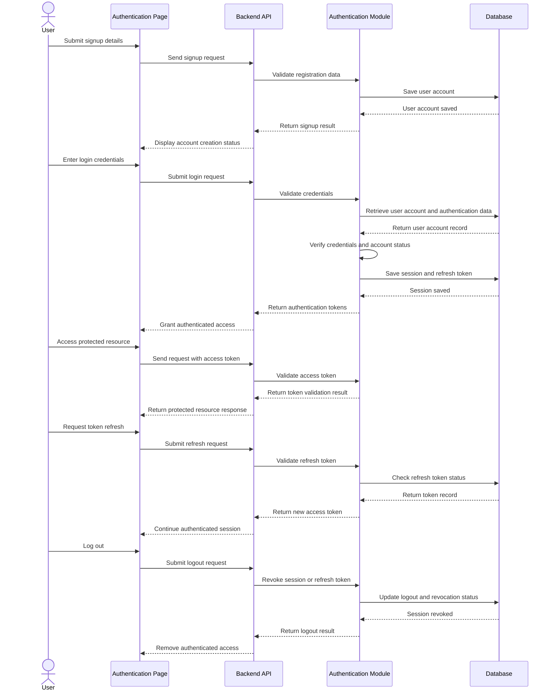

---

### Classes

#### authRouter

Defines the API routes for signup, login, logout, token refresh, token validation, and authenticated user retrieval. It maps incoming HTTP requests to the appropriate controller functions.

#### authController

Handles authentication API requests and responses. It receives requests for signup, login, logout, token refresh, token validation, and authenticated user context retrieval, then returns the appropriate response to the client.

#### authService

Contains the business logic for authentication operations. It validates signup and login credentials, creates user accounts, issues authentication tokens, verifies token status, refreshes access tokens, revokes sessions, and enforces secure access rules.

#### authRepository

Handles data access and database queries related to user authentication sessions, refresh tokens, and authentication state records.

#### authValidator

Validates request data for authentication operations. It ensures signup credentials, login credentials, token inputs, and session-related data are complete and correctly formatted before processing.

---

### Error Handling

400  
Invalid authentication request data

401  
Invalid credentials or unauthorized access

403  
User account is inactive or access is restricted

404  
Authenticated user or session record not found

409  
User account already exists or authentication session is already revoked or in conflicting state

422  
Authentication validation failed

500  
Internal server error

503  
Authentication service unavailable

---

## Module 2
<<<<<<< HEAD

=======
>>>>>>> 09dd7e1 (Revert "Merge branch 'feat/hono-cloudflare-migration' of github.com:Wiii-1/New_LINAW")

User Management

---

### Responsibilities

- Handle company registration and company profile maintenance.
- Store and maintain company profile details and user membership under the registered company.
- Allow authorized users to view and update their own profile information.
- Allow authorized company administrators to manage company user accounts.
- Control access to procurement functions based on company-scoped roles and permissions.

### Module Dependencies

- Depends On: Authentication, `users`, `companies`, `roles`, `permissions`, `user_roles`, and `role_permissions`.
- Produces: company records, updated user profiles, company user account changes, role assignments, and permission mappings.

---

<<<<<<< HEAD
### Module Dependencies
=======
### Functional Requirements
>>>>>>> 09dd7e1 (Revert "Merge branch 'feat/hono-cloudflare-migration' of github.com:Wiii-1/New_LINAW")

- The system shall allow the initial organization administrator to register and maintain company details in the application.
- The system shall allow the system to associate a registered user with a company as its organization administrator after company registration.
- The system shall allow authorized users to view and update their account information within the scope allowed by the company.
- The system shall allow authorized company administrators to create, view, update, deactivate, and remove company user accounts after company setup is completed.
- The system shall allow authorized company administrators to assign roles and permissions to company users based on authorized access requirements.
- The system shall allow authorized company administrators to search and filter company users by name, email, role, or account status.
- The system shall allow the system to enforce access restrictions based on company membership, assigned roles, and permissions.
- The system shall restrict company user and role management functions to authorized organization administrators only.

---

<<<<<<< HEAD
### Functional Requirements
=======
### Business Rules
>>>>>>> 09dd7e1 (Revert "Merge branch 'feat/hono-cloudflare-migration' of github.com:Wiii-1/New_LINAW")

- A company record must be created before company-level administration can be fully performed.
- The registered user designated during company setup shall become the organization administrator of that company.
- Every managed user account must belong to one valid company record based on the current system design.
- A user account must have at least one valid company-scoped role before it can access protected procurement functions.
- Company administrators shall manage only users belonging to their own company.
- Inactive or deactivated user accounts shall not be allowed to access the system.
- Company-related roles and permissions shall apply only within the scope of the user’s registered company.
- Significant user, company, role, and membership changes shall be recorded with the acting user and timestamp.

---

<<<<<<< HEAD
### Business Rules
=======
### Internal Sections
>>>>>>> 09dd7e1 (Revert "Merge branch 'feat/hono-cloudflare-migration' of github.com:Wiii-1/New_LINAW")

#### User Profile Management

<<<<<<< HEAD
---

### Internal Sections

#### User Profile Management

Handles retrieval and updates of the authenticated user's personal profile information.
=======
Handles self-service user profile retrieval and profile updates for the authenticated user.
>>>>>>> 09dd7e1 (Revert "Merge branch 'feat/hono-cloudflare-migration' of github.com:Wiii-1/New_LINAW")

API Endpoints

GET  
/api/users/profile

<<<<<<< HEAD
PATCH

/api/users/profile

Validation

- first_name
- last_name
=======
PUT  
/api/users/profile

**Validation**
- full_name
>>>>>>> 09dd7e1 (Revert "Merge branch 'feat/hono-cloudflare-migration' of github.com:Wiii-1/New_LINAW")
- email
- contact_number
- Email must be in a valid format
- User email must be unique within the allowed account rules
- Contact number must follow the accepted format when provided

#### Organization (Company) Management

<<<<<<< HEAD
#### Organization Registration

Handles organization registration during the onboarding process and associates the registering user as the initial organization administrator.
=======
Handles company registration and company profile maintenance for the SaaS platform.
>>>>>>> 09dd7e1 (Revert "Merge branch 'feat/hono-cloudflare-migration' of github.com:Wiii-1/New_LINAW")

API Endpoints

POST  
/api/companies/register

GET  
/api/companies/:companyId

PUT  
/api/companies/:companyId

<<<<<<< HEAD
Validation
=======
**Validation**
- company_name
- company_email
- company_address
- company_contact_number
- company_status
- Company name must not be empty during company registration
- Company record must contain required organization details before setup is completed
- Company email must be in a valid format when provided
- Company status must match an allowed company state
>>>>>>> 09dd7e1 (Revert "Merge branch 'feat/hono-cloudflare-migration' of github.com:Wiii-1/New_LINAW")

#### User Administration

Handles company-scoped user creation, retrieval, update, deactivation, and removal after company setup is completed.

<<<<<<< HEAD
### API Endpoints
=======
**API Endpoints**
>>>>>>> 09dd7e1 (Revert "Merge branch 'feat/hono-cloudflare-migration' of github.com:Wiii-1/New_LINAW")

POST  
/api/companies/:companyId/users

GET  
/api/companies/:companyId/users  
/api/companies/:companyId/users/:userId  
/api/companies/:companyId/users?status=active  
/api/companies/:companyId/users?role=:roleName

PUT  
/api/companies/:companyId/users/:userId  
/api/companies/:companyId/users/:userId/status

DELETE  
/api/companies/:companyId/users/:userId

<<<<<<< HEAD
PUT

/api/users/profile

---

### Validation

- first_name
- last_name
=======
**Validation**
- full_name
>>>>>>> 09dd7e1 (Revert "Merge branch 'feat/hono-cloudflare-migration' of github.com:Wiii-1/New_LINAW")
- email
- password
- user_status
- User email must be unique within the allowed account rules
- Password must meet the configured security requirements when applicable
- User status must match an allowed account state
- Company user administration must be restricted to the acting administrator’s company scope

#### Role & Permission Management

Handles company-scoped role assignment, role removal, and permission reference retrieval for RBAC enforcement.

**API Endpoints**

POST  
/api/companies/:companyId/users/:userId/assign-role  
/api/companies/:companyId/users/:userId/remove-role

GET  
/api/roles  
/api/permissions

**Validation**
- role_id
- permission_id
- Role reference must match an existing company-scoped role record
- Permission reference must match an existing permission record
- User account must have at least one assigned role before protected procurement access is allowed

---

<<<<<<< HEAD
### Database Tables

- Tenant
  - Stores tenant scope and isolation boundaries.
  - Ensures users and companies are isolated by tenant.

- User
  - Stores user account information and profile data.
  - Includes identity, contact information, job title, and account status.

- UserCredential
  - Stores authentication data separate from the user profile.
  - Includes the password hash and credential lifecycle data.

- Company
  - Stores organization records created during onboarding.
  - Includes organization identity, contact information, and profile details.

- CompanyMembership
  - Stores the relationship between users and companies.
  - Tracks membership and employment status within the organization.

- Role
  - Stores tenant-scoped role definitions.

- UserRole
  - Stores role assignments for users.
  - May be linked to a company when the role is organization-specific.

---

=======
### API Endpoints

POST  
/api/companies/register  
/api/companies/:companyId/users  
/api/companies/:companyId/users/:userId/assign-role  
/api/companies/:companyId/users/:userId/remove-role

GET  
/api/users/profile  
/api/companies/:companyId  
/api/companies/:companyId/users  
/api/companies/:companyId/users/:userId  
/api/companies/:companyId/users?status=active  
/api/companies/:companyId/users?role=:roleName  
/api/roles  
/api/permissions

PUT  
/api/users/profile  
/api/companies/:companyId  
/api/companies/:companyId/users/:userId  
/api/companies/:companyId/users/:userId/status

DELETE  
/api/companies/:companyId/users/:userId

---

### Validation

- full_name
- email
- password
- contact_number
- user_status
- company_name
- company_email
- company_address
- company_contact_number
- company_status
- role_id
- permission_id
- Email must be in a valid format
- User email must be unique within the allowed account rules
- Password must meet the configured security requirements when applicable
- Company name must not be empty during company registration
- Company record must contain required organization details before setup is completed
- Role reference must match an existing company-scoped role record
- Permission reference must match an existing permission record
- User account must have at least one assigned role before protected procurement access is allowed

---

### Database Tables

- **users**
  - Stores the main user account records.
  - Includes full name, email, password hash, contact number, account status, and company reference.

- **companies**
  - Stores the registered company records in the application.
  - Includes company name, address, contact details, status, registration metadata, and organization administrator reference.

- **roles**
  - Stores the role definitions used for company-scoped access control.
  - Includes role name, description, and status.

- **permissions**
  - Stores the permission definitions used for module and action authorization.
  - Includes permission name, module reference, action type, and description.

- **user_roles**
  - Stores the role assignments associated with company users.
  - Includes user reference, company reference, role reference, assigned by, and assignment timestamp.

- **role_permissions**
  - Stores the permission assignments associated with roles.
  - Includes role reference, permission reference, assigned by, and assignment timestamp.

---

>>>>>>> 09dd7e1 (Revert "Merge branch 'feat/hono-cloudflare-migration' of github.com:Wiii-1/New_LINAW")
### Sequence Diagram

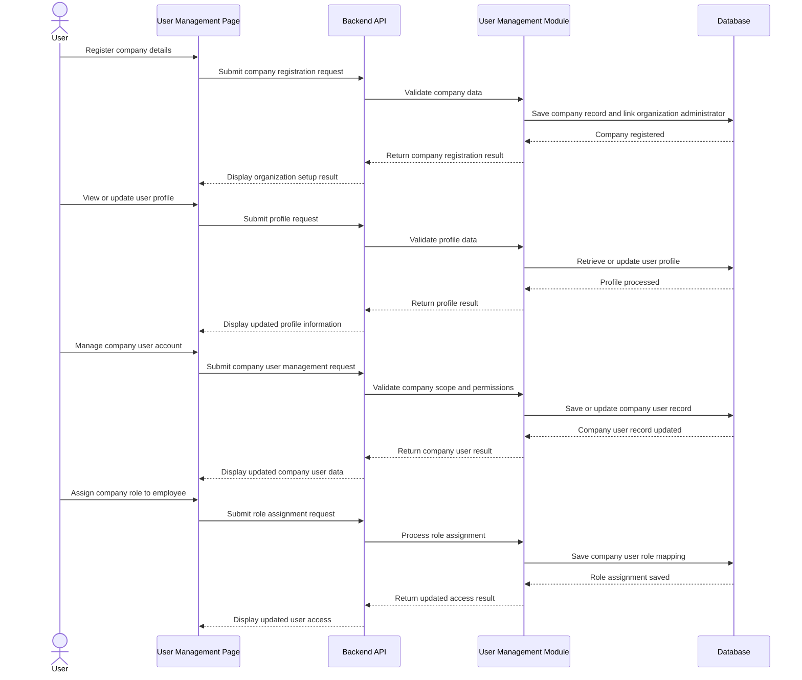

---

### Classes

#### userRouter

Defines the API routes for company registration, user profile management, company user management, and company-scoped role and permission operations. It maps incoming HTTP requests to the appropriate controller functions.

#### userController

Handles user management API requests and responses. It receives requests for company registration, profile updates, company user management, and role assignment, then returns the appropriate response to the client.

#### userService

Contains the business logic for user management operations. It registers companies, links organization administrators to companies, manages company user membership, validates company-scoped roles, and enforces company-based access control rules.

#### userRepository

Handles data access and database queries related to users, companies, roles, permissions, user-role mappings, and role-permission mappings.

#### userValidator

Validates request data for user management operations. It ensures company registration details, profile inputs, role references, permission references, and account status inputs are complete and correctly formatted before processing.

---

### Error Handling
<<<<<<< HEAD

400
=======
>>>>>>> 09dd7e1 (Revert "Merge branch 'feat/hono-cloudflare-migration' of github.com:Wiii-1/New_LINAW")

400  
Invalid user management request data

401  
Unauthorized access

403  
Insufficient privileges to manage company users, roles, or permissions

404  
User, company, role, or permission record not found

409  
Company record or role assignment already exists or is in conflicting state

422  
User management validation failed

500  
Internal server error

503  
User management service unavailable

---

## Module 3

Purchase Requisition

---

### Responsibilities

- Handle purchase requisition request creation, submission, and tracking within the procurement system.
- Store requisition details such as requester, items, quantities, purpose, and status.
- Allow authorized users to save, submit, update, and monitor purchase requisition records.
- Maintain links between purchase requisitions and related approval, supplier, and procurement records.
- Provide visibility into requisition progress from draft to final processing status.

### Module Dependencies

- Depends On: Authentication, `users`, `companies`, and `approval_requests` for downstream routing.
- Produces: `purchase_requisitions`, `purchase_requisition_items`, `purchase_requisition_status_logs`, and approval request references.

---

### Functional Requirements

- The system shall allow authorized users to create purchase requisitions for requested goods or services.
- The system shall allow authorized users to add item details, quantities, descriptions, justification, and related request information to a purchase requisition.
- The system shall allow authorized users to save purchase requisitions in draft status before submission.
- The system shall allow authorized users to submit purchase requisitions for further review or approval.
- The system shall allow authorized users to update or revise purchase requisitions while still in an editable status.
- The system shall allow authorized users to view and track purchase requisition status and history.
- The system shall allow authorized users to search and filter purchase requisitions by requester, status, date, or reference number.
- The system shall maintain links between purchase requisitions and downstream procurement records such as approval records, RFQs, or purchase orders where applicable.
- The system shall restrict purchase requisition actions and records to authorized users only.

---

### Business Rules

- Only authorized users shall be allowed to create, update, submit, cancel, or view purchase requisitions based on their assigned roles.
- A purchase requisition must contain at least one valid line item before it can be submitted.
- A purchase requisition shall remain in draft status until it is formally submitted.
- Submitted purchase requisitions shall move to the next workflow stage according to configured approval or procurement rules.
- Purchase requisitions may be edited only while they are in an allowed editable status such as draft or returned for revision.
- Approved or fully processed purchase requisitions shall become read-only to normal users unless a controlled revision process is allowed.
- Cancelled purchase requisitions shall not proceed to downstream procurement processing.
- All significant status changes shall be recorded with the acting user and timestamp.

---

### API Endpoints

POST  
/api/purchase-requisitions  
/api/purchase-requisitions/:requisitionId/submit  
/api/purchase-requisitions/:requisitionId/cancel  
/api/purchase-requisitions/:requisitionId/resubmit

GET  
/api/purchase-requisitions  
/api/purchase-requisitions/:requisitionId  
/api/purchase-requisitions?status=draft  
/api/purchase-requisitions?status=submitted  
/api/purchase-requisitions?requesterId=:requesterId  
/api/purchase-requisitions?referenceNo=:referenceNo

PUT  
/api/purchase-requisitions/:requisitionId  
/api/purchase-requisitions/:requisitionId/status

DELETE  
/api/purchase-requisitions/:requisitionId

---

### Validation

- requisition_number
- requester_id
- company_id
- request_date
- requisition_status
- justification
- total_estimated_amount
- created_by
- submitted_at
- line_items
- Purchase requisition must contain at least one line item
- Each line item must contain a valid item description or item reference
- Each line item must contain a valid quantity
- Request date must be a valid date
- Requester reference must match an existing authorized user
- Submission must be blocked if required requisition data is incomplete
- Status transitions must follow the allowed purchase requisition workflow

---

### Database Tables

- purchase_requisitions
  - Stores the main purchase requisition records.
  - Includes requisition number, requester reference, company reference, request date, justification, total estimated amount, status, creator, and submission timestamp.

- purchase_requisition_items
  - Stores the line items associated with each purchase requisition.
  - Includes purchase requisition reference, item description or item reference, quantity, estimated unit cost, subtotal, and remarks.

- purchase_requisition_status_logs
  - Stores the status history and tracking records for purchase requisitions.
  - Includes purchase requisition reference, previous status, new status, action by, action timestamp, and remarks.

- Referenced Existing Tables
  - `users` — stores the users who create, update, submit, cancel, or track purchase requisitions.
  - `companies` — stores the company context associated with the purchase requisition.
  - `approval_requests` — stores related approval workflow records where requisitions are submitted for approval.
  - `rfqs` — stores request for quotation records created from approved requisitions where applicable.
  - `purchase_orders` — stores purchase orders derived from approved requisitions where applicable.

---

### Sequence Diagram

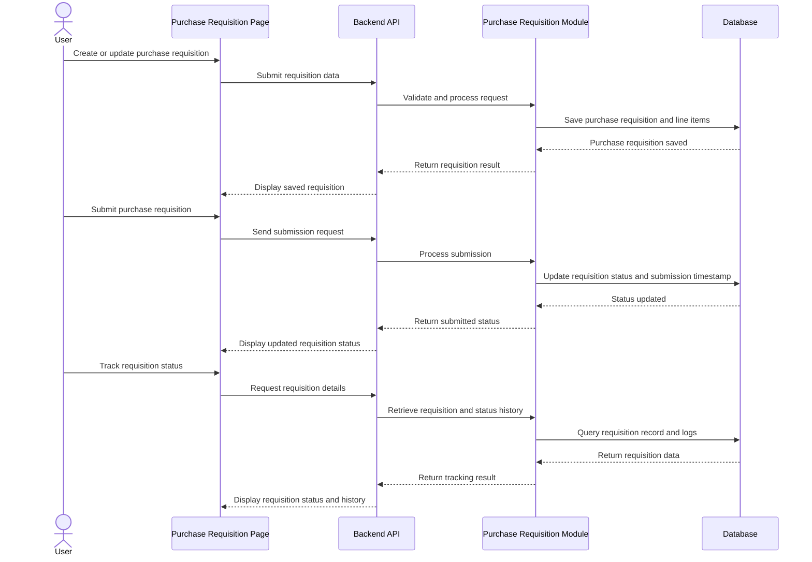

---

### Classes

#### purchaseRequisitionRouter

Defines the API routes for purchase requisition creation, retrieval, updating, submission, cancellation, resubmission, and status tracking. It maps incoming HTTP requests to the appropriate controller functions.

#### purchaseRequisitionController

Handles purchase requisition API requests and responses. It receives requests for creating, updating, submitting, cancelling, resubmitting, and viewing purchase requisitions, then returns the appropriate response to the client.

#### purchaseRequisitionService

Contains the business logic for purchase requisition operations. It validates requisition data, manages requisition status transitions, stores tracking history, and links requisitions to downstream procurement processes.

#### purchaseRequisitionRepository

Handles data access and database queries related to purchase requisitions, requisition line items, and requisition status logs.

#### purchaseRequisitionValidator

Validates request data for purchase requisition operations. It ensures requester references, requisition details, line items, and workflow-related inputs are complete and correctly formatted before processing.

---

### Error Handling

400  
Invalid purchase requisition request data

401  
Unauthorized access

403  
Insufficient privileges to manage purchase requisitions

404  
Purchase requisition or related record not found

409  
Purchase requisition already submitted, cancelled, or in conflicting state

422  
Purchase requisition validation failed

500  
Internal server error

503  
Purchase requisition service unavailable

---

## Module 4

Approval Workflow

---

### Responsibilities

- Handle request review, approval, rejection, and status updates within the system.
- Route requests to the appropriate approver or approval level based on workflow rules.
- Record approval decisions, comments, timestamps, and resulting request statuses.
- Maintain visibility of pending, approved, rejected, and cancelled approval requests.
- Allow authorized users to monitor and process approval workflow actions.

### Module Dependencies

- Depends On: Authentication, `users`, `companies`, and transactional records such as `purchase_requisitions`, `rfqs`, and `purchase_orders`.
- Produces: `approval_requests`, `approval_actions`, and workflow routing outcomes.

---

### Functional Requirements

- The system shall allow authorized users to submit requests for approval.
- The system shall allow the system to route requests to the appropriate approver based on defined workflow rules.
- The system shall allow authorized approvers to review submitted requests and take approval or rejection actions.
- The system shall allow authorized approvers to include remarks or comments during approval or rejection.
- The system shall update the request status after an approval decision is recorded.
- The system shall maintain the request in pending status until all required approvals are completed where multi-level approval is applicable.
- The system shall allow authorized users to cancel or resubmit approval requests where permitted by workflow rules.
- The system shall allow authorized users to view approval history, approval status, and current approver information.
- The system shall restrict approval workflow actions and records to authorized users only.

---

### Business Rules

- Only authorized users shall be allowed to submit, review, approve, reject, cancel, or resubmit approval requests.
- Every approval request must be associated with a valid request record or business transaction.
- A request shall remain in pending approval status until all required approval steps are completed.
- A rejected approval request shall update the related request status to rejected or returned status based on system rules.
- An approved request shall update the related request status to approved or released status based on the workflow outcome.
- Approval or rejection actions must be recorded with the acting approver, timestamp, decision, and remarks where applicable.
- A cancelled approval request may be resubmitted only if allowed by the defined workflow rules.
- Users shall not approve their own request unless explicitly permitted by the system configuration.
- Invalid or incomplete requests shall not proceed to approval processing.

---

### API Endpoints

POST  
/api/approval-workflows/submit  
/api/approval-workflows/:requestId/approve  
/api/approval-workflows/:requestId/reject  
/api/approval-workflows/:requestId/cancel  
/api/approval-workflows/:requestId/resubmit

GET  
/api/approval-workflows  
/api/approval-workflows/:requestId  
/api/approval-workflows?status=pending  
/api/approval-workflows?status=approved  
/api/approval-workflows?status=rejected  
/api/approval-workflows?approverId=:approverId

PUT  
/api/approval-workflows/:requestId/status

---

### Validation

- request_id
- request_type
- requester_id
- approver_id
- approval_level
- approval_status
- decision
- remarks
- submitted_at
- decided_at
- Request must reference a valid business record
- Approver reference must match an authorized user
- Approval status must match an allowed workflow status
- Approval decision must be valid based on the current request state
- Remarks may be required for rejection depending on workflow rules
- Request submission must be blocked if required fields are incomplete
- Status transitions must follow the configured approval workflow sequence

---

### Database Tables

- approval_requests
  - Stores the main approval workflow records.
  - Includes request reference, request type, requester, current approval level, current approver, approval status, and submission timestamp.

- approval_actions
  - Stores the approval decisions and action history for each approval request.
  - Includes approval request reference, approver, action type, remarks, action timestamp, and resulting status.

- approval_workflow_levels
  - Stores the configured approval workflow levels or routing definitions.
  - Includes request type, approval level, assigned approver or role, sequence order, and workflow rules.

- Referenced Existing Tables
  - `users` — stores the users who submit, review, approve, reject, cancel, or resubmit requests.
  - `companies` — stores the company context associated with approval requests.
  - Transactional tables such as `purchase_requisitions`, `rfqs`, `purchase_orders`, or other request records — store the business documents subject to approval.

---

### Sequence Diagram

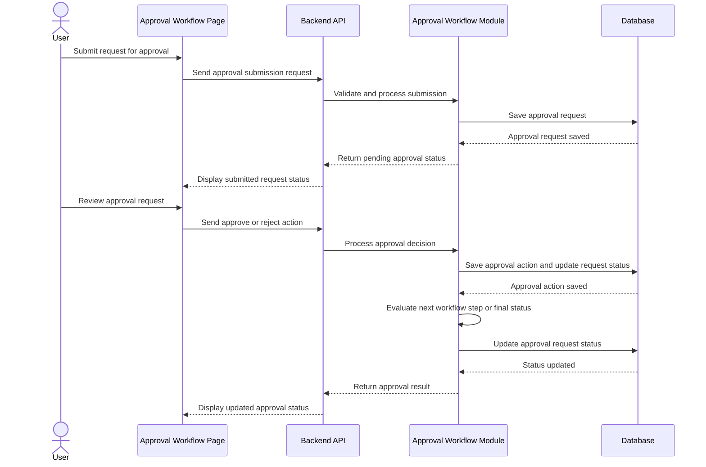

---

### Classes

#### approvalWorkflowRouter

Defines the API routes for approval workflow submission, review, approval, rejection, cancellation, resubmission, and status retrieval. It maps incoming HTTP requests to the appropriate controller functions.

#### approvalWorkflowController

Handles approval workflow API requests and responses. It receives requests for submitting requests, approving, rejecting, cancelling, resubmitting, and viewing approval records, then returns the appropriate response to the client.

#### approvalWorkflowService

Contains the business logic for approval workflow operations. It routes requests to approvers, validates workflow transitions, records approval decisions, updates request statuses, and evaluates multi-level approval outcomes.

#### approvalWorkflowRepository

Handles data access and database queries related to approval workflow requests, approval actions, and workflow level configurations.

#### approvalWorkflowValidator

Validates request data for approval workflow operations. It ensures request references, approver references, decisions, statuses, and workflow inputs are complete and correctly formatted before processing.

---

### Error Handling

400  
Invalid approval workflow request data

401  
Unauthorized access

403  
Insufficient privileges to process approval workflow actions

404  
Approval request or related business record not found

409  
Approval request already processed or in conflicting state

422  
Approval workflow validation failed

500  
Internal server error

503  
Approval workflow service unavailable

---

## Module 5 —

Supplier Management

--- 

### 5.1 Responsibilities

The Supplier Management module manages supplier identities, company-to-supplier relationships, supplier onboarding invitations, and supplier-facing procurement activities within LINAW.

The module consists of three dedicated services:

#### 1. Supplier Governance Service

Responsible for managing supplier records and company-supplier relationships from the perspective of the organization managing its suppliers.

- Retrieve, search, and view supplier records and their associated information.
- Maintain supplier profile information and supplier status.
- Display suppliers associated with the currently active company.
- Allow authorized users to remove a supplier relationship from their company.
- Preserve supplier records and historical procurement information when a relationship is removed.
- Prevent inactive supplier relationships from being used for new procurement activities where an active relationship is required.

Removing a supplier from a company's supplier list does not delete the supplier identity or historical procurement records. It deactivates the relevant company-supplier relationship.

#### 2. Supplier Invitation Service

Responsible for inviting companies to establish supplier relationships and coordinating supplier onboarding.

- Generate secure, time-limited supplier invitation links.
- Send invitations through the configured email service.
- Validate invitation tokens and expiration.
- Determine whether the invited company's organization already exists in LINAW.
- Allow an existing company to accept an invitation and establish or reactivate its supplier relationship.
- Coordinate new-company onboarding with the existing authentication and organization management workflows.
- Track invitation lifecycle status and prevent expired, invalid, or previously consumed invitations from being accepted.
- Preserve existing supplier identities and avoid duplicate supplier records when an invitation is accepted.

The Invitation Service coordinates onboarding but does not independently reimplement authentication, account registration, or organization creation.

#### 3. Supplier Portal Service

Responsible for supplier-facing procurement operations.

- Determine whether the authenticated user's active company is eligible to access the supplier portal.
- Retrieve RFQs that the supplier is authorized to view and respond to.
- Retrieve RFQ details and relevant line items.
- Allow authorized supplier users to submit quotations against eligible RFQs.
- Retrieve quotations submitted by the supplier's company.
- Display quotation details, submission status, pricing, quantities, and other relevant information.
- Enforce supplier eligibility, company boundaries, user permissions, and RFQ-specific restrictions.

The Supplier Portal Service handles supplier-facing quotation submission and retrieval. It does not own RFQ creation, publication, quotation selection, or purchase order creation.

These purchasing-side operations remain the responsibility of the Purchase Order Management (POM) module.

---

### 5.2 Module Dependencies

#### Depends On

- **Authentication:** Authenticated user identity, access-token validation, and session-related authorization context.
- **Company Management:** Company records and organization lifecycle operations.
- **User Management and RBAC:** Company memberships, user permissions, and authorization checks.
- **Email Service:** Delivery of supplier invitation emails.
- **Purchase Order Management (POM):** RFQs, RFQ items, supplier quotations, and related procurement records.
- **Database Access Layer:** Prisma-based persistence and retrieval of supplier-related records.

#### Owns

The Supplier Management module owns the supplier-specific business logic associated with:

- `Supplier`
- `SupplierInvitation`
- `SupplierCompanyRelationship`
- `SupplierQuotation`
- `SupplierQuotationItem`

The module also coordinates with existing `Company`, `User`, `CompanyMembership`, `RFQ`, `RFQItem`, and `PurchaseOrder` records where required.

**Ownership boundary:** Although Supplier Management provides supplier-facing quotation operations, the existing POM module remains responsible for procurement-side RFQ and purchase order workflows. The implementation must respect the existing database schema and avoid duplicating POM business logic.

---

### 5.3 Functional Requirements

#### 5.3.1 Supplier Governance

- The system shall allow authorized users to retrieve and view supplier records associated with their active company.
- The system shall allow authorized users to search and filter supplier records by supported criteria, such as supplier name and status.
- The system shall display supplier information, including legal name, display name, contact information, supplier status, and relevant company relationships.
- The system shall allow authorized users to remove a supplier relationship from their company.
- The system shall preserve the supplier identity and associated historical procurement records when a relationship is removed.
- The system shall prevent users from modifying supplier records or relationships outside their authorized company and permission scope.
- The system shall distinguish the overall supplier status from the status of an individual company-supplier relationship.

#### 5.3.2 Supplier Invitations

- The system shall allow authorized users to invite a company to establish a supplier relationship.
- The system shall generate a unique, unpredictable, time-limited invitation token.
- The system shall store a hash of the invitation token rather than the raw token.
- The system shall send the invitation link through the configured email service.
- The system shall allow an invitee to validate an invitation before accepting it.
- The system shall determine whether the invited company already exists in LINAW and direct the invitee through the appropriate onboarding flow.
- The system shall allow an existing company to accept an invitation without creating a duplicate company or user account.
- The system shall coordinate new-company onboarding with existing authentication and company registration workflows.
- The system shall establish or reactivate the appropriate company-supplier relationship after successful acceptance.
- The system shall not reactivate a supplier relationship merely because an invitation has been created or sent.
- The system shall prevent expired, invalid, cancelled, or previously consumed invitations from being accepted.
- The system shall track invitation lifecycle status and relevant timestamps supported by the data model.

#### 5.3.3 Supplier Portal

- The system shall allow supplier portal access only when the authenticated user's active company satisfies supplier eligibility requirements.
- The system shall independently enforce supplier eligibility and authorization on every protected portal operation.
- The system shall allow eligible supplier users to retrieve RFQs that their company is authorized to access.
- The system shall display the relevant RFQ details and line items required to prepare a quotation.
- The system shall allow authorized supplier users to submit quotations against eligible RFQs.
- The system shall validate quotation data and its relationship to the relevant RFQ and supplier identity.
- The system shall allow supplier users to retrieve quotations associated with their company, subject to authorization.
- The system shall prevent supplier users from accessing another supplier's restricted quotations.
- The system shall prevent quotation submissions for RFQs that are unavailable, closed, or otherwise ineligible for submission.
- The system shall not allow supplier users to select the winning quotation or create purchase orders through the Supplier Portal.
- The system shall not expose supplier portal functionality to companies that do not satisfy supplier eligibility requirements.

---

### 5.4 Business Rules

#### 5.4.1 Supplier Identity and Relationships

1. A supplier identity represents a company participating as a supplier in LINAW.
2. A company may participate in procurement as both a buyer and a supplier. These roles do not require duplicate company identities.
3. The `Supplier.company_id` field identifies the company represented by the supplier record.
4. The `SupplierCompanyRelationship.company_id` field identifies the company that maintains the supplier relationship.
5. The supplier identity and the relationship between two companies are separate concepts.
6. A supplier may maintain relationships with multiple purchasing companies.
7. Deactivating one company-supplier relationship shall not automatically deactivate the supplier's relationships with other companies.
8. Removing a supplier relationship shall not hard-delete the supplier or cascade-delete its historical procurement records.
9. Reinviting a previously associated supplier shall reuse the existing supplier identity and relationship where appropriate rather than creating duplicates.
10. An inactive supplier relationship shall not be treated as active merely because a new invitation has been issued.

#### 5.4.2 Supplier Eligibility and Authorization

1. Supplier portal eligibility shall be evaluated using the authenticated user's active company and the supplier identity associated with that company.
2. The existence of a supplier record alone shall not grant every user in the company access to the supplier portal.
3. User-level access shall be enforced through the existing authentication, company membership, and RBAC mechanisms.
4. Supplier portal access and individual operations shall be enforced by the backend, not solely by frontend visibility.
5. Supplier-specific operations shall derive or verify the supplier identity from trusted company context. The backend shall not blindly trust a client-supplied `supplier_id`.
6. Access to RFQs shall additionally depend on the RFQ's availability and the supplier's authorization to participate.
7. An inactive or globally suspended supplier shall not regain eligibility simply by accepting an invitation. Reactivation of the supplier identity, where required, must follow the appropriate authorized process.

#### 5.4.3 Invitation Lifecycle

1. Each invitation shall have a unique token and an expiration time.
2. The raw invitation token shall not be stored in the database.
3. An invitation shall be accepted only when its token is valid, its expiration time has not passed, and its lifecycle state permits acceptance.
4. Invitation acceptance shall be performed in a way that prevents replay and concurrent duplicate acceptance.
5. Acceptance shall establish or reactivate the relevant company-supplier relationship only after successful validation and acceptance processing.
6. Existing companies shall be associated with the invitation rather than recreated.
7. New companies shall be registered through existing LINAW onboarding workflows.
8. Invitation status shall represent invitation lifecycle, not supplier eligibility or company-supplier relationship status.
9. Sending an invitation shall not, by itself, grant supplier portal access.

#### 5.4.4 Supplier Quotations

1. Each supplier quotation shall reference an existing supplier, RFQ, and associated company context.
2. A supplier shall submit quotations only for RFQs it is authorized to access and that permit quotation submission.
3. The quotation's supplier identity shall be derived from or verified against the authenticated supplier company.
4. Quotation items shall reference valid RFQ items and satisfy the applicable quantity and pricing validations.
5. Quotation totals shall be consistent with the accepted quotation data and applicable pricing rules.
6. Submitted quotations shall follow the quotation status and revision rules defined by the existing procurement workflow.
7. Suppliers shall not be allowed to select quotations, approve their own quotations, or create purchase orders through the Supplier Portal.
8. Procurement-side quotation evaluation and selection shall remain under POM.
9. Historical quotations shall be retained according to the system's data-retention and audit requirements, even if the associated company-supplier relationship becomes inactive.

---

### 5.5 API Design

All routes are relative to the `/api` base path. The exact route names may be adjusted to match the existing routing conventions.

The API is grouped by the responsibility of each service.

#### 5.5.1 Governance Routes

| Method | Endpoint | Description |
|---|---|---|
| GET | `/suppliers` | Retrieve suppliers associated with the active company. |
| GET | `/suppliers/:supplierId` | Retrieve supplier details after verifying the relevant company relationship. |
| DELETE | `/suppliers/:supplierId/relationship` | Deactivate the supplier relationship with the active company. |

**Notes:**

- `GET /suppliers` may support pagination and filters such as `status` and `name`.
- The delete operation deactivates a relationship; it does not delete the supplier record.
- Changes must be scoped to the authenticated user's authorized company.
- Creating or editing supplier invitations belongs to the Invitation Service rather than the Governance Service.

#### 5.5.2 Invitation Routes

| Method | Endpoint | Description |
|---|---|---|
| POST | `/supplier-invitations` | Create and send a supplier invitation. |
| GET | `/supplier-invitations/:invitationId` | Retrieve invitation details for authorized users. |
| POST | `/supplier-invitations/:invitationId/resend` | Resend an eligible invitation or issue a replacement according to the invitation policy. |
| GET | `/supplier-invitations/validate/:token` | Validate an invitation token and return the permitted next step. |
| POST | `/supplier-invitations/:invitationId/accept` | Accept an invitation after identity and token validation. |

**Notes:**

- Invitation creation shall record which purchasing company initiated the invitation.
- Public token validation shall disclose only the information needed to continue onboarding.
- Acceptance must verify the invitation token and the invitee's identity or company context as required by the onboarding flow.
- Invitation identifiers and tokens shall not be treated as substitutes for authorization.
- If invitation acceptance requires signup, the flow shall coordinate with existing authentication and company registration endpoints rather than duplicate them.

#### 5.5.3 Supplier Portal Routes

| Method | Endpoint | Description |
|---|---|---|
| GET | `/supplier-portal/rfqs` | Retrieve RFQs available to the authenticated supplier company. |
| GET | `/supplier-portal/rfqs/:rfqId` | Retrieve details of an RFQ the supplier is authorized to access. |
| POST | `/supplier-portal/rfqs/:rfqId/quotations` | Submit a quotation for an eligible RFQ. |
| GET | `/supplier-portal/quotations` | Retrieve quotations associated with the authenticated supplier company. |
| GET | `/supplier-portal/quotations/:quotationId` | Retrieve a quotation belonging to the authenticated supplier company. |

**Notes:**

- Supplier identity shall be derived from trusted authentication and company context.
- Every endpoint must enforce supplier eligibility, company-level data isolation, and user-level permissions.
- RFQ visibility and submission eligibility must be validated by the backend.
- Quotation selection, RFQ publication, and purchase order creation remain POM responsibilities.

---

### 5.6 Validation

#### 5.6.1 Supplier Governance

- `supplierId`: Must be a valid identifier and reference an existing supplier.
- `company_id`: Must come from trusted request context or be verified against the authenticated user's authorized company.
- `supplier_status`: Must be one of the supported supplier lifecycle states.
- `relationship_status`: Must be one of the supported company-supplier relationship states.
- Supplier details returned to the client must respect company-level access restrictions.
- Relationship removal must target the relationship associated with the active company.

#### 5.6.2 Supplier Invitations

- `email`: Must be a valid email address.
- `company_id`: Must identify the purchasing company initiating the invitation and must be authorized for the requesting user.
- `invitation_token`: Must match a stored token hash and satisfy the invitation's lifecycle and expiration rules.
- `expires_at`: Must be valid and future-dated when an invitation is created.
- `invitation_status`: Must be a supported invitation lifecycle state.
- Invitation acceptance must reject invalid, expired, cancelled, or already-consumed invitations.
- Invitation acceptance must verify that the invitee is permitted to establish the intended company-supplier relationship.
- Invitation creation and acceptance must not create duplicate supplier identities or company-supplier relationships.
- Resending an invitation must not inadvertently reactivate an inactive relationship.
- Public invitation endpoints must not expose sensitive supplier, company, or user information.

#### 5.6.3 Supplier Portal and Quotations

- `rfqId`: Must reference an existing RFQ.
- `quotationId`: Must reference an existing quotation within the authenticated supplier's authorized scope.
- `rfq_item_id`: Must reference an item belonging to the RFQ associated with the quotation.
- `quoted_quantity`: Must be a valid positive quantity that satisfies the RFQ's applicable requirements.
- `unit_price`: Must be a valid non-negative monetary amount, subject to the procurement rules.
- `total_price`: Must be consistent with the applicable quantity and unit-price calculation.
- `currency_code`: Must be valid and consistent with the quotation and RFQ rules.
- `valid_until`: Must be a valid date when provided.
- Quotation submission must be rejected if the RFQ is closed or otherwise ineligible.
- Quotation retrieval must enforce supplier ownership and company-level data isolation.
- Client-supplied supplier identifiers must be verified against the authenticated supplier company.
- Quotation submission must reject incomplete or inconsistent quotation data.

---

### 5.7 Database Tables

#### 5.7.1 `Supplier`

Stores the supplier identity and its supplier-specific information.

Relevant fields include:

- `id`
- `tenant_id`
- `company_id`
- `supplier_code`
- `legal_name`
- `display_name`
- `tax_id`
- `contact_email`
- `contact_phone`
- `address`
- `status`
- `created_at`
- `updated_at`

The `company_id` field associates the supplier identity with its represented company.

The supplier record is distinct from any individual purchasing company's relationship with that supplier.

#### 5.7.2 `SupplierCompanyRelationship`

Stores the relationship between a purchasing company and a supplier.

Relevant fields include:

- `id`
- `tenant_id`
- `company_id`
- `supplier_id`
- `relationship_status`
- `created_at`
- `updated_at`

The `company_id` identifies the purchasing company maintaining the relationship, while `supplier_id` identifies the supplier.

The unique constraint on `[tenant_id, company_id, supplier_id]` prevents duplicate relationship records within the same tenant.

Relationship deactivation preserves the record for historical reference and potential reactivation.

#### 5.7.3 `SupplierInvitation`

Stores supplier invitation records and their lifecycle.

Relevant fields include:

- `id`
- `tenant_id`
- `supplier_id`
- `invited_by_user_id`
- `email`
- `token_hash`
- `status`
- `expires_at`
- `accepted_at`
- `created_at`
- `updated_at`

The invitation must also retain an unambiguous reference to the purchasing company that initiated it. If this is not already represented in the schema, a `company_id` field should be added.

The token hash is used for secure validation. The raw token is used only to construct the invitation link and must not be persisted.

#### 5.7.4 `SupplierQuotation`

Stores supplier quotations submitted against RFQs.

Relevant fields include:

- `id`
- `tenant_id`
- `company_id`
- `rfq_id`
- `supplier_id`
- `quotation_number`
- `currency_code`
- `total_amount`
- `status`
- `submitted_at`
- `valid_until`
- `created_at`
- `updated_at`

The quotation must reference the supplier submitting it and the RFQ to which it responds.

The existing company context must be validated against the authenticated supplier and the relevant procurement context.

#### 5.7.5 `SupplierQuotationItem`

Stores the individual items included in a supplier quotation.

Relevant fields include:

- `id`
- `tenant_id`
- `company_id`
- `supplier_quotation_id`
- `rfq_item_id`
- `line_no`
- `quoted_quantity`
- `unit_price`
- `total_price`
- `lead_time_days`
- `remarks`
- `created_at`
- `updated_at`

Each quotation item must reference a valid item belonging to the associated RFQ.

#### 5.7.6 Referenced Existing Tables

- **`Company`:** Stores company identity and organization information.
- **`CompanyMembership`:** Associates users with companies and supports company-context authorization.
- **`User`:** Stores user identities, including users who initiate invitations.
- **`RFQ`:** Stores requests for quotation managed by POM.
- **`RFQItem`:** Stores the items included in an RFQ.
- **`PurchaseOrder`:** Stores purchase orders managed by POM and may reference the selected quotation.
- **`Tenant`:** Provides the existing tenant-level data boundary.

---

### 5.8 Class Design

The Supplier Management module shall use three dedicated service groups. Each service group contains its own controller, service, repository, and validator where needed.

#### 5.8.1 `supplierManagementRoutes`

Defines the module's routes and maps each route to its appropriate controller.

Routes shall be grouped by Governance, Invitation, and Portal responsibilities.

#### 5.8.2 Governance Service Group

**`supplierManagementGovernanceController`**

- Receives governance-related HTTP requests.
- Extracts and validates route parameters and query values.
- Passes the authenticated user and authorized company context to the service.
- Returns appropriate responses without implementing business rules.

**`supplierManagementGovernanceService`**

- Retrieves supplier records and supplier details.
- Enforces supplier governance rules.
- Deactivates the relationship between the active company and a supplier when authorized.
- Ensures supplier history and other companies' relationships remain intact.

**`supplierManagementGovernanceRepository`**

- Retrieves supplier records and their company relationships.
- Retrieves supplier details within the permitted scope.
- Updates the status of the appropriate company-supplier relationship.
- Performs database operations without duplicating service-level business rules.

**`supplierManagementGovernanceValidator`**

- Validates governance query parameters, route identifiers, and supported status values.

#### 5.8.3 Invitation Service Group

**`supplierManagementInvitationController`**

- Receives invitation creation, validation, resend, and acceptance requests.
- Validates request inputs and passes the required context to the service.
- Returns onboarding results and invitation lifecycle information.

**`supplierManagementInvitationService`**

- Generates invitation tokens and their expiration times.
- Coordinates invitation persistence and email delivery.
- Validates invitation lifecycle rules.
- Determines whether the invited company already exists.
- Coordinates existing-company acceptance or new-company onboarding.
- Establishes or reactivates the company-supplier relationship after successful acceptance.
- Prevents duplicate acceptance and inappropriate relationship reactivation.

**`supplierManagementInvitationRepository`**

- Creates and retrieves invitation records.
- Looks up invitation records using token hashes.
- Updates invitation lifecycle state.
- Retrieves or verifies the relevant supplier and company-supplier relationship.
- Supports atomic or transactional acceptance operations as required by the schema.

**`supplierManagementInvitationValidator`**

- Validates invitation request data, email addresses, supported statuses, and token-related inputs.
- Does not replace service-level verification of token validity, expiration, or acceptance eligibility.

#### 5.8.4 Portal Service Group

**`supplierManagementPortalController`**

- Receives supplier portal RFQ and quotation requests.
- Validates request parameters and quotation payloads.
- Passes trusted authentication and company context to the service.
- Returns authorized RFQ and quotation information.

**`supplierManagementPortalService`**

- Enforces supplier portal eligibility and user authorization.
- Retrieves RFQs the supplier is authorized to access.
- Validates RFQ eligibility before quotation submission.
- Coordinates quotation creation and retrieval.
- Ensures quotation operations remain within the authenticated supplier's scope.
- Does not implement procurement-side RFQ publication, quotation selection, or purchase order creation.

**`supplierManagementPortalRepository`**

- Retrieves eligible RFQ and RFQ item data through the established database-access pattern.
- Creates and retrieves supplier quotations and quotation items.
- Queries quotations within the correct tenant, company, supplier, and RFQ context.
- Uses transactional database operations when creating a quotation and its items together.

**`supplierManagementPortalValidator`**

- Validates RFQ identifiers, quotation payloads, quantities, prices, currency, and other applicable request fields.

#### 5.8.5 Cross-Cutting Rules

- Services contain business logic; controllers handle HTTP concerns; repositories handle database access; validators handle request-shape validation.
- Repository methods shall accept a single structured input object when multiple values are required.
- Company, tenant, and user context shall be passed explicitly through the appropriate service and repository operations.
- Services shall use the existing authentication and authorization context rather than introducing a separate identity system.
- Email delivery shall use the existing email-service abstraction where available.
- Database changes involving invitation acceptance and relationship activation shall preserve consistency under failure or concurrent requests.

---

### 5.9 Sequence Diagrams

#### 5.9.1 Supplier Governance — View and Remove Supplier

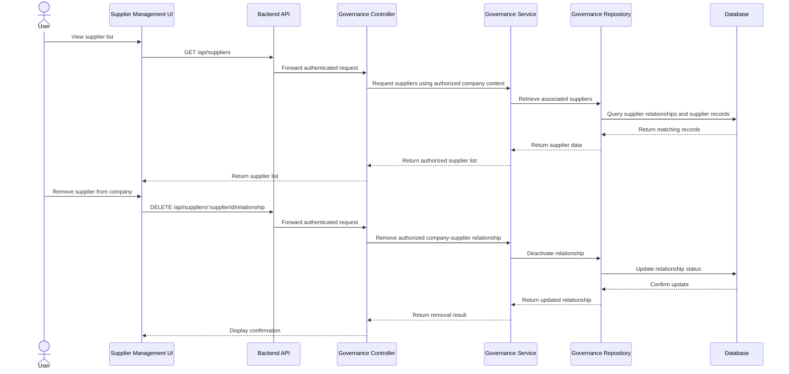

#### 5.9.2 Supplier Invitation and Acceptance

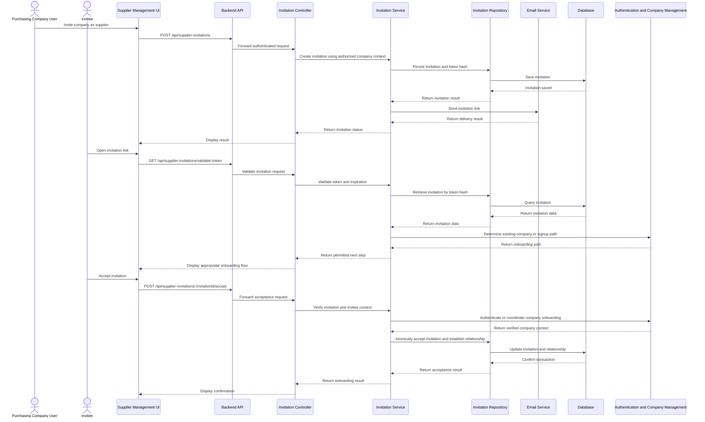

#### 5.9.3 Supplier Portal — Submit Quotation

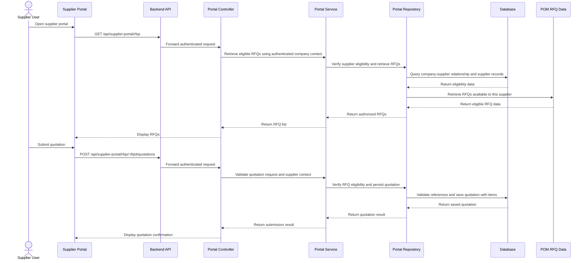

---

### 5.10 Error Handling

| HTTP Status | Condition |
|---|---|
| `400 Bad Request` | Invalid route parameters, query values, or request payload. |
| `401 Unauthorized` | Missing or invalid authentication where authentication is required. |
| `403 Forbidden` | The user lacks the required permission, company access, supplier eligibility, or RFQ access. |
| `404 Not Found` | The requested supplier, relationship, invitation, RFQ, or quotation does not exist within the caller's permitted scope. |
| `409 Conflict` | Duplicate relationship, duplicate submission, invalid lifecycle transition, or conflicting invitation acceptance. |
| `410 Gone` | An invitation token has expired or an invitation is no longer usable, where exposing this distinction is appropriate. |
| `422 Unprocessable Entity` | The request is structurally valid but violates business rules, such as submitting a quotation for a closed RFQ. |
| `500 Internal Server Error` | An unexpected server-side failure. |
| `503 Service Unavailable` | A required dependency is temporarily unavailable, such as the email delivery provider. |

Error responses shall not expose raw invitation tokens, secrets, internal database details, or unauthorized supplier information.


---

## Module 6

Purchase Order Management

---

### Responsibilities

- Manage procurement activities after a Purchase Requisition has been approved.

- Allow authorized Procurement Officers to create and manage Requests for Quotation (RFQs) based on approved procurement requirements.

- Store RFQ details including procurement items, quantities, specifications, dates, and status.

- Publish created RFQs to the Supplier Dashboard for supplier response.

- Retrieve and manage supplier quotations submitted through the Supplier Dashboard.

- Support quotation review, comparison, and selection by authorized Procurement Officers.

- Create purchase orders based on selected supplier quotations.

- Maintain purchase order details including supplier, items, quantities, prices, totals, references, and status.

- Maintain links between Purchase Orders, selected quotations, RFQs, and originating Purchase Requisitions.

- Provide procurement status visibility throughout the RFQ, quotation, and purchase order lifecycle.

### Module Dependencies

- Depends On: Authentication, Authorization/RBAC, `users`, `companies`, `purchase_requisitions`, Supplier Dashboard, Supplier Management, and Audit Trail.

- Produces: `rfqs`, `rfq_items`, and `purchase_orders` with their associated purchase order items.

- Consumes: `supplier_quotations` and `supplier_quotation_items` submitted through the Supplier Dashboard.

---

### Functional Requirements

- The system shall allow authorized Procurement Officers to view approved Purchase Requisitions available for procurement.

- The system shall allow authorized Procurement Officers to create Requests for Quotation based on approved procurement requirements.

- The system shall allow authorized users to add procurement items, quantities, units of measure, and specifications to an RFQ.

- The system shall allow authorized users to save RFQs in draft status before publication.

- The system shall allow authorized Procurement Officers to publish RFQs to the Supplier Dashboard.

- The system shall allow POM to retrieve supplier quotations submitted against published RFQs.

- The system shall allow authorized Procurement Officers to view and compare submitted supplier quotations.

- The system shall allow authorized Procurement Officers to select a supplier quotation for procurement.

- The system shall allow authorized Procurement Officers to create a Purchase Order based on a selected supplier quotation.

- The system shall allow authorized users to view, search, and filter RFQs and Purchase Orders by status, date, reference number, or related procurement record.

- The system shall maintain links between Purchase Orders, selected quotations, RFQs, and originating Purchase Requisitions where applicable.

- The system shall maintain procurement status changes throughout the RFQ and Purchase Order lifecycle.

- The system shall record significant procurement actions for audit purposes.

---

### Business Rules

- Only authorized Procurement Officers or users with the required procurement permissions shall be allowed to create, publish, evaluate, select, or manage procurement records.

- A Purchase Requisition must be approved before it can normally be used to initiate an RFQ.

- Approval of a Purchase Requisition shall not automatically create an RFQ.

- An RFQ must contain at least one valid procurement item before it can be published.

- RFQ items must contain valid quantities and units of measure.

- Published RFQs shall not be freely modified once supplier responses are being accepted.

- Supplier quotations must belong to the RFQ against which they were submitted.

- Only valid submitted quotations may be selected for Purchase Order creation.

- POM shall not automatically select the lowest quotation unless an explicit procurement policy requires such behavior.

- A Purchase Order must reference the selected quotation from which it was created.

- Purchase Order line items and totals must be derived from valid procurement data.

- A Purchase Order shall maintain traceability to its selected quotation, RFQ, and originating Purchase Requisition where applicable.

- Critical procurement actions such as RFQ publication, quotation selection, and Purchase Order creation shall be recorded in the Audit Trail.

- All procurement records must be isolated by tenant and company according to the authenticated user's access.

---

### API Endpoints

POST

`/api/purchase-orders/rfqs`

`/api/purchase-orders/rfqs/:rfqId/publish`

`/api/purchase-orders`

GET

`/api/purchase-orders/rfqs`

`/api/purchase-orders/rfqs/:rfqId`

`/api/purchase-orders/rfqs/:rfqId/quotations`

`/api/purchase-orders/rfqs/:rfqId/quotations/:quotationId`

`/api/purchase-orders`

`/api/purchase-orders/:poId`

`/api/purchase-orders?status=:status`

`/api/purchase-orders?referenceNo=:referenceNo`

PATCH

`/api/purchase-orders/rfqs/:rfqId`

`/api/purchase-orders/:poId`

DELETE

`/api/purchase-orders/rfqs/:rfqId`

`/api/purchase-orders/:poId`

POST

`/api/purchase-orders/rfqs/:rfqId/quotations/:quotationId/select`

---

### Validation

- `rfq_number`

- `purchase_requisition_id`

- `company_id`

- `title`

- `description`

- `status`

- `issue_date`

- `closing_date`

- `rfq_items`

- `line_no`

- `quantity`

- `unit_of_measure`

- `specification`

- `quotation_id`

- `purchase_order_number`

- `supplier_id`

- `order_date`

- `total_amount`

- `created_by`

- `purchase_order_items`

- RFQ must contain at least one valid item before publication.

- Each RFQ item must contain a valid quantity and unit of measure.

- Closing date must be valid and applicable to the RFQ lifecycle.

- A quotation must belong to the RFQ from which it is being selected.

- Only submitted and valid quotations may be selected.

- A Purchase Order must contain a valid selected quotation reference.

- Each Purchase Order line item must contain a valid quantity and unit price.

- Purchase Order totals must equal the computed sum of its line items.

- Status transitions must follow the allowed RFQ, quotation, and Purchase Order workflows.

- Cross-tenant or unauthorized procurement references must be rejected.

---

### Database Tables

- `rfqs`

- Stores the main Request for Quotation records.

- Includes RFQ number, company reference, originating Purchase Requisition reference, title, description, status, issue date, closing date, creator, and timestamps.

- `rfq_items`

- Stores the procurement items associated with each RFQ.

- Includes RFQ reference, originating Purchase Requisition Item reference where applicable, line number, description, quantity, unit of measure, specification, and timestamps.

- `supplier_quotations`

- Stores supplier quotations submitted against an RFQ.

- Includes RFQ reference, supplier reference, quotation number, currency, total amount, status, submission date, validity date, and timestamps.

- `supplier_quotation_items`

- Stores the individual supplier quotation line items.

- Includes quotation reference, RFQ item reference, line number, quoted quantity, unit price, total price, lead time, remarks, and timestamps.

- `purchase_orders`

- Stores the main Purchase Order records created from selected supplier quotations.

- Includes Purchase Order number, supplier reference, RFQ reference, selected quotation reference, company reference, order date, total amount, status, creator, and relevant timestamps.

- `purchase_order_items`

- Stores the line items associated with each Purchase Order.

- Includes Purchase Order reference, item description or source item reference, quantity, unit price, subtotal, and remarks.

- Referenced Existing Tables

- `purchase_requisitions` — stores the approved procurement request that may serve as the origin of an RFQ.

- `purchase_requisition_items` — stores the original procurement requirements referenced by RFQ items where applicable.

- `suppliers` — provides supplier information referenced by submitted quotations and Purchase Orders. Supplier management remains outside POM.

- `users` — stores the users who create RFQs, manage procurement records, evaluate quotations, and create Purchase Orders.

- `companies` — stores the company context associated with procurement records.

---

### Sequence Diagram

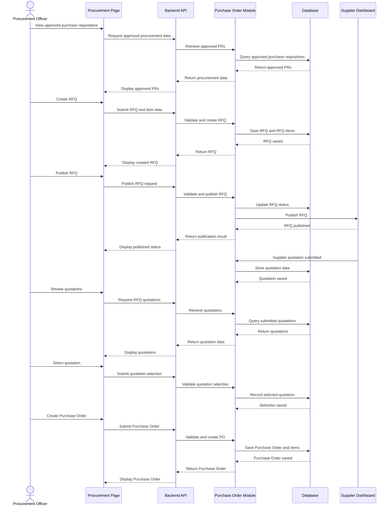

---

### Classes

#### purchaseOrderRouter

Defines the API routes for procurement queue access, RFQ creation, RFQ publication, quotation retrieval and selection, Purchase Order creation, retrieval, updating, and deletion. It maps incoming HTTP requests to the appropriate controller functions.

#### purchaseOrderController

Handles POM API requests and responses. It receives requests for creating and managing RFQs, publishing RFQs, retrieving quotations, selecting quotations, and creating or managing Purchase Orders.

#### purchaseOrderService

Contains the business logic for POM operations. It validates procurement state, manages RFQ lifecycle operations, retrieves and evaluates quotation data, processes quotation selection, creates Purchase Orders, maintains document relationships, and coordinates procurement status changes.

#### purchaseOrderRepository

Handles data access and database queries related to RFQs, RFQ items, supplier quotations, supplier quotation items, Purchase Orders, and Purchase Order items.

#### purchaseOrderValidator

Validates request data for POM operations. It ensures RFQ information, procurement items, quotation references, Purchase Order data, quantities, prices, totals, and status transitions are correctly formatted and complete before processing.

---

### Error Handling

400

Invalid RFQ, quotation, or Purchase Order request data

401

Unauthorized access

403

Insufficient privileges to manage procurement records

404

RFQ, quotation, Purchase Order, or related procurement record not found

409

RFQ, quotation, or Purchase Order already exists or is in a conflicting state

422

RFQ, quotation, or Purchase Order validation failed

500

Internal server error

503

POM or dependent procurement service unavailable

---

---

## Module 7

Delivery Verification

---

### Responsibilities

- Verify that a delivery associated with a procurement transaction has been delivered.
- Notify the company or responsible users that the delivery has already been received.
- Record delivery confirmation details, timestamps, and related verification status.
- Maintain links between delivery verification records and related purchase orders, suppliers, and receiving data.
- Allow authorized users to review, confirm, and monitor delivery verification records.

### Module Dependencies

- Depends On: Authentication, `users`, `companies`, `purchase_orders`, and `suppliers`.
- Produces: `delivery_verifications` and `delivery_notifications`.

---

### Functional Requirements

- The system shall allow authorized users to record delivery verification for a related procurement transaction.
- The system shall allow the system to notify the company or designated users once a delivery is confirmed as delivered.
- The system shall allow authorized users to view delivery verification details including delivery date, confirmation status, and related references.
- The system shall allow the system to link a delivery verification record to the related purchase order and supplier record.
- The system shall allow authorized users to update the delivery verification status when supporting confirmation data is available.
- The system shall allow the system to store remarks, notification details, and timestamps related to delivery verification.
- The system shall allow authorized users to search and filter delivery verification records by status, supplier, purchase order, or delivery date.
- The system shall restrict delivery verification actions and records to authorized users only.

---

### Business Rules

- Only authorized users shall be allowed to create, update, or view delivery verification records.
- A delivery verification record must be associated with a valid purchase order or related procurement reference.
- Delivery verification shall not be marked as confirmed without a valid related supplier and transaction reference.
- The system shall notify the company or assigned responsible user after successful delivery confirmation.
- A delivery verification record must store the confirmation timestamp and resulting status.
- Delivery verification records shall be maintained in read-only mode after final confirmation unless a controlled update process is allowed.
- Duplicate delivery confirmation for the same delivery reference shall not be allowed unless explicitly permitted by the system.
- If delivery confirmation data is incomplete, the delivery verification record shall remain pending or flagged for review.

---

### API Endpoints

POST  
/api/delivery-verifications  
/api/delivery-verifications/:deliveryId/confirm  
/api/delivery-verifications/:deliveryId/notify

GET  
/api/delivery-verifications  
/api/delivery-verifications/:deliveryId  
/api/delivery-verifications?status=confirmed  
/api/delivery-verifications?status=pending  
/api/delivery-verifications?purchaseOrderId=:poId  
/api/delivery-verifications?supplierId=:supplierId

PUT  
/api/delivery-verifications/:deliveryId/status

---

### Validation

- delivery_id
- purchase_order_id
- supplier_id
- delivery_date
- delivery_status
- confirmation_status
- confirmed_by
- confirmation_timestamp
- notification_status
- remarks
- Delivery verification must reference a valid purchase order
- Supplier reference must match an existing supplier record
- Delivery date must be a valid date
- Confirmation status must match an allowed verification status
- Notification shall not be marked as sent unless delivery confirmation is successful
- Duplicate confirmed delivery references must be blocked unless reprocessing is allowed
- Required delivery confirmation data must be complete before final confirmation

---

### Database Tables

- delivery_verifications
  - Stores the main delivery verification records.
  - Includes delivery reference, purchase order reference, supplier reference, delivery date, confirmation status, remarks, confirmed by, and confirmation timestamp.

- delivery_notifications
  - Stores notification records related to verified deliveries.
  - Includes delivery verification reference, notification recipient, notification channel, notification status, sent timestamp, and related remarks.

- Referenced Existing Tables
  - `purchase_orders` — stores the purchase order records linked to the delivery being verified.
  - `suppliers` — stores the supplier information associated with the delivery.
  - `users` — stores the user who confirmed the delivery or received the notification.
  - `companies` — stores the company context for the verified delivery.
  - `goods_receipts` or `receiving_reports` — stores supporting receipt or receiving information where applicable.

---

### Sequence Diagram

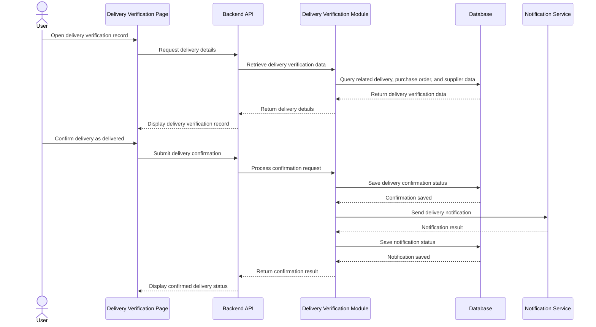

---

### Classes

#### deliveryVerificationRouter

Defines the API routes for delivery verification, confirmation, notification, and retrieval operations. It maps incoming HTTP requests to the appropriate controller functions.

#### deliveryVerificationController

Handles delivery verification API requests and responses. It receives requests for listing, viewing, confirming, notifying, and updating delivery verification records, then returns the appropriate response to the client.

#### deliveryVerificationService

Contains the business logic for delivery verification operations. It validates delivery references, confirms delivered status, stores confirmation details, triggers notifications, and enforces delivery-related business rules.

#### deliveryVerificationRepository

Handles data access and database queries related to delivery verification records and delivery notification records.

#### deliveryVerificationValidator

Validates request data for delivery verification operations. It ensures purchase order references, supplier references, delivery details, confirmation inputs, and notification-related fields are complete and correctly formatted before processing.

---

### Error Handling

400  
Invalid delivery verification request data

401  
Unauthorized access

403  
Insufficient privileges to access delivery verification

404  
Delivery verification record or related reference not found

409  
Delivery already confirmed or conflicting delivery status

422  
Delivery confirmation validation failed

500  
Internal server error

503  
Notification or delivery verification service unavailable

---

## Module 8

Invoice Verification

---

### Responsibilities

- Verify whether uploaded invoice records match the related purchase order, vendor information, and supporting transaction data.
- Compare invoice details against procurement and receiving records before approval or further processing.
- Detect mismatches in quantities, prices, totals, vendor references, and document relationships.
- Record the verification status and remarks for each processed invoice.
- Support authorized users in reviewing, validating, and resolving invoice discrepancies.

### Module Dependencies

- Depends On: Authentication, `users`, `companies`, `purchase_orders`, `suppliers`, and supporting receipt records such as `goods_receipts` or `receiving_reports`.
- Produces: `invoice_verifications`, `invoice_verification_items`, and `invoice_verification_attachments`.

---

### Functional Requirements

- The system shall allow authorized users to upload or submit invoice records for verification.
- The system shall retrieve the related purchase order, vendor information, and supporting transaction data linked to the invoice.
- The system shall compare invoice fields such as supplier, line items, quantities, prices, totals, and reference numbers with the related records.
- The system shall determine whether the invoice matches the related procurement records based on defined validation rules.
- The system shall mark the invoice as verified, flagged, or rejected depending on the verification result.
- The system shall allow authorized users to view mismatch details and verification remarks.
- The system shall store verification results, timestamps, and the responsible user for traceability.
- The system shall restrict invoice verification actions to authorized users only.

---

### Business Rules

- Only authorized users shall be allowed to verify uploaded invoices.
- An invoice must be matched against its related purchase order before it can be marked as verified.
- Vendor information in the invoice must match the vendor information in the related procurement record.
- Invoice quantities, unit prices, and totals must be consistent with the related purchase order and supporting transaction data.
- If a required related record is missing, the invoice shall be flagged for review and must not be marked as verified.
- Invoices with mismatched totals, quantities, or vendor details shall not proceed as verified until resolved.
- Verification actions must be recorded with the acting user, timestamp, and resulting status.
- Verified invoice records shall remain read-only to normal users unless a controlled re-verification process is allowed.

---

### API Endpoints

POST  
/api/invoice-verifications/upload  
/api/invoice-verifications/verify/:invoiceId  
/api/invoice-verifications/recheck/:invoiceId

GET  
/api/invoice-verifications  
/api/invoice-verifications/:invoiceId  
/api/invoice-verifications?status=verified  
/api/invoice-verifications?status=flagged  
/api/invoice-verifications?vendorId=:vendorId  
/api/invoice-verifications?purchaseOrderId=:purchaseOrderId

---

### Validation

- invoice_id
- purchase_order_id
- vendor_id
- invoice_number
- invoice_date
- invoice_total
- verification_status
- uploaded_file
- verified_by
- verification_timestamp
- Invoice record must contain a valid related purchase order reference
- Vendor reference must match an existing vendor record
- Invoice total must be a valid numeric value
- Invoice date must be a valid date
- Uploaded invoice file must be present before verification if file submission is required
- Verification must be blocked if required matching records are incomplete or missing
- Invoice line items must contain valid quantity and price values where applicable

---

### Database Tables

- invoice_verifications
  - Stores the main invoice verification records and verification results.
  - Includes invoice reference, purchase order reference, vendor reference, verification status, remarks, verified by, and verification timestamp.

- invoice_verification_items
  - Stores detailed line-level comparison results between invoice entries and related purchase order or transaction records.
  - Includes item description, expected quantity, invoiced quantity, expected price, invoiced price, and mismatch indicators.

- invoice_verification_attachments
  - Stores uploaded invoice files and related attachment metadata.
  - Includes invoice verification reference, file name, file path, file type, and upload timestamp.

- Referenced Existing Tables
  - `purchase_orders` — stores the purchase order records used as the primary reference for invoice matching.
  - `suppliers` — stores vendor or supplier information used for vendor validation.
  - `goods_receipts` or `receiving_reports` — stores supporting receipt or delivery data used to confirm delivered items where applicable.
  - `users` — stores the user who uploaded, reviewed, or verified the invoice.
  - `companies` — stores the company context associated with the invoice and procurement records.

---

### Sequence Diagram

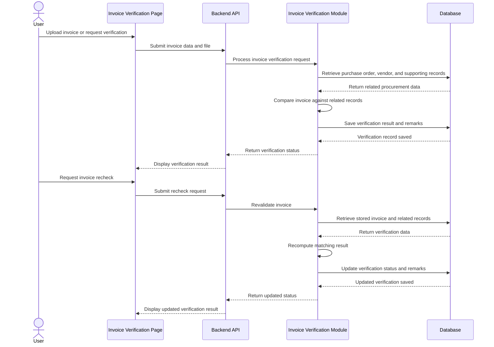

---

### Classes

#### invoiceVerificationRouter

Defines the API routes for invoice upload, verification, rechecking, and retrieval operations. It maps incoming HTTP requests to the appropriate controller functions.

#### invoiceVerificationController

Handles invoice verification API requests and responses. It receives requests for uploading invoices, checking matches, revalidating records, and viewing verification results, then returns the appropriate response to the client.

#### invoiceVerificationService

Contains the business logic for invoice verification operations. It retrieves related procurement records, compares invoice data against purchase orders and vendor details, determines verification results, and stores mismatch findings.

#### invoiceVerificationRepository

Handles data access and database queries related to invoice verification records, line-level comparison results, and invoice attachments.

#### invoiceVerificationValidator

Validates request data for invoice verification operations. It ensures invoice references, vendor references, purchase order links, uploaded files, and verification inputs are complete and correctly formatted before processing.

---

### Error Handling

400  
Invalid invoice verification request data

401  
Unauthorized access

403  
Insufficient privileges to verify invoices

404  
Invoice record or related purchase order not found

409  
Invoice already verified or conflicting verification state

422
Invoice mismatch detected or verification failed

500  
Internal server error

503  
Verification service unavailable

---


## Module 9

Reporting

---

### Responsibilities

- Display dashboards, summaries, and procurement reports for authorized users.
- Consolidate procurement-related data from multiple modules into readable report outputs.
- Provide filtered, searchable, and exportable views of reporting data.
- Present key performance indicators, totals, statuses, and trends relevant to procurement operations.
- Support generation of periodic and on-demand reports for decision-making and monitoring.

### Module Dependencies

- Depends On: Authentication, `users`, `companies`, and transactional tables across requisitions, approvals, suppliers, quotations, purchase orders, delivery verification, invoice verification, and audit trails.
- Produces: `report_requests`, `report_exports`, and report output datasets.

---

### Functional Requirements

- The system shall display dashboard data summarizing procurement activities and record statuses.
- The system shall generate procurement reports based on available transactional data.
- The system shall allow authorized users to filter reports by date range, status, supplier, company, and document type.
- The system shall allow authorized users to view summary counts, totals, and breakdowns for procurement records.
- The system shall allow authorized users to export report results in supported formats.
- The system shall allow authorized users to view detailed report entries behind summarized dashboard values.
- The system shall retrieve reporting data from relevant procurement and reference tables.
- The system shall restrict report access based on user authorization and scope.

---

### Business Rules

- Only authorized users shall be allowed to access dashboards and reports.
- Reporting data shall be generated from existing approved or recorded system transactions.
- Report results must reflect the latest saved data available at the time of generation.
- Filters applied by the user shall affect only the requested report view and shall not modify source records.
- Summary values in dashboards must be derived from the same underlying transactional data used in detailed reports.
- Exported reports must match the filtered data currently displayed or requested by the user.
- Reports shall be generated in read-only mode and must not allow direct editing of transactional records.
- If no matching data is found, the system shall return an empty result set instead of invalid values.

---

### API Endpoints

POST  
/api/reports/export

GET  
/api/reports/dashboard  
/api/reports/procurement-summary  
/api/reports/procurement-status  
/api/reports/purchase-orders  
/api/reports/rfqs  
/api/reports/quotations  
/api/reports?dateFrom=YYYY-MM-DD&dateTo=YYYY-MM-DD  
/api/reports?status=approved  
/api/reports?supplierId=:supplierId

---

### Validation

- date_from
- date_to
- report_type
- format
- status
- supplier_id
- company_id
- document_type
- Date range must be valid and `date_from` must not be later than `date_to`
- Report type must match a supported reporting category
- Export format must match an allowed output type
- Filter values must reference existing and authorized records where applicable
- Dashboard and report requests must only return data within the requesting user's allowed scope

---

### Database Tables

- report_requests
  - Stores generated or requested report metadata when report generation is logged.
  - Includes requesting user, report type, applied filters, generation timestamp, and output format.

- report_exports
  - Stores exported report file references and related export details.
  - Includes report request reference, file name, format, generated path, and export timestamp.

- Referenced Existing Tables
  - `rfqs` — stores request for quotation records used in procurement reporting.
  - `quotations` — stores supplier quotation records used in comparative and summary reporting.
  - `purchase_orders` — stores purchase order records used in status and total amount reports.
  - `suppliers` — stores supplier information used in supplier-based reporting filters and summaries.
  - `users` — stores the user requesting or viewing the report.
  - `companies` — stores the company context for report scope and filtering.

---

### Sequence Diagram

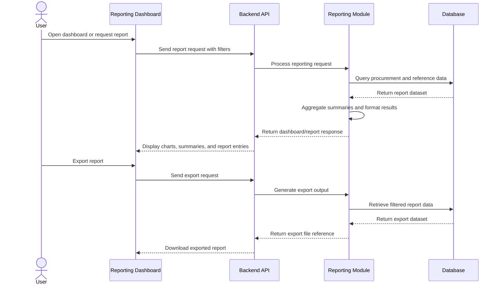

---

### Classes

#### reportingRouter

Defines the API routes for dashboard, summary, report viewing, and export operations. It maps incoming reporting requests to the appropriate controller functions.

#### reportingController

Handles reporting-related API requests and responses. It receives requests for dashboards, filtered reports, and exports, then returns the appropriate data or file response to the client.

#### reportingService

Contains the business logic for reporting operations. It retrieves procurement data, applies filters, computes summaries, prepares dashboard metrics, and generates exportable report outputs.

#### reportingRepository

Handles data access and database queries related to report generation. It retrieves procurement records, summary datasets, and report-related metadata from the database.

#### reportingValidator

Validates request data for reporting operations. It ensures filters, date ranges, report types, and export parameters are complete, correctly formatted, and authorized before processing.

---

### Error Handling

400  
Invalid report request data

401  
Unauthorized access

403  
Insufficient privileges to access reports

404  
Report data not found

422  
Invalid filter range or unsupported report type

500  
Internal server error

503  
Report generation service unavailable

---

## Module 10

Audit Trail

---

### Responsibilities

- Record significant user and system actions performed within the application.
- Maintain a chronological and tamper-evident history of transactions and record changes.
- Generate cryptographic hashes of audit records for blockchain verification.
- Store blockchain transaction references associated with verified audit trail entries.
- Allow authorized users to view and verify audit records and related blockchain status.

### Module Dependencies

- Depends On: Authentication, `users`, `companies`, all transactional modules, and the configured blockchain network.
- Produces: `audit_trails`, `audit_trail_hashes`, and `audit_trail_blockchain_refs`.

---

### Functional Requirements

- The system shall record important user and system actions as audit trail entries.
- The system shall capture details such as user, action performed, affected module, affected record, timestamp, and related metadata.
- The system shall generate a hash value for each audit trail entry or grouped audit transaction.
- The system shall submit the generated hash to the configured blockchain network for verification.
- The system shall store the resulting blockchain transaction reference together with the related audit trail record.
- The system shall allow authorized users to view audit trail entries and their blockchain verification status.
- The system shall allow authorized users to verify whether an audit trail entry matches its recorded blockchain hash.
- The system shall restrict audit trail access to authorized users only.

---

### Business Rules

- Only significant user and system actions shall be recorded in the audit trail.
- Every audit trail entry must contain the acting user, action type, affected module, timestamp, and affected record reference when applicable.
- An audit trail entry must not be editable or deletable through normal application functions.
- Each audit trail entry or audit batch must generate a unique cryptographic hash before blockchain submission.
- The blockchain transaction hash or reference shall be stored after successful blockchain anchoring.
- Audit trail verification shall compare the current audit record hash with the blockchain-anchored hash.
- Only authorized users may access and review audit trail records.
- Failed blockchain submissions shall not remove the original audit trail record from the application database.
- Audit records shall remain available even if blockchain verification is temporarily unavailable.

---

### API Endpoints

<<<<<<< HEAD
  GET /api/audit-trails/search
  GET /api/audit-trails/:auditId/verify
  
=======
POST
/api/audit-trails/verify/:auditId
/api/audit-trails/blockchain-anchor

GET
/api/audit-trails
/api/audit-trails/:auditId
/api/audit-trails?module=procurement
/api/audit-trails?status=verified
/api/audit-trails?status=pending

>>>>>>> 09dd7e1 (Revert "Merge branch 'feat/hono-cloudflare-migration' of github.com:Wiii-1/New_LINAW")
---

### Validation

- user_id
- action_type
- module_name
- record_id
- record_type
- action_timestamp
- hash_value
- blockchain_network
- blockchain_tx_hash
- Verification blocked if required audit data is incomplete
- Blockchain anchoring blocked if hash value is missing
- Blockchain transaction reference must be stored only after a successful submission response
- Audit trail entry must contain valid module and action references

---

### Database Tables

<<<<<<< HEAD
- audit_trails
  - Stores immutable audit records generated from completed procurement lifecycle events.
  - Represents the finalized state of a procurement transaction at the time of auditing.
  - Includes:
    - audit identifier
    - source module
    - event type
    - referenced transaction ID
    - record type
    - performed by user
    - company identifier
    - transaction snapshot metadata
    - audit creation timestamp
    - verification status

- audit_trail_hashes
  - Stores cryptographic hashes generated from finalized procurement transaction snapshots.
  - Used to verify that stored transaction data has not been modified after blockchain anchoring.
  - Includes:
    - audit identifier
    - hash algorithm
    - generated hash value
    - hash generation timestamp

- audit_trail_blockchain_refs
  - Stores blockchain anchoring information associated with audit trail hashes.
  - Contains references required to locate and verify the blockchain record.
  - Includes:
    - audit identifier
    - blockchain network
    - blockchain transaction hash
    - block number
    - anchoring timestamp
    - blockchain verification status

- Referenced Existing Tables
  - `users`
    - Stores the user associated with procurement actions such as approval, completion, or confirmation.

  - `companies`
    - Stores the organization associated with the procurement transaction.

  - `purchase_orders`
    - Stores the primary procurement transaction referenced by the audit trail.

  - `rfqs`, `quotations`, and other procurement tables
    - Store related business records linked to the audited transaction.
=======
- **audit_trails**
  - Stores the main audit trail records for significant user and system actions.
  - Includes user identifier, action type, module name, affected record reference, timestamp, status, and metadata.

- **audit_trail_hashes**
  - Stores the cryptographic hash generated for an audit trail entry or audit batch.
  - Used for integrity checking and blockchain verification.

- **audit_trail_blockchain_refs**
  - Stores blockchain-related references linked to audit trail records.
  - Includes blockchain network name, transaction hash, block number, verification status, and anchoring timestamp.

- **Referenced Existing Tables**
  - `users` — stores the user account associated with the recorded action.
  - `companies` — stores the company or organization related to the action where applicable.
  - `rfqs`, `quotations`, `purchase_orders`, and other transactional tables — store the business records referenced by the audit trail.
>>>>>>> 09dd7e1 (Revert "Merge branch 'feat/hono-cloudflare-migration' of github.com:Wiii-1/New_LINAW")

---

### Sequence Diagram

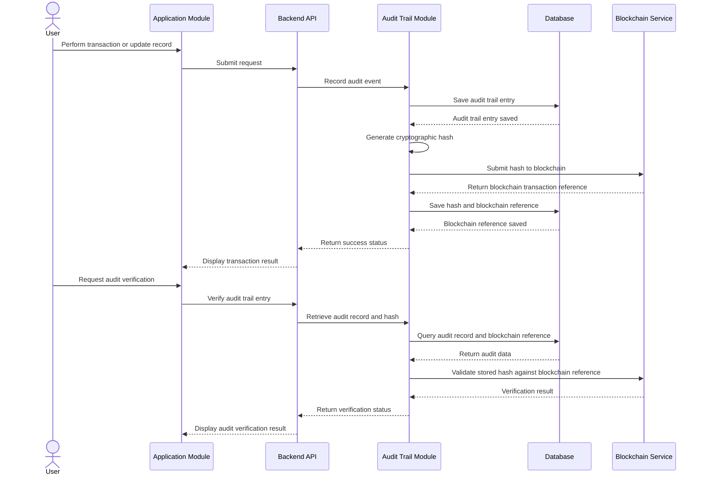

---

### Classes

#### auditTrailRouter
Defines the API routes for audit trail operations. It maps incoming HTTP requests to the appropriate controller functions.

#### auditTrailController
Handles audit trail API requests and responses. It receives requests for listing, viewing, anchoring, and verifying audit records, then returns the appropriate response to the client.

#### auditTrailService
Contains the business logic for audit trail operations. It records actions, generates cryptographic hashes, initiates blockchain anchoring, and verifies audit entries against blockchain references.

#### auditTrailRepository
Handles data access and database queries related to audit trail records, generated hashes, and blockchain transaction references.

#### auditTrailValidator
Validates request data for audit trail operations. It ensures required audit fields, hash values, and verification inputs are complete and correctly formatted before processing.

---

### Error Handling

400
Invalid audit request data

401
Unauthorized access

403
Insufficient privileges to access audit trails

404
Audit trail record not found

409
Audit trail already anchored or conflicting blockchain reference

422
Audit verification failed

500
Internal server error

503
Blockchain service unavailable

---


## Module 11

Organization Administration

---

### Responsibilities

<<<<<<< HEAD
- Manage organization membership within the administrator's organization.
- Invite or add users to the organization.
- View, update, activate, deactivate, and remove organization memberships.
- Create and manage organization-scoped roles.
- Assign and revoke organization roles from organization members.
- View system-defined permissions available for organization role configuration.
- Map and unmap system-defined permissions to organization-scoped roles.
- Maintain organization settings and administrative configurations.
- Monitor organization administrative activities through audit trail records.
- Enforce organization-scoped administrative access and security policies.
- Prevent organization administrators from accessing or modifying resources belonging to other organizations.
=======
- Manage user accounts within the organization.
- Assign organization-level roles and permissions to company users.
- Maintain organization-specific settings and administrative controls.
- Monitor organization-level administrative actions through audit logs.
- Restrict administrative functions to authorized users within the organization only.

### Module Dependencies

- Depends On: Authentication, `users`, `companies`, `roles`, `permissions`, and `audit_logs`.
- Produces: organization user mappings, role assignments, permissions, settings, and administrative audit records.
>>>>>>> 09dd7e1 (Revert "Merge branch 'feat/hono-cloudflare-migration' of github.com:Wiii-1/New_LINAW")

---

### Functional Requirements

<<<<<<< HEAD
- Depends on: Authentication, `Tenant`, `User`, `Company`, `CompanyMembership`, `Role`, `Permission`, `RolePermission`, and `AuditTrail`.
- Produces: organization membership records, organization-scoped roles, role assignments, role-permission mappings, administrative configuration records, and audit trail entries.
=======
- The organization administrator shall be able to create, update, deactivate, and view user accounts within the organization.
- The organization administrator shall be able to assign and modify roles and permissions for users within the organization.
- The organization administrator shall be able to configure organization-specific settings required for company operations.
- The organization administrator shall be able to view audit logs of important administrative activities within the organization.
- The system shall restrict organization administration pages and functions to authorized users within the same organization only.
- The system shall record significant administrative changes such as user updates, role assignments, and organization setting changes.
>>>>>>> 09dd7e1 (Revert "Merge branch 'feat/hono-cloudflare-migration' of github.com:Wiii-1/New_LINAW")

---

### Business Rules

<<<<<<< HEAD
- The system shall allow authorized organization administrators to invite or add users to their organization.
- The system shall allow authorized organization administrators to view members belonging to their organization.
- The system shall allow authorized organization administrators to update organization membership information that they are permitted to manage.
- The system shall allow authorized organization administrators to activate or deactivate organization memberships.
- The system shall allow authorized organization administrators to remove users from their organization.
- The system shall allow authorized organization administrators to create organization-scoped roles.
- The system shall allow authorized organization administrators to view roles belonging to their organization.
- The system shall allow authorized organization administrators to modify organization-scoped roles that belong to their organization.
- The system shall allow authorized organization administrators to assign organization roles to members of their organization.
- The system shall allow authorized organization administrators to revoke organization roles from members of their organization.
- The system shall allow authorized organization administrators to view system-defined permissions available for role configuration.
- The system shall allow authorized organization administrators to map system-defined permissions to organization-scoped roles.
- The system shall allow authorized organization administrators to remove permissions from organization-scoped roles.
- The system shall not allow organization administrators to create, modify, or delete system-defined permissions.
- The system shall allow authorized organization administrators to view and configure organization settings.
- The system shall allow authorized organization administrators to view administrative audit trail records belonging to their organization.
- The system shall enforce organization-level access restrictions so administrators may access and manage only resources belonging to their own organization.
- The system shall prevent organization administrators from accessing or modifying another organization's members, roles, role-permission mappings, settings, or audit trail records.

---

## Business Rules

- Organization administration shall only be available after an organization has been successfully registered.
- Only users assigned an authorized organization administrator role may access organization administration functions.
- Organization administrators may manage only members belonging to their own organization.
- Every organization membership shall reference one valid organization and one valid user.
- Duplicate membership of the same user within the same organization is not allowed.
- A deactivated organization membership shall not grant access to protected organization resources.
- An organization member must have at least one active organization role with the required permissions before accessing protected organization functions.
- Organization roles shall belong to a specific tenant or organization.
- Organization administrators may create roles only within their own organization.
- Organization administrators may modify or delete only roles belonging to their own organization and for which they have the required administrative permission.
- System-defined permissions are globally defined and cannot be created, modified, or deleted by organization administrators.
- Organization administrators may only view permissions available for organization role configuration.
- Permissions may only be assigned to or revoked from roles belonging to the administrator's organization.
- A role-permission mapping shall reference one valid organization role and one valid system-defined permission.
- Duplicate role-permission mappings are not allowed.
- Organization settings may only be modified by authorized administrators with the required permission.
- Organization administrators may only access settings belonging to their own organization.
- Organization administrators may only access administrative audit records belonging to their own organization.
- All administrative actions affecting organization memberships, roles, role-permission mappings, and organization settings shall be recorded in the audit trail.
- Cross-organization access or modification attempts shall be rejected by the authorization and organization-scope validation layer.
- Removing or deactivating an organization member shall not delete the global user account unless explicitly handled by a separate system-level process.

---

## Internal Sections

### Organization Member Management

Handles organization member retrieval, invitation, manual addition, updates, deactivation, and removal.

API Endpoints

POST

/api/org-admin/members

GET

/api/org-admin/members

/api/org-admin/members/:userId

PATCH

/api/org-admin/members/:userId

/api/org-admin/members/:userId/status
=======
- Only authorized organization administrators may access the Organization Administration module.
- An organization administrator may create, modify, or deactivate only the user accounts belonging to the same organization.
- A user account must be assigned an appropriate organization role before the account can access protected organization functions.
- Administrative changes to user access, roles, and organization settings must be recorded in the audit log.
- An organization administrator shall not access or modify users, settings, or records belonging to another organization.
- Deactivated users shall not be allowed to log in or access protected organization features.
- Organization settings shall not be changed without appropriate organization-level permission.

---

### API Endpoints

POST
/api/org-admin/users
/api/org-admin/roles
/api/org-admin/settings

GET
/api/org-admin/users
/api/org-admin/users/:userId
/api/org-admin/roles
/api/org-admin/settings
/api/org-admin/audit-logs

PUT
/api/org-admin/users/:userId
/api/org-admin/roles/:roleId
/api/org-admin/settings/:settingId

PATCH
/api/org-admin/users/:userId/status
>>>>>>> 09dd7e1 (Revert "Merge branch 'feat/hono-cloudflare-migration' of github.com:Wiii-1/New_LINAW")

---

<<<<<<< HEAD
/api/org-admin/members/:userId

---

### Organization Role & Permission Management

Handles organization-scoped role creation, modification, deletion, role assignment, and role-permission mapping.

API Endpoints

POST

/api/org-admin/roles

/api/org-admin/members/:userId/roles

/api/org-admin/roles/:roleId/permissions

GET

/api/org-admin/roles

/api/org-admin/roles/:roleId

/api/org-admin/roles/:roleId/permissions

/api/org-admin/permissions

PATCH

/api/org-admin/roles/:roleId

DELETE

/api/org-admin/roles/:roleId

/api/org-admin/roles/:roleId/permissions/:permissionId

/api/org-admin/members/:userId/roles/:roleId

---

### Organization Settings

Handles organization/company information and administrative configuration.

API Endpoints

GET

/api/org-admin/settings

PUT

/api/org-admin/settings

---

### Administrative Audit Trail

Provides access to organization administrative activity records.

API Endpoints

GET

/api/org-admin/audit-trail

---

## API Endpoints

POST

/api/org-admin/members

/api/org-admin/roles

/api/org-admin/members/:userId/roles

/api/org-admin/roles/:roleId/permissions

GET

/api/org-admin/members

/api/org-admin/members/:userId

/api/org-admin/roles

/api/org-admin/roles/:roleId

/api/org-admin/roles/:roleId/permissions

/api/org-admin/permissions

/api/org-admin/settings

/api/org-admin/audit-trail

PUT

/api/org-admin/members/:userId

/api/org-admin/roles/:roleId

/api/org-admin/settings

PATCH

/api/org-admin/members/:userId/status

DELETE

/api/org-admin/members/:userId

/api/org-admin/roles/:roleId

/api/org-admin/roles/:roleId/permissions/:permissionId

/api/org-admin/members/:userId/roles/:roleId

---

## Validation

- `first_name`
- `last_name`
- `email`
- `role_id`
- `permission_id`
- `account_status`
- `setting_key`
- `setting_value`
- Email must be in a valid format.
- Organization membership must belong to the administrator's organization.
- Role references must resolve to an existing role within the administrator's organization.
- Permission references must resolve to an existing system-defined permission.
- Organization administrators cannot create, modify, or delete system-defined permissions.
- Role-permission mappings must reference a role belonging to the administrator's organization.
- Duplicate organization membership is not allowed.
- Duplicate role-permission mappings are not allowed.
- Organization settings must satisfy configured validation rules.
- All organization administration operations must pass organization-scope authorization checks.
=======
### Validation

- first_name
- last_name
- email
- password
- role_id
- account_status
- setting_key
- setting_value
- organization_id
- Audit log entry required for administrative updates when applicable
- Submission blocked if required administrative fields are incomplete
- Email must be in valid format
- Password must satisfy system security requirements
- Role assignment must reference an existing valid role within the organization
>>>>>>> 09dd7e1 (Revert "Merge branch 'feat/hono-cloudflare-migration' of github.com:Wiii-1/New_LINAW")

---

### Database Tables

<<<<<<< HEAD
### CompanyMembership

- Stores organization membership records.
- Associates users with their organization.
- Stores organization-specific membership state.
- Determines whether a user is active within an organization.
- Prevents duplicate membership of the same user within the same organization.

### Role

- Stores organization-scoped role definitions.
- Associates roles with a tenant or organization.
- Defines named access roles used within an organization.
- Allows organization administrators to create and manage organization-specific roles.

### Permission

- Stores globally defined system permissions.
- Defines individual authorization capabilities available to roles.
- Is not created, modified, or deleted by organization administrators.
- Acts as the permission catalog available for organization role configuration.

### RolePermission

- Stores mappings between roles and system-defined permissions.
- Associates permissions with organization-scoped roles.
- Allows organization administrators to configure the permissions of roles belonging to their organization.
- Must prevent duplicate role-permission mappings.

### AuditTrail

- Stores administrative activities, system events, and historical records.
- Records organization administration actions affecting memberships, roles, permissions mappings, and settings.
- Provides organization-scoped administrative activity history.
=======
- **organization_users**
  - Stores the relationship between users and the organization.
  - Used to determine which users belong to a specific organization.

- **organization_roles**
  - Stores organization-level roles such as company owner, chief procurement officer, procurement officer, and company administrator.
  - Used to define access levels within a specific organization.

- **organization_permissions**
  - Stores the available permissions for organization users and modules.
  - Used to define allowed actions within the organization scope.

- **organization_role_permissions**
  - Stores the mapping between organization roles and permissions.
  - Used to determine what actions are allowed for each assigned organization role.

- **organization_settings**
  - Stores configurable settings for a specific organization.
  - Used to maintain organization-level operational configurations.
>>>>>>> 09dd7e1 (Revert "Merge branch 'feat/hono-cloudflare-migration' of github.com:Wiii-1/New_LINAW")

- **audit_logs**
  - Stores records of important user and administrative actions within the organization.
  - Includes user identifier, organization identifier, action performed, affected record, timestamp, and related details.

<<<<<<< HEAD
### Tenant

- Stores the tenant boundary used for organization isolation.
- Determines the administrative scope for organization resources.

### User

- Stores global user account information.
- Represents the user identity associated with an organization membership.
- Is not deleted when an organization membership is removed.

### Company

- Stores organization information.
- Represents the organization managed by the organization administrator.
- Provides the organization boundary for membership, roles, settings, and audit records.
=======
- **Referenced Existing Tables**
  - `users` — stores authentication and account ownership data.
  - `companies` — stores organization records.
>>>>>>> 09dd7e1 (Revert "Merge branch 'feat/hono-cloudflare-migration' of github.com:Wiii-1/New_LINAW")

---

### Sequence Diagram

```mermaid
sequenceDiagram
    actor OrgAdmin as Organization Administrator
    participant UI as Organization Administration Page
    participant API as Backend API
    participant AUTH as Authorization Service
    participant ORG as Organization Administration Module
    participant DB as Database

<<<<<<< HEAD
    Admin->>UI: Open Organization Administration
    UI->>API: Request organization data
    API->>ORG: Authenticate and validate organization scope
    ORG->>DB: Retrieve organization members, roles, permissions, settings, and audit records
    DB-->>ORG: Return organization-scoped data
    ORG-->>API: Return organization information
    API-->>UI: Display administration dashboard

    Admin->>UI: Manage organization resource
    UI->>API: Submit administrative request
    API->>ORG: Validate authorization and organization scope
    ORG->>DB: Verify resource belongs to administrator's organization
    DB-->>ORG: Resource scope validated

    ORG->>DB: Apply organization-scoped change
    DB-->>ORG: Update successful

    ORG->>DB: Record audit trail entry
    DB-->>ORG: Audit trail entry stored

    ORG-->>API: Return success
    API-->>UI: Display confirmation
=======
    OrgAdmin->>UI: Open Organization Administration module
    UI->>API: Request organization administration data
    API->>AUTH: Verify organization administrator access
    AUTH->>DB: Check user role, permission, and organization scope
    DB-->>AUTH: Return authorization data
    AUTH-->>API: Access granted

    API->>ORG: Retrieve users, roles, settings, and logs
    ORG->>DB: Query organization administrative records
    DB-->>ORG: Return requested records
    ORG-->>API: Send organization data
    API-->>UI: Display Organization Administration dashboard

    OrgAdmin->>UI: Create or update organization user, role, or setting
    UI->>API: Submit organization administrative data
    API->>AUTH: Validate permission and organization scope
    AUTH-->>API: Permission confirmed
    API->>ORG: Process organization administrative update
    ORG->>DB: Save changes
    DB-->>ORG: Update successful
    ORG->>DB: Record audit log entry
    DB-->>ORG: Audit log saved
    ORG-->>API: Return success response
    API-->>UI: Display confirmation message
>>>>>>> 09dd7e1 (Revert "Merge branch 'feat/hono-cloudflare-migration' of github.com:Wiii-1/New_LINAW")
```

---

### Classes

#### organizationAdminRouter
Defines the API routes for organization administration operations. It maps incoming HTTP requests to the appropriate controller functions.

<<<<<<< HEAD
Defines API routes for organization membership management, organization role management, role-permission mapping, organization settings, and administrative audit trail operations.
=======
#### organizationAdminController
Handles organization administration API requests and responses. It receives validated input, calls the service layer, and returns the appropriate response to the client.
>>>>>>> 09dd7e1 (Revert "Merge branch 'feat/hono-cloudflare-migration' of github.com:Wiii-1/New_LINAW")

#### organizationAdminService
Contains the business logic for organization administration functions. It manages organization users, roles, permissions, settings, and audit log retrieval within the same organization scope.

<<<<<<< HEAD
Receives organization administration requests, validates request data, invokes the service layer, and returns appropriate responses.

### organizationAdminService

Contains the business logic for organization administration.

Responsibilities include:

- Managing organization memberships.
- Creating and managing organization-scoped roles.
- Assigning and revoking roles from organization members.
- Mapping and removing system-defined permissions from organization roles.
- Validating organization ownership and scope.
- Enforcing organization administrative permissions.
- Managing organization settings.
- Retrieving organization administrative audit records.
- Creating audit trail entries for administrative operations.

### organizationAdminRepository

Handles database operations for:

- Organization memberships.
- Organization-scoped roles.
- System-defined permissions.
- Role-permission mappings.
- Organization settings.
- Organization administrative audit records.

The repository shall apply organization-scope conditions to organization-owned resources where applicable.

### organizationAdminValidator

Validates organization administration request payloads and parameters.

Responsibilities include:

- Validating member information.
- Validating role identifiers.
- Validating permission identifiers.
- Validating membership status.
- Validating organization settings.
- Enforcing input constraints before service-layer processing.
=======
#### organizationAdminRepository
Handles data access and database queries related to organization administration functions. It is responsible for retrieving and storing organization users, roles, permissions, settings, and audit logs.

#### organizationAdminValidator
Validates request data for organization administration operations. It ensures required account, role, and settings data are complete and correctly formatted before processing.
>>>>>>> 09dd7e1 (Revert "Merge branch 'feat/hono-cloudflare-migration' of github.com:Wiii-1/New_LINAW")

---

### Error Handling

400
<<<<<<< HEAD

Invalid input data or malformed request.

401

Unauthenticated access.

403

Insufficient organization administrative privileges or attempted access outside the administrator's organization scope.

404

Organization member, organization role, permission, setting, or audit record not found within the administrator's organization scope.

409

Duplicate organization membership, duplicate role-permission mapping, or conflicting organization configuration.

422

Validation failed.

500

Internal server error.

503

Organization Administration service unavailable.
=======
Invalid input data

401
Unauthorized access

403
Insufficient organization administrative privileges

404
User, role, or setting not found

409
Duplicate email or conflicting organization configuration

500
Internal server error

---
>>>>>>> 09dd7e1 (Revert "Merge branch 'feat/hono-cloudflare-migration' of github.com:Wiii-1/New_LINAW")

## Module 12

Supplier Dashboard

*

### Responsibilities

- Allow authenticated users belonging to invited supplier companies to access the supplier dashboard.   
- Allow invited supplier company users to complete required supplier company registration or onboarding steps after account registration.  
- Allow supplier company users to view RFQs assigned or made available to their company.   
- Allow supplier company users to select an RFQ and review its details before quotation submission.   
- Allow supplier company users to submit quotations for eligible RFQs assigned or made available to their company.   
- Allow supplier company users to view purchase orders issued to their company.  
- Restrict supplier dashboard access and actions to records associated only with the authenticated user and linked supplier company.   

*

### Functional Requirements

- Only authenticated users belonging to a company with a valid supplier invitation or approved supplier relationship shall be allowed to access the supplier dashboard.  
- The system shall allow invited supplier company users to complete supplier company onboarding and required profile registration through the application.  
- Completion of supplier onboarding shall create or link the supplier company record so that it becomes visible in the Supplier Management module of the buyer organization that issued the invitation.  
- The system shall allow supplier company users to view RFQs assigned or made available to their company.   
- The system shall allow supplier company users to retrieve and review RFQ details before quotation submission.   
- The system shall allow supplier company users to submit quotations only for open and valid RFQs within the allowed submission period.   
- The system shall allow supplier company users to view active, ongoing, and completed purchase orders issued to their company.  
- The system shall restrict supplier company users to viewing and managing only their own company profile, quotations, RFQs, and purchase orders within the permitted supplier scope.  
- The system shall block quotation submission when required quotation fields are incomplete or when the RFQ is no longer eligible for response.  
- The system shall record quotation submission details, timestamps, and related supplier company references for traceability.  

*

### Business Rules

- A user may access the Supplier Dashboard only if the user belongs to a company with a valid supplier invitation or approved supplier relationship.  
- A supplier company user may view only RFQs and purchase orders assigned or made available to that supplier company.  
- A supplier company user may submit a quotation only for an open and valid RFQ assigned or made available to its company.   
- The selected RFQ and its details must be displayed before quotation submission.  
- Supplier company onboarding must be completed through the invitation flow before supplier participation is fully activated.  
- Completion of supplier registration shall update the supplier onboarding or relationship status according to the configured onboarding workflow.  
- A quotation submission must include all required fields before it can be submitted.  
- A supplier company user may not submit a quotation after the specified submission deadline.  
- A supplier company user may access and manage only the records associated with its own supplier company.  
- Purchase orders displayed in the Supplier Dashboard shall be read-only unless a separate supplier-side action is explicitly supported by the system.  

*

### API Endpoints

POST  
/api/supplier-dashboard/register-company  
/api/supplier-dashboard/quotations  

GET  
/api/supplier-dashboard/profile  
/api/supplier-dashboard/rfqs  
/api/supplier-dashboard/rfqs/:rfqId  
/api/supplier-dashboard/orders  
/api/supplier-dashboard/orders?status=ongoing  
/api/supplier-dashboard/orders?status=completed  

PUT  
/api/supplier-dashboard/profile  

*

### Validation

- invitationtoken  
- companyname  
- companyaddress  
- companyemail  
- companycontactnumber  
- taxidentificationnumber  
- rfqid  
- suppliercompanyid  
- quoteprice  
- quotedquantity  
- currency  
- deliverydate  
- quotevaliduntil  
- leadtimedays  
- remarks  
- Invitation token must match an existing, valid, and non-expired supplier invitation record.  
- The authenticated user must be linked to a company with a valid supplier invitation or approved supplier relationship before dashboard access is granted.  
- Supplier company registration must contain the required business and contact details before onboarding can be completed.  
- RFQ reference must match an existing and accessible RFQ record assigned or made available to the supplier company.  
- Quotation submission must be blocked if the RFQ is closed, expired, or not assigned to the supplier company.  
- Attachment must be present if supporting documents are required.   
- Submission shall be blocked if required fields are incomplete.  

*

### Database Tables

- supplier_profiles  
  - Stores the supplier company’s registered business information, including company name, address, contact details, tax identification number, and registration details.  
  - Linked to the invited supplier company and its authenticated user records.  

- supplierinvitations  
  - Stores supplier onboarding invitation records generated by the buyer organization.  
  - Includes invitation token, invitation status, expiration timestamp, and completion timestamp.  

- supplier_company_relationships  
  - Stores the relationship between the buyer company and the supplier company.  
  - Used to determine whether the supplier relationship is invited, in progress, approved, active, suspended, or otherwise restricted under a specific buyer organization.  

- rfq_supplier_assignments  
  - Stores the RFQs assigned or made available to a specific supplier company.  
  - Used to control which RFQs are visible in the Supplier Dashboard.  

- quotations  
  - Stores quotations submitted by the supplier company for selected RFQs.   
  - Includes quotation status, total amount, currency, delivery date, quote validity period, lead time, remarks, submitted by, and submission timestamp.  

- quotation_items  
  - Stores the individual line items associated with each quotation.  
  - Includes item description, quoted quantity, unit price, subtotal, and remarks where applicable.  

- Referenced Existing Tables  
  - `users` stores authentication and account ownership data for supplier company users.  
  - `companies` stores buyer and supplier organization records.   
  - `rfqs` and `rfq_items` store procurement-side RFQ records and corresponding line items.  
  - `purchaseorders` stores awarded or active supplier orders.  

*

### Sequence Diagram

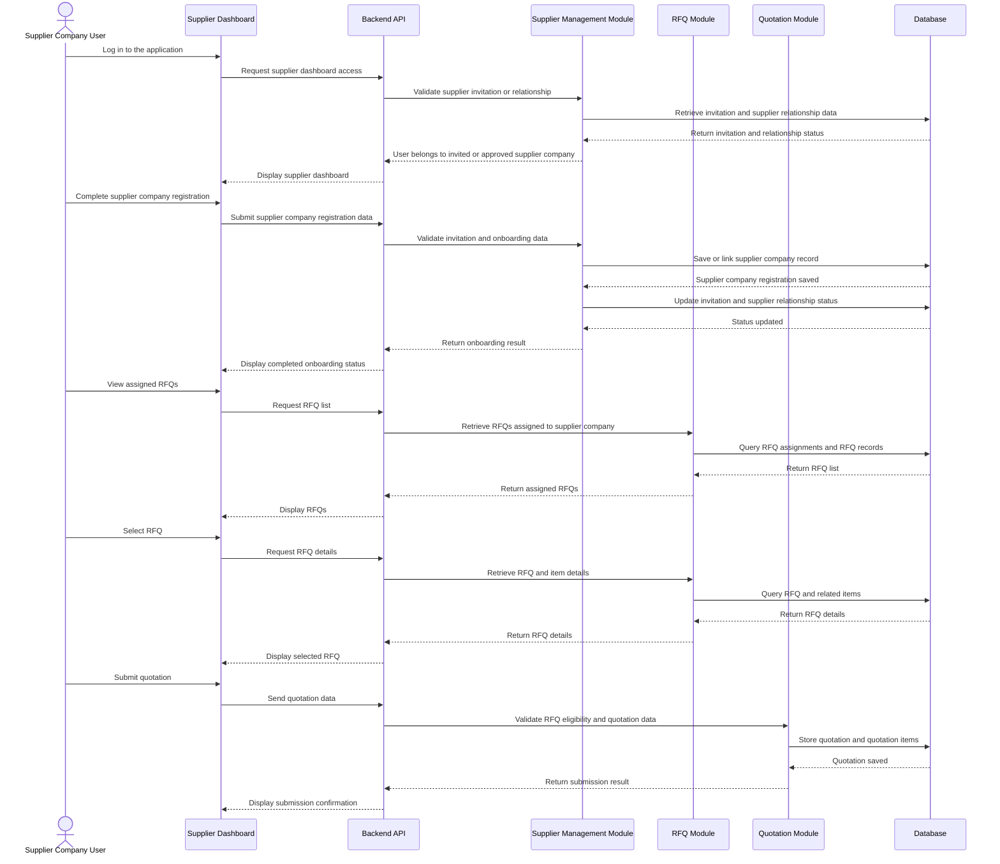

*

### Classes

- supplierDashboardRouter  
- supplierDashboardController  
- supplierDashboardService  
- supplierDashboardRepository  
- supplierDashboardValidator  

*

### Error Handling

400 Invalid supplier dashboard request data    
401 Unauthorized access    
403 Supplier company access is not allowed for the requested record or dashboard action    
404 Supplier invitation, supplier company record, RFQ, quotation, or purchase order not found    
409 Supplier onboarding already completed or quotation already submitted, or the record is in a conflicting state    
410 Supplier invitation link expired    
422 Supplier dashboard validation failed    
500 Internal server error    
503 Supplier dashboard service unavailable  


## Module 12 